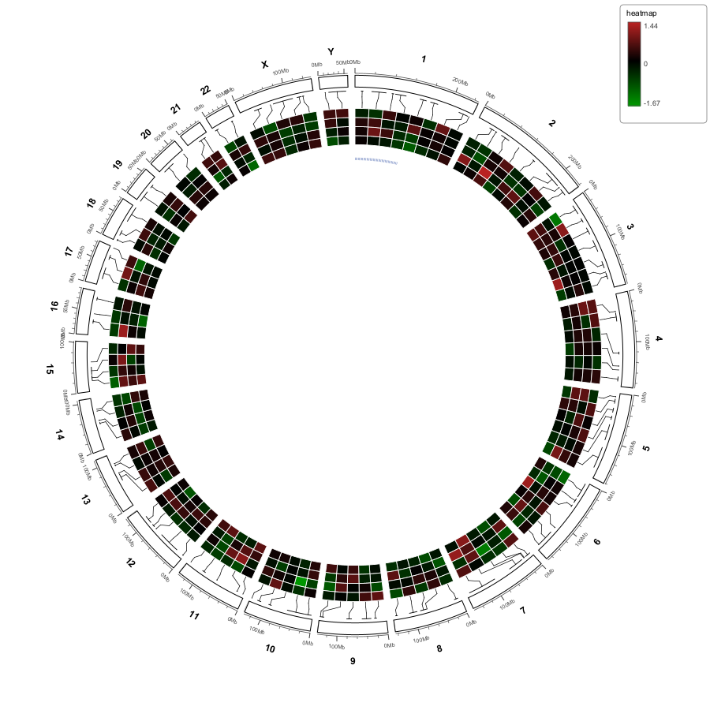
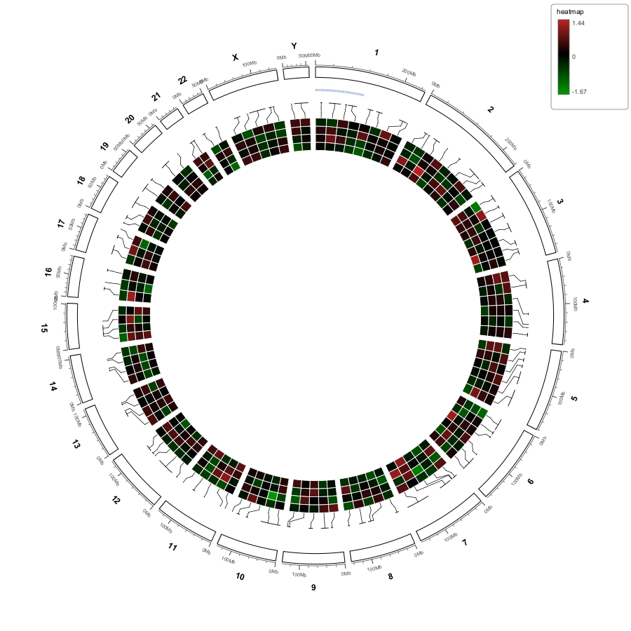
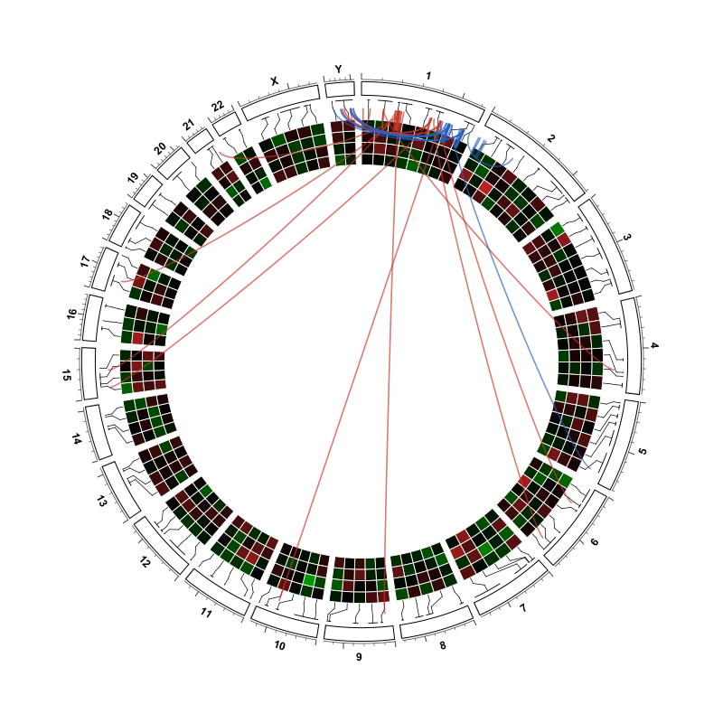

Data Tracks column and layer rows
=================================

The left-hand column of the Circular View is titled ``Data Tracks``.  It is the
control surface for everything drawn on the ring: normal IGV tracks *and* the
circular-only layers created by :doc:`circular_import`.

.. important::

   **Row order is radial order.**  The top row is the outermost ring band and
   the bottom row is the innermost.  Dragging a row changes the figure
   immediately; there is no separate "apply" step.

One list, two kinds of row
--------------------------

``dataColumnRows`` is a single ordered list whose entries are either a
``CircularViewPanel.CircularLayer`` or an IGV ``Track``.

.. list-table::
   :header-rows: 1
   :widths: 26 37 37

   * - Row kind
     - Label text
     - Where it is drawn
   * - Links layer
     - ``<file>   (links N)``
     - Ribbons/chords in the empty centre of the ring.
   * - Heatmap layer
     - ``<file>   (heatmap R x S)``
     - A concentric band whose radial position is **its row position**.
   * - Labels layer
     - ``<file>   (labels N)``
     - A dedicated label ring (inside or outside the ideogram), placed at
       **its row position** when the labels sit inside the ring.
   * - Normal IGV track
     - ``<track display name>``
     - A concentric data band.

A hidden row gets a ``   (hidden)`` suffix.  ``refreshDataColumn()`` preserves
the existing order, appends newly imported layers at the top and newly loaded
tracks at the bottom, then recomputes ``heatmapBandIndex`` **and**
``labelBandIndex`` from the row list and calls ``setRingTracks(...)`` with the
tracks in that same order.

.. note::

   The heatmap is **not** pinned to the innermost or outermost ring.  Because
   ``heatmapBandIndex`` is derived from the row list, moving the heatmap row
   between two track rows moves its band between those two bands.  This is what
   fixes the historical problem of a heatmap overlapping a RefSeq band that was
   listed after it.

.. note::

   The label ring follows the same rule.  ``labelBandIndex`` is the number of
   data bands listed **above** the labels row, and ``drawTrackRings`` reserves
   ``labelRingReserve()`` worth of radial room at exactly that position — so
   dragging the labels row to the last place moves the labels to the
   **innermost** ring, below every data band, instead of leaving them pinned
   just under the ideogram.  With the labels row at the top (the default) they
   sit directly under the ideogram, which is the historical layout.  The slot
   applies only when ``Labels inside the ideogram`` is on: outside labels hang
   from the ideogram's outer edge regardless of row order, and a slot past the
   last band clamps to the innermost position.

Dragging rows
-------------

``TrackReorderHandler`` implements drag-and-drop on the list.  On drop,
``moveDataRow`` reorders ``dataColumnRows``, ``refreshDataColumn()`` re-derives
the band order, and the ring repaints.  The horizontal view is unaffected —
this reorders only the Circular View composition.

   Heatmap row first: the equal-width heatmap band sits at the outermost
   position of the band stack.

   After dragging the heatmap row down, its band moves inward relative to the
   other data bands.  No parameters were changed — only the row order.

Right-click: layer rows
-----------------------

Right-clicking a **layer** row opens ``showLayerPopup``, which contains three
blocks:

#. A visibility checkbox, whose label depends on the layer kind:

   .. list-table::
      :header-rows: 1
      :widths: 30 70

      * - Layer kind
        - Visibility item
      * - Heatmap
        - ``Show heatmap``
      * - Labels
        - ``Show labels``
      * - Links
        - ``Show this links layer``

#. All parameters for that layer kind:

   * Links → :doc:`circular_links`
   * Heatmap → :doc:`circular_heatmap`
   * Labels → :doc:`circular_labels`

#. A removal item:

   .. list-table::
      :header-rows: 1
      :widths: 30 70

      * - Layer kind
        - Removal item
      * - Heatmap
        - ``Remove heatmap from circular view…``
      * - Labels
        - ``Remove labels from circular view…``
      * - Links
        - ``Remove links from circular view…``

Removal calls ``removeLayer(layer)``, refreshes the column and the ring, and
leaves no ghost row.  There is no ``(hidden)`` residue after a removal.

   Links, heatmap and labels layers can all be active in the same figure; each
   has its own row and its own context menu.

Right-click: normal track rows
------------------------------

Right-clicking a **track** row shows the usual IGV track options plus
ring-specific ones:

* ``Track height… (<n> px)`` — band height; supports multi-selection.
* ``Delete track`` — **really deletes** the track (via ``IGV.deleteTracks``).
  ``forgetRingTrack`` first clears the ring-track reference, the hidden marker,
  the band configuration and all feature/data/adaptive/Hi-C tile caches.  Older
  builds only hid the track and left a ``(hidden)`` row behind; that behaviour
  is gone.
* ``Expand`` / collapse, ``Stack outer``, ``Graph type``, ``Y-axis range``,
  ``Y-axis scale (multi-sample)`` and ``Hi-C ring height… (<n> px)`` for Hi-C
  tracks.
* A ``Links`` submenu with the same ribbon styling items documented in
  :doc:`circular_links`, for interaction tracks loaded through
  ``File → Load from File...``.

.. note::

   A BED track bound to a Hi-C TAD/domain overlay is set invisible by
   ``HiCDomainOverlay.acquire()``.  ``circularColumnTracks()`` and
   ``drawableAsBand()`` both filter on ``isVisible()``, so that BED no longer
   appears as a row or as a separate band on the ring.  See :doc:`circular_hic`.

Typical workflow
----------------

#. Load a genome and the tracks you want (they become band rows).
#. ``Import ▾ → Heatmap  (BED with value columns)…`` and/or ``Labels  (BED +
   name column)…`` and/or ``Links  (BEDPE / Circos links)…``.
#. Drag rows until the radial stacking is right.
#. Right-click each layer row to set its parameters.
#. ``Export ▾`` to write the figure (see :doc:`circular_export`).

.. tip::

   Because imported layers are not saved in sessions, keep the row order and
   parameter values you used in a short note alongside the exported figure if
   you need to rebuild it later.
