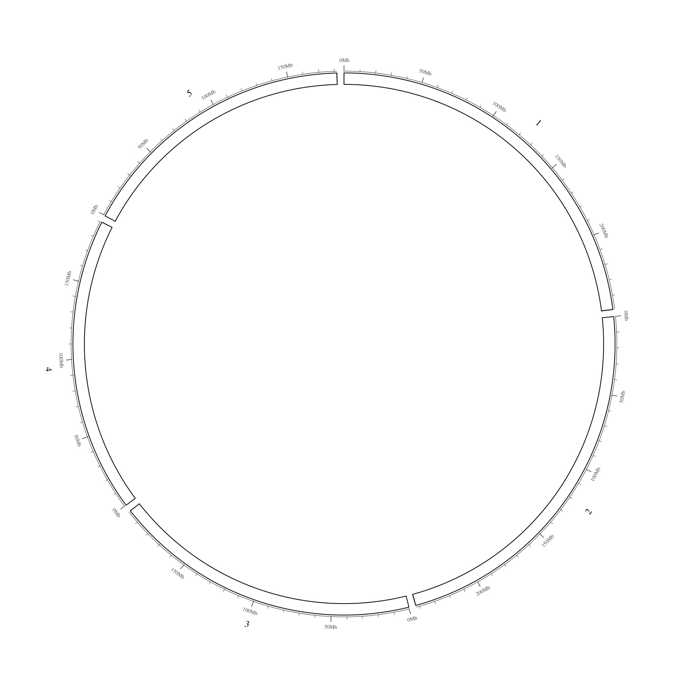
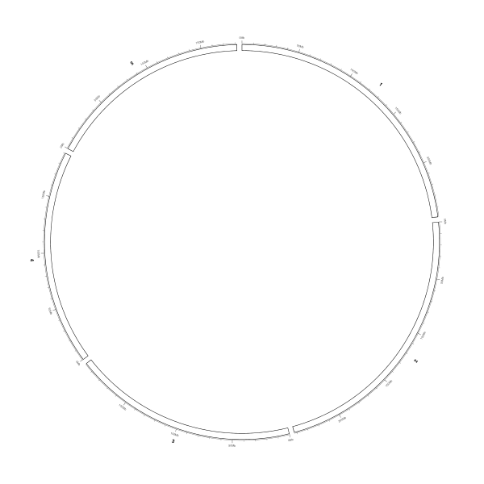
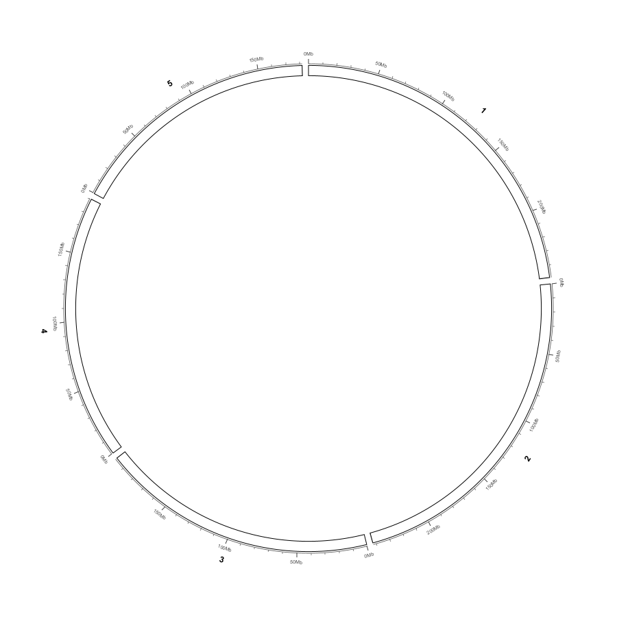
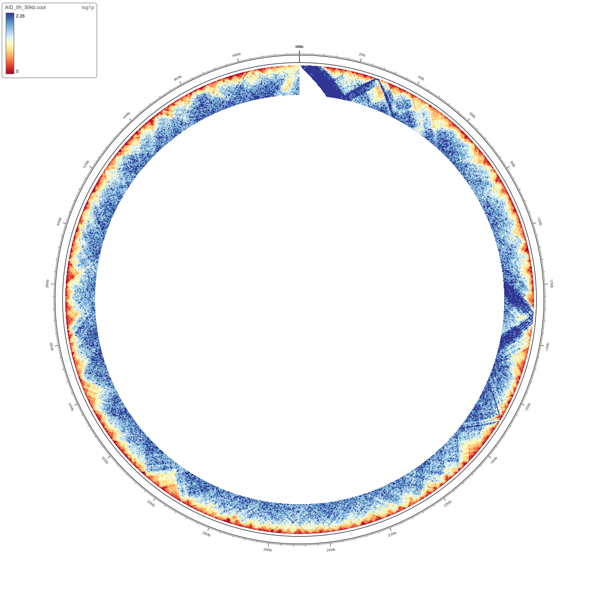

Exporting publication-ready figures
===================================

Upstream IGV 2.19.8 can save a screenshot of the desktop, but it has no way to
turn the Circular View into a sized, high-resolution, publication-grade figure.
myIGV adds an ``Export ▾`` button to the Circular View toolbar — the third and
last button, after ``Import ▾`` and ``View options ▾``.

.. note::

   This chapter is about exporting **the circular plot**.  It is separate from
   the linear Hi-C track's image handling described in :doc:`hic`.

The Export menu
---------------

``Export ▾`` contains exactly three active items, generated from the
``CircularExporter.Format`` enum, followed by a disabled hint:

.. list-table::
   :header-rows: 1
   :widths: 34 66

   * - Menu item (verbatim)
     - What it writes
   * - ``Export PNG…``
     - A raster ``.png`` image with the requested resolution recorded in its
       ``pHYs`` metadata chunk.
   * - ``Export SVG…``
     - A vector ``.svg`` file produced with Apache Batik's ``SVGGraphics2D``.
   * - ``Export PDF…``
     - A vector ``.pdf`` file produced with OpenPDF's ``PdfGraphics2D``.
   * - ``Size, resolution and file are chosen in the dialog``
     - Disabled informational line; it is not clickable.

Selecting any of the three opens the same modal dialog, titled
``Export circular view``, with that format preselected.  When the export
succeeds, a message box titled ``Export circular view`` reports
``Exported <FORMAT>:`` followed by the absolute output path.

.. note::

   This guide does not include a screenshot of the ``Export ▾`` menu or of the
   ``Export circular view`` dialog itself.  The figure below is the **rendered
   result** of an export; the dialog's fields are described in text and tables
   in the following sections.

.. figure:: images/export_shot.png
   :alt: Circular View rendered by the export path at publication size
   :width: 62%

   A circular figure produced through the export path: an ideogram with the
   outside coordinate axis, at publication size.  In general the export uses
   the same drawing code as the on-screen panel, so any loaded data bands,
   links, heatmap cells, labels and legends are included — but this particular
   capture has no data layers loaded.  The identical render is reused for
   ``shot_svg.png`` below — PNG and SVG differ only in the written file
   format, not in geometry.

The export dialog
-----------------

.. list-table::
   :header-rows: 1
   :widths: 26 20 54

   * - Field
     - Default
     - Meaning and accepted range
   * - ``Format:``
     - The format chosen in the menu (``PNG image``, ``SVG vector`` or
       ``PDF vector``)
     - Changing the combo box rewrites the extension of the output path and
       enables or disables the resolution field.
   * - ``Width (px):``
     - Current on-screen panel width, or the last used width
     - Whole number between ``100`` and ``20000`` pixels.  Values outside that
       range are rejected with ``Width and height must be between 100 and
       20000 pixels.``
   * - ``Height (px):``
     - Current on-screen panel height, or the last used height
     - Whole number between ``100`` and ``20000`` pixels.
   * - ``Resolution (dpi):``
     - ``300``
     - Whole number between ``1`` and ``2400``.  Disabled for ``SVG vector``,
       because an SVG has no physical pixel grid.  For PNG it is written into
       the ``pHYs`` chunk; for PDF it determines the page size.
   * - ``File:`` + ``Browse…``
     - ``<home>/circular_view.<ext>``, or a file in the last used directory
     - Output path.  ``Browse…`` opens a save dialog titled
       ``Export circular view`` filtered to the active format.  The extension
       is kept in sync with ``Format:`` automatically.
   * - ``Use current window size``
     - —
     - Resets the width and height fields to the live panel size; resolution
       and path are left alone.
   * - ``Cancel`` / ``Export``
     - —
     - Dismisses the dialog / validates and writes the file.

A grey hint next to the resolution field updates on every keystroke and shows
the physical size implied by the numbers, for example
``= 5.00 x 5.00 in  (12.7 x 12.7 cm)``.  This is the quickest way to check
that a figure will fit a journal column before exporting.

.. important::

   ``Width`` and ``Height`` are the pixel dimensions the plot is **laid out on**,
   not a scale factor applied to a screenshot.  All three formats call
   ``CircularViewPanel.renderTo(g2, w, h)`` at the requested size, so fonts,
   strokes, label tiling and heatmap cells are re-laid-out for the target
   canvas.  Enlarging an existing screenshot would only interpolate pixels;
   exporting re-renders geometry.

Validation and safety
---------------------

* Non-numeric input produces ``Width, height and resolution must be whole
  numbers.``
* An empty path produces ``Choose an output file.``
* If the file already exists, a ``Overwrite existing file?`` confirmation is
  shown before anything is written.
* Width, height and resolution are remembered for the rest of the session, as
  is the last output directory.
* Any failure is reported as ``Export failed: <exception>``; the dialog stays
  open so the values can be corrected.

What differs between the three formats
--------------------------------------

.. list-table::
   :header-rows: 1
   :widths: 18 82

   * - Format
     - Rendering details
   * - PNG
     - Raster ``BufferedImage``.  The requested dpi is converted to pixels per
       metre and stored in the PNG ``pHYs`` chunk, so Word, PowerPoint and
       Illustrator insert the image at the correct physical size instead of
       guessing 96 dpi.
   * - SVG
     - Batik ``SVGGraphics2D`` with an ``svg`` canvas of ``w`` × ``h``.  Text,
       arcs and ribbons stay editable vector objects.  The dpi field is
       disabled because resolution is meaningless for vector output.
   * - PDF
     - OpenPDF ``PdfGraphics2D`` on a page of ``w * 72 / dpi`` ×
       ``h * 72 / dpi`` points, with a page transform that maps the ``w`` ×
       ``h`` drawing onto it.  The result is a vector page whose physical size
       matches the dpi hint shown in the dialog.

   SVG output.  Because the same ``renderTo`` path is used, the vector file has
   the same geometry as the on-screen view.  This is the same render reused
   from ``export_shot.png`` above.

   PDF output of the same layout.  Only the page size changes with the dpi
   setting; the drawing itself is vector.

   Re-rendering at a custom ``Width``/``Height``.  Radial spacing is
   recomputed for the new canvas rather than scaled from a bitmap.

Content that is included
------------------------

Everything the on-screen painter draws is included in an export:

* the ideogram, coordinate axis, ticks, tick labels and chromosome labels;
* stacked data-track bands (feature, numeric and Hi-C ring bands);
* links ribbons and arrows, heatmap cells and comb connectors, and label
  rings — see :doc:`circular_import`, :doc:`circular_links`,
  :doc:`circular_heatmap` and :doc:`circular_labels`;
* the heatmap colour-bar legend and the Hi-C colour legend.  Both are drawn
  on the export path unconditionally, even when no Hi-C track is loaded.

   A PDF export containing a Hi-C ring band.  The warped contact matrix and
   its legend are part of the exported figure, not a separate screenshot.

.. tip::

   For a journal figure, set the width/height to the pixel count you want at
   the target physical size (for example ``1800 x 1800`` at ``300 dpi`` gives a
   6 × 6 inch square) and export PDF or SVG.  Use PNG when the recipient needs
   a bitmap; its embedded ``pHYs`` metadata keeps the physical size correct.
   See :doc:`parameter_reference` for a compact table of all dialog defaults.
