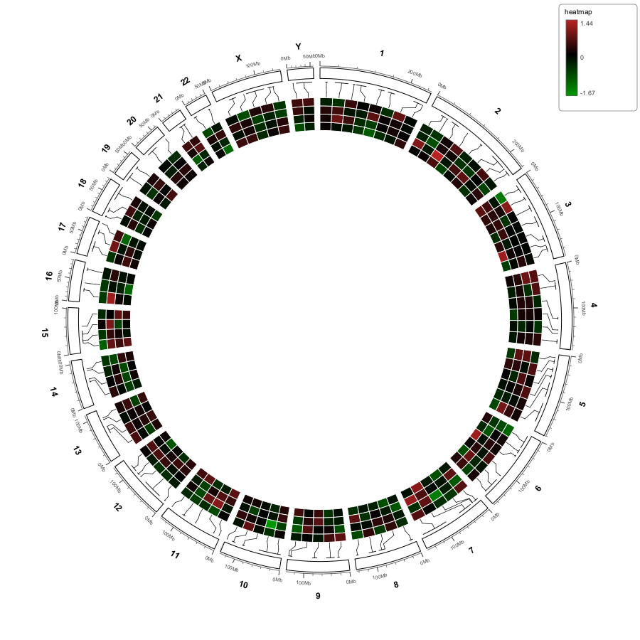
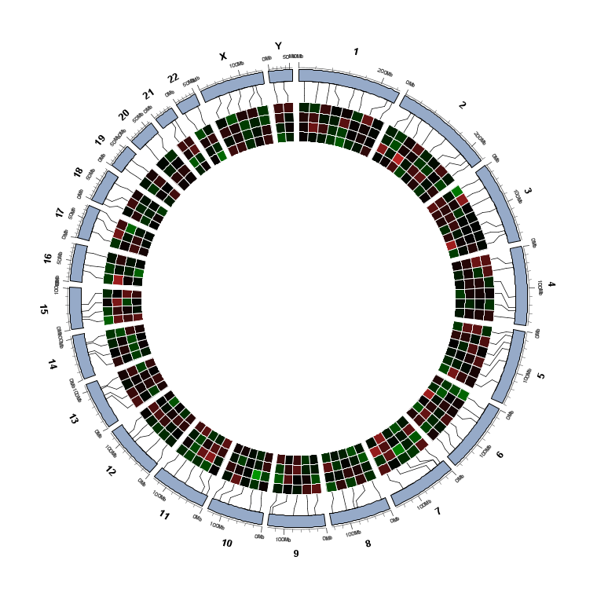
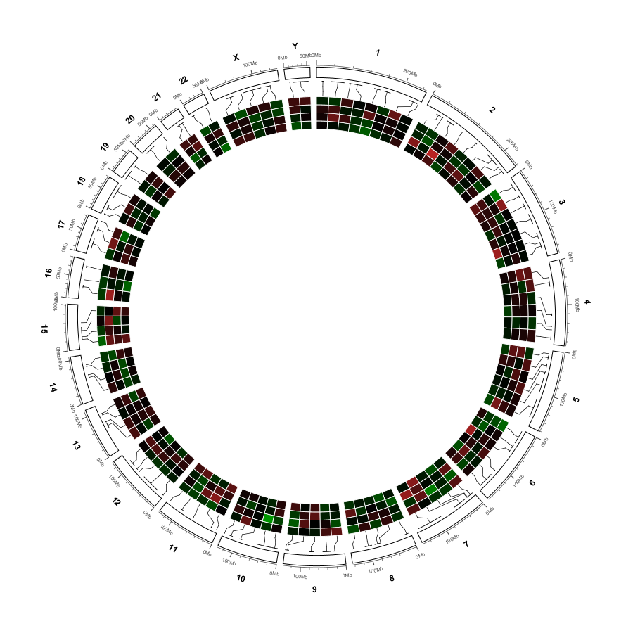
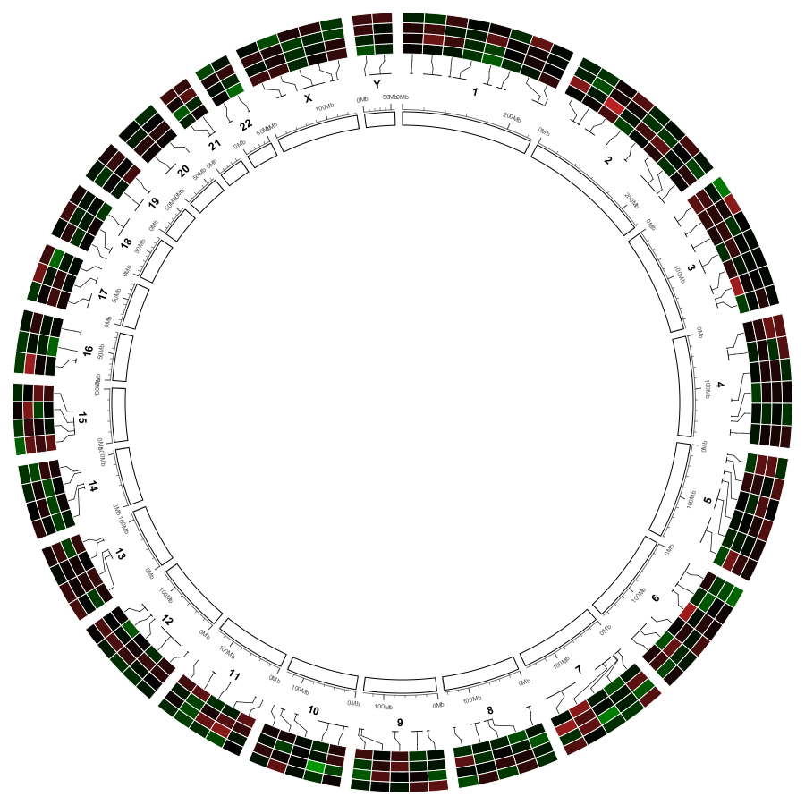
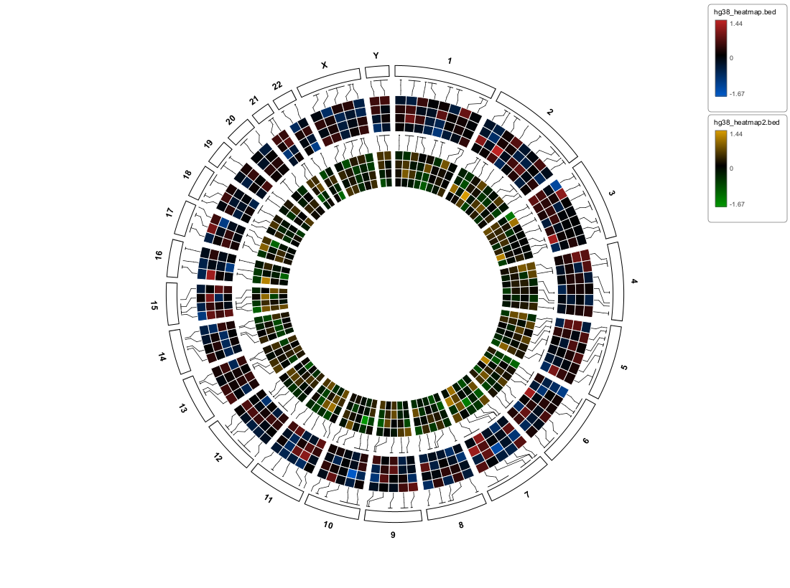
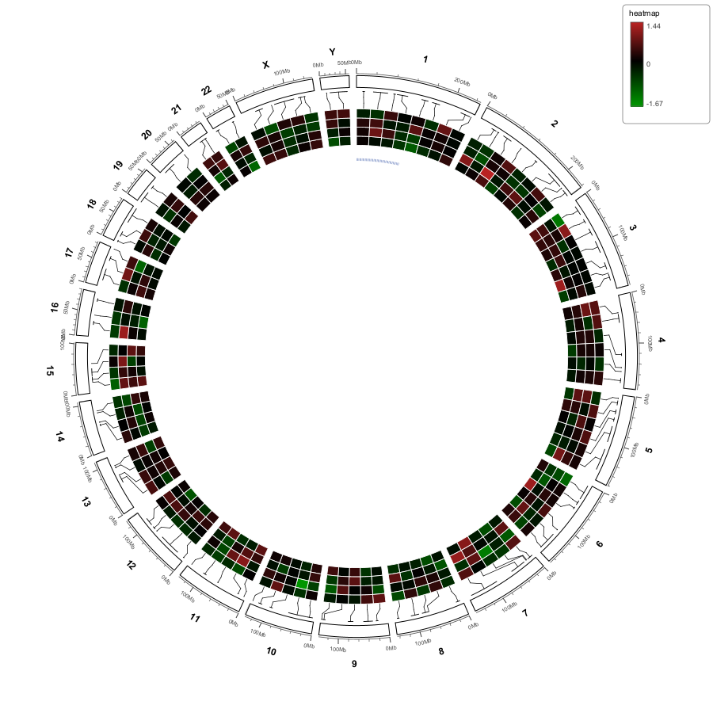
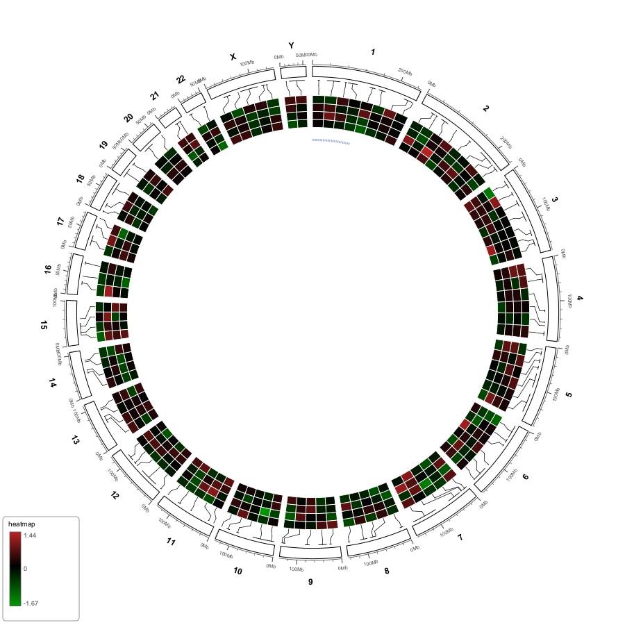
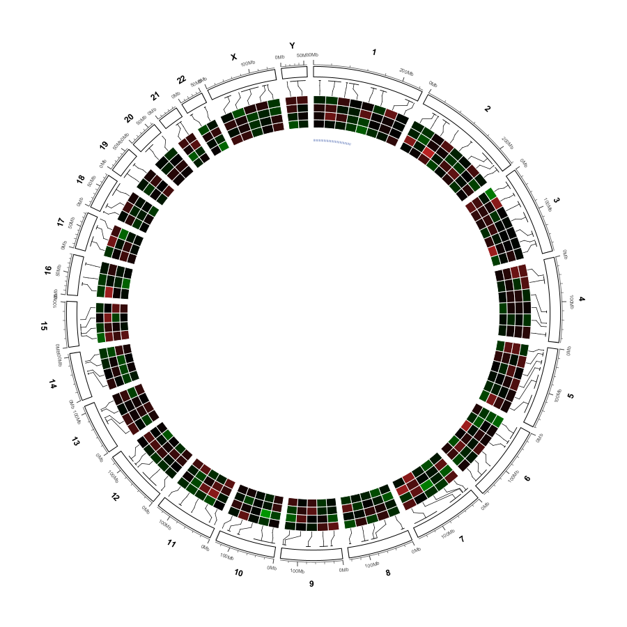

Heatmap layers: genomic heatmap rings
=====================================

A heatmap layer is created by ``Import ▾ → Heatmap  (BED with value
columns)…``.  It reproduces the semantics of ``circos.genomicHeatmap``,
``posTransform.default`` and ``circos.genomicPosTransformLines`` from the
circlize R package.  Right-click the heatmap row in the Data Tracks column to
open its parameters.

.. note::

   Importing another heatmap **adds a second heatmap layer** — several heatmaps
   stack as independent bands, and each keeps its own colours, height,
   connection track and inside/outside placement.  Links and labels layers
   accumulate the same way.  The heatmap's position among the other bands comes
   from its row in the Data Tracks column (see :doc:`circular_data_tracks`).

What the heatmap ring actually draws
------------------------------------

Two transformations are applied, and understanding them explains most of the
parameters below.

**Equal-width cells (``posTransform.default``).**  Rows are *not* drawn at their
true base-pair width.  Within a chromosome sector, the sector is divided into
``nrow(region) + 1`` equal angular slices and each heatmap row gets exactly one
slice.  This is circlize's ``posTransform.default`` behaviour: a 10 kb row and a
10 Mb row occupy the same width on the ring.  Cells are separated by a thin
white gutter.

**Four-segment comb connectors.**  Because the cell is no longer at its real
genomic position, circlize draws a position-transform line to tie them
together.  myIGV uses the same four segments as
``circos.genomicPosTransformLines``:

#. a short **cap** along the real interval on the ideogram edge;
#. a **radial segment** at the real interval midpoint, out to one third of the
   connection track;
#. a **diagonal segment** from the real midpoint to the equal-width cell's
   midpoint at two thirds of the connection track;
#. a final **radial segment** from the cell midpoint to the heatmap band.

The result is the characteristic comb/elbow shape.  It lives entirely inside
the *connection track* — it does not cross other data bands.

   The reference ``hg38_heatmap.bed`` (107 rows × 4 samples): equal-width
   green/black/red cells, a white gutter between cells, dark comb connectors
   and the default ``TOP_RIGHT`` colour legend outside the ring.

   Detail of the same layer.  Note that cells have uniform angular width even
   though the underlying BED intervals have very different lengths.

Placement: inside or outside
----------------------------

.. list-table::
   :header-rows: 1
   :widths: 36 14 50

   * - Menu item
     - Default
     - What it controls
   * - ``Show heatmap connectors``
     - on
     - Draw the four-segment comb.  Turn it off for a clean band of cells.
   * - ``Heatmap outside the ideogram``
     - off
     - ``off`` (default): the heatmap sits **inside** the ideogram, between it
       and the data bands.  ``on``: the heatmap and its comb grow **outwards**,
       and ``ideogramOuterRadius()`` shrinks the main ring so nothing leaves
       the canvas.
   * - ``Heatmap height… (<n> px)``
     - ``50 px``
     - Radial thickness of the cell band.  Minimum ``8``.
   * - ``Heatmap connection height… (<n> px)``
     - ``22 px``
     - Height of the *connection track* that contains the comb lines.  Range
       starts at ``0``: at ``0`` the heatmap is packed right against the
       ideogram with no visible comb.  This is an absolute pixel value, not a
       0–1 radius fraction, so the visual height no longer depends on the
       window size.

   Default ``inside`` placement: the heatmap ring and its inward comb are
   between the ideogram and the inner data bands.

   ``Heatmap outside the ideogram`` on: the comb points outward and the whole
   ideogram radius shrinks to leave room.

.. tip::

   If the comb looks disproportionately tall, lower ``Heatmap connection
   height…`` — it is the only knob for the connection track.  Setting it to
   ``0`` removes the connector track entirely.  ``Heatmap height…`` controls
   the coloured cells, not the comb.

Row order
---------

The heatmap band participates in the Data Tracks column order:
``heatmapBandIndex`` is derived from the row list by ``refreshDataColumn()``.
See :doc:`circular_data_tracks` for the drag-to-reorder behaviour and the two
screenshots showing the heatmap band moving between tracks.

Colour ramp
-----------

``divergingColor`` maps the global ``min`` / ``max`` of **all numeric cells** to
a ramp.  The number of stops depends on the data:

.. list-table::
   :header-rows: 1
   :widths: 26 20 54

   * - Data range
     - Stops
     - Behaviour
   * - ``min < 0 < max`` (straddles 0)
     - 3
     - Low → Mid → High, with **Mid pinned at value 0**.  The submenu is titled
       ``Heatmap colours (low / 0 / high)``.
   * - all positive or all negative
     - 2
     - Low → High only.  The submenu is titled
       ``Heatmap colours (low / high)`` and ``Mid (0)…`` is disabled, with the
       tooltip ``Only used when the data range contains 0 (negative and
       positive values).``

.. list-table::
   :header-rows: 1
   :widths: 32 22 46

   * - Colour item
     - Default
     - Meaning
   * - ``Low (min)…``
     - ``RGB(0, 150, 0)`` green
     - Colour at the global minimum.
   * - ``Mid (0)…``
     - ``RGB(0, 0, 0)`` black
     - Colour at zero, only used when the range straddles 0.
   * - ``High (max)…``
     - ``RGB(215, 40, 40)`` red
     - Colour at the global maximum.
   * - ``Reset (green / black / red)``
     - —
     - Restores the three defaults above.

Non-numeric or ``NaN`` cells (produced when a short row is padded to the widest
sample count) are not drawn, so the white background shows through.

Colour legend
-------------

.. list-table::
   :header-rows: 1
   :widths: 34 16 50

   * - Menu item
     - Default
     - What it controls
   * - ``Show heatmap legend``
     - on
     - Draws a vertical colour bar **outside the ring** with the numeric
       ``min`` / ``max`` labels — one bar per heatmap layer (see below).
   * - ``Legend position``
     - ``TOP_RIGHT``
     - Submenu with the five literals ``TOP_LEFT``, ``TOP_RIGHT``,
       ``BOTTOM_LEFT``, ``BOTTOM_RIGHT``, ``NONE``.

.. important::

   The heatmap legend submenu displays the **enum constant names** in upper
   case (``TOP_LEFT`` … ``NONE``) because the menu is built from
   ``LegendPosition.toString()``.  The Hi-C track's ``Color legend`` submenu
   displays the human-readable labels ``Top left`` / ``Top right`` /
   ``Bottom left`` / ``Bottom right`` / ``None``.  Both use the same four
   corners plus ``None``; only the wording differs.  See :doc:`hic`.

The legend is drawn unconditionally on both the on-screen painting path and
the export path — it does **not** require a Hi-C track to be loaded.  This was a
bug in an earlier build where the call sat inside an ``if
(!visibleHics.isEmpty())`` block.

**One legend per heatmap layer.**  Each imported heatmap gets its **own** colour
bar: its own title (the file name), its own ``min`` / ``max`` and its own
low / mid / high ramp.  They stack downward in the chosen corner, below any Hi-C
legends in the same corner.  Two heatmaps with different ranges or different
colours therefore stays readable instead of sharing one bar.

   Two heatmaps imported together: one legend per layer, each with its own file
   name, value range and colour ramp.

   ``Legend position → TOP_RIGHT`` (default).  The identical render is reused
   for ``polish_heat_first.png`` in :doc:`circular_data_tracks`.

   ``Legend position → BOTTOM_LEFT``.  The ring and cells are unchanged; only
   the legend moves.

   ``Legend position → NONE`` (or ``Show heatmap legend`` off).

   The legend also renders on the normal on-screen path, with no Hi-C track
   loaded.

Full menu inventory
-------------------

In order, the heatmap layer context menu contains: ``Show heatmap``,
``Show heatmap connectors``, ``Heatmap outside the ideogram``, ``Heatmap
height…``, ``Heatmap connection height…``, ``Show heatmap legend``,
``Legend position``, ``Heatmap colours (low / 0 / high)`` (or ``(low / high)``),
and ``Remove heatmap from circular view…``.

Every item above except the legend settings applies to **that heatmap layer
only**: two imported heatmaps can have different colours, heights, connection
tracks and inside/outside placement.  ``Heatmap outside the ideogram`` moves the
row to the ``Outside the ideogram`` column, where outside heatmaps stack
outward in their row order, and the comb starts just outside the chromosome
names instead of running across them.
