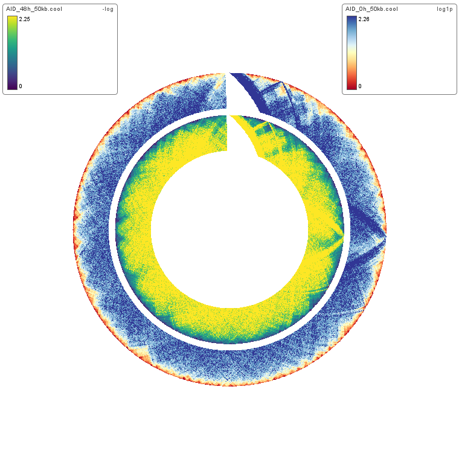
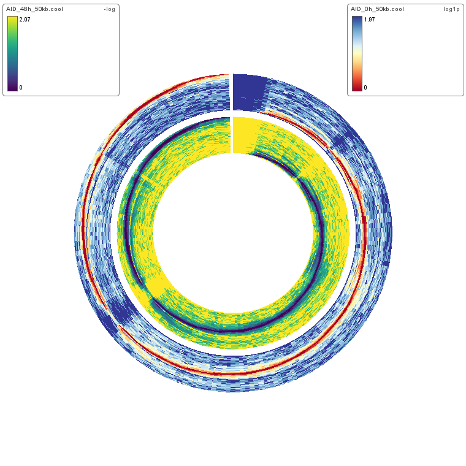
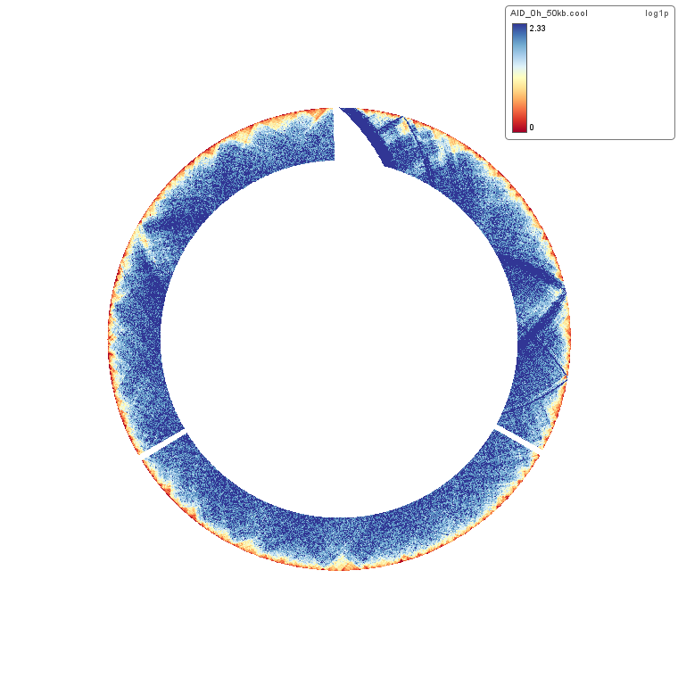
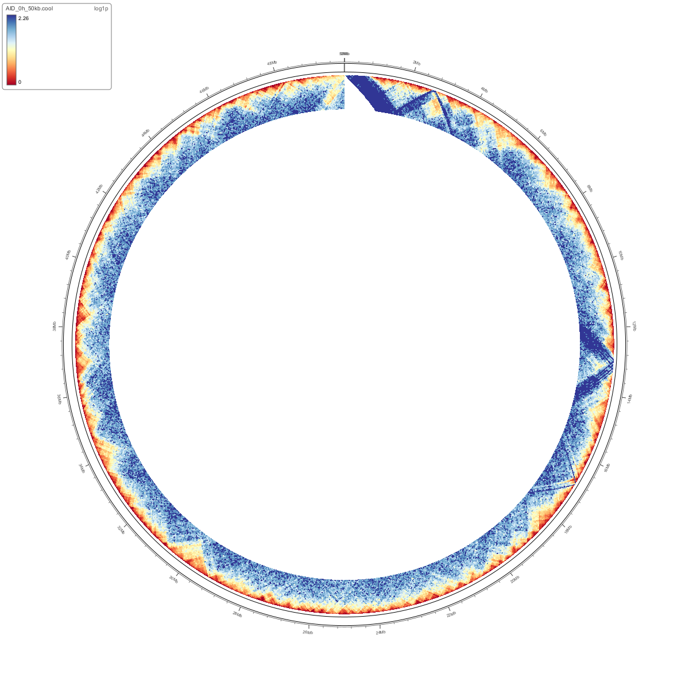
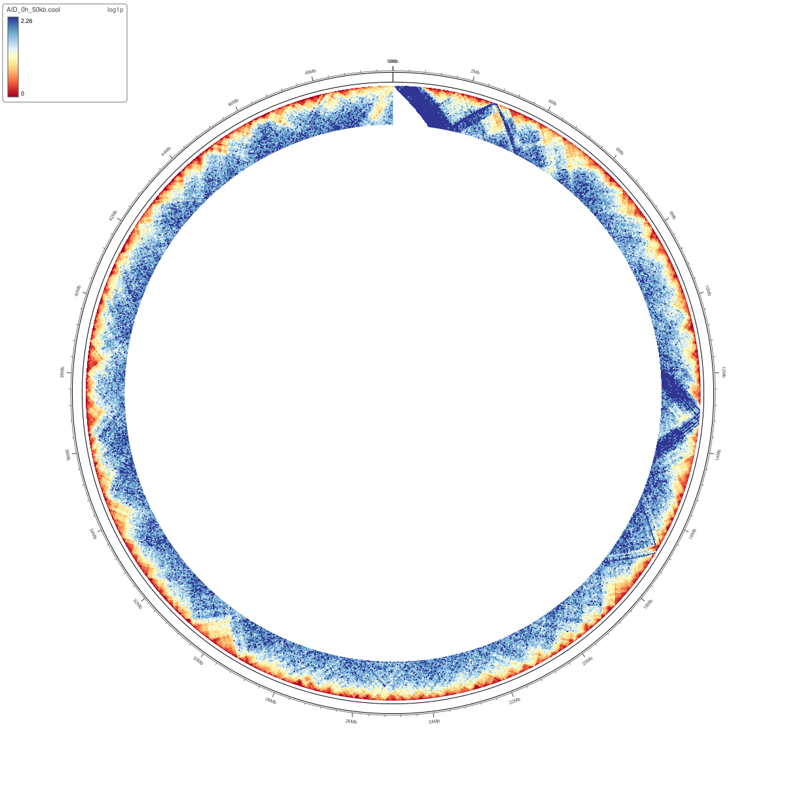
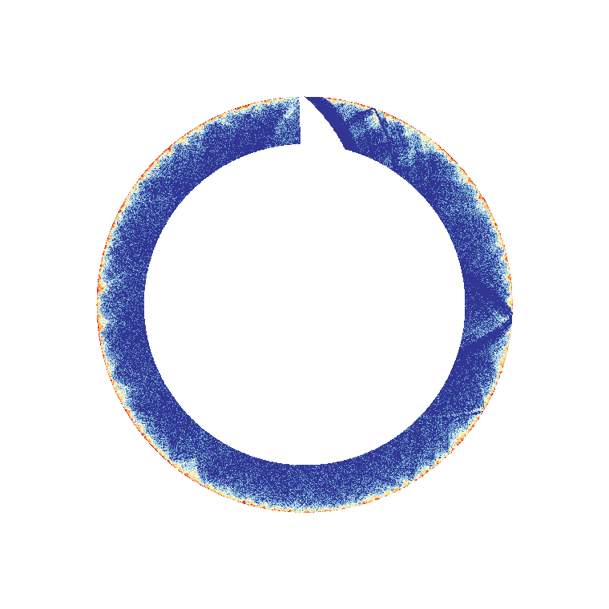
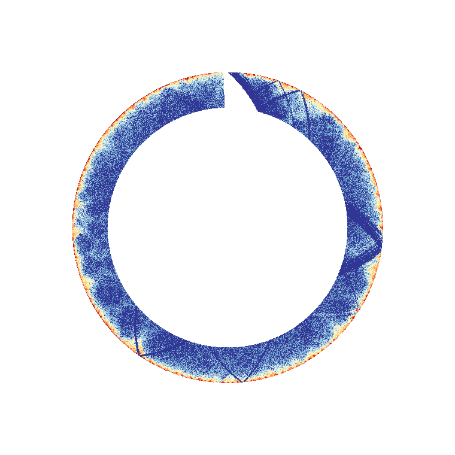
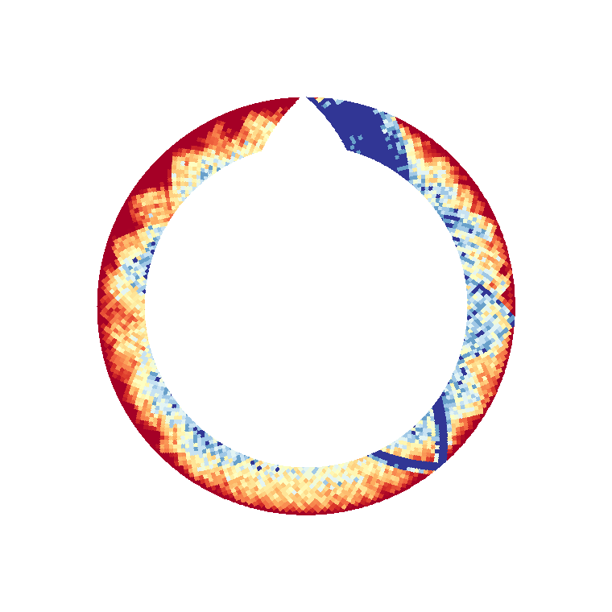
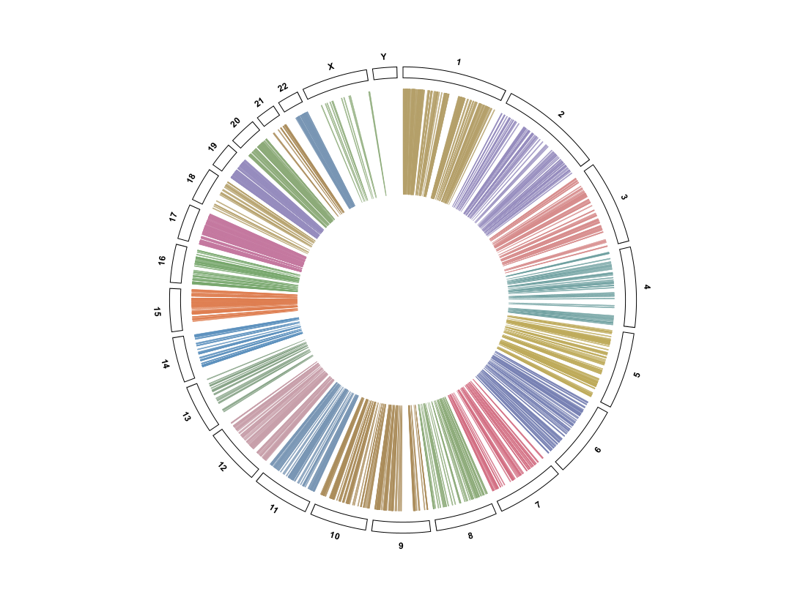

Hi-C on the Circular View ring
==============================

Hi-C contact matrices loaded into myIGV (see :doc:`hic`) are also available as
concentric bands in the Circular View.  This chapter covers only the
**ring-specific** behaviour; format support, colour transforms, resolution
switching, TAD styling and the linear-view menus are documented in :doc:`hic`.

Triangle and square rings
-------------------------

``warpHiCTile`` maps a linear Hi-C tile (triangle or square display) into the
chromosome sector's annular band.  The two display modes stay available on the
ring:

.. list-table::
   :header-rows: 1
   :widths: 26 74

   * - Mode
     - Ring appearance
   * - Triangle
     - A 45°-rotated matrix whose apex points outward, producing the scalloped
       red/orange band.  Each contact cell is an equal-width/equal-height
       diamond.
   * - Square
     - A double-axis matrix warped into the band; the diagonal runs around the
       ring, producing a continuous blue/orange annulus.

   Two ``Triangle`` Hi-C rings warped as concentric bands, rendered from the
   real ``AID_0h_50kb.cool`` (``log1p``) and ``AID_48h_50kb.cool`` (``-log``)
   matrices.  The **two** colour legends sit outside the ring in the top-left
   and top-right corners, each labelled with its source file name.

   ``Square`` Hi-C display warped into a ring, from the same real 50 kb cooler
   matrices.

   The Hi-C ring in gene-list / faceted mode, rendered from the real
   ``AID_0h_50kb.cool`` matrix.

Ring height
-----------

Right-click a Hi-C **track row** in the Data Tracks column:

* ``Hi-C ring height… (<n> px)`` — radial thickness of the Hi-C band.  Default
  ``60 px`` (``RingTrackConfig.hicHeightPx``); Hi-C uses its own taller value
  rather than the ordinary ``Track height…`` (``cfg.heightPx``).
* ``Delete track`` — truly deletes the Hi-C track and releases its
  ``HiCDomainOverlay`` bindings (see :doc:`circular_data_tracks`).

Colour legends
--------------

Hi-C legends are drawn **outside** the ring, at four corners or not at all:
``Top left`` (default), ``Top right``, ``Bottom left``, ``Bottom right`` and
``None``, from ``HiCTrack.LegendPosition``.  When several Hi-C tracks are
loaded, ``legendRect()`` stacks legends in the same corner so they do not
overlap.  The heatmap legend reuses exactly this corner set — see
:doc:`circular_heatmap`.

.. note::

   Wording differs between the two menus.  The linear Hi-C track's
   ``Hi-C display → Color legend`` submenu shows the human-readable labels
   (``Top left`` … ``None``, via ``getLabel()``).  A **heatmap layer** row's
   ``Legend position`` submenu shows the enum constants (``TOP_LEFT`` …
   ``NONE``, via ``toString()``).  Both choose from the same five values.

HiDPI sharpness
---------------

The warped tile cache is rendered at the **device resolution** given by the
``Graphics2D`` HiDPI transform (Windows 150% = 1.5×) and then blitted back
1:1.  Rendering at logical resolution and letting the system upscale would
resample the 45° lines into alternating half-pixel blocks.  TAD outline strokes
are additionally drawn on a 2× supersampled transparent layer with bilinear
downscaling and ``VALUE_STROKE_PURE`` so 1–2 px diagonal lines stay continuous
instead of looking like a string of dots.

TAD / domain overlays on the ring
---------------------------------

A BED track bound to a Hi-C TAD/domain overlay is marked invisible by
``HiCDomainOverlay.acquire()``.  myIGV's ``circularColumnTracks()`` and
``drawableAsBand()`` both respect ``isVisible()``, so that BED no longer shows
as a separate row in the Data Tracks column or as its own band on the ring —
it is drawn only as an outline on the Hi-C matrix.  Unbinding or deleting the
Hi-C track restores it (reference counting handles one BED shared by several
Hi-C tracks).

   A domain overlay drawn on the circular Hi-C band.  The source BED track is
   hidden from the panel so the same intervals are not shown twice.

   The same ring with the overlay turned off.

Flip follows the matrix
-----------------------

``Hi-C display → Flip vertically (inverted triangle)`` mirrors the composited
image.  In the Circular View the TAD overlay is **first composited onto the
unflipped matrix and then the whole image is flipped**, so the domain outlines
move with the matrix instead of staying at their old angular positions.  The
``flipped`` flag was removed from the tile-cache key: toggling flip only
re-composites, it does not recompute the matrix.  Overlays added after the flip
are aligned automatically.

   After ``Flip vertically``: both the matrix and the domain outline are
   mirrored.

Performance with several Hi-C files
-----------------------------------

An earlier build was noticeably sluggish when two ``.hic`` files were loaded.
``warpHiCTile`` scanned the **full-circle bounding square** once per chromosome
sector.  In ``All`` mode with two Hi-C tracks that is ``26 chromosomes × 2 =
52`` full-circle scans, roughly **26 million pixels** per rebuild, giving warm
render times of about ``747 / 1137 / 842 ms``.

The fix has two parts:

#. ``sectorBounds()`` computes the bounding box of **only the current sector**,
   so each warp scans a small wedge instead of the whole circle.
#. Pixels are written directly into a ``DataBufferInt`` rather than through
   per-pixel ``setRGB`` calls.

Warm rebuild dropped to roughly ``25 – 31 ms``, which keeps panning, zooming
and menu interaction responsive with two Hi-C files in ``All`` mode.

.. tip::

   If a figure still feels slow, reduce the number of visible Hi-C tracks or
   chromosomes via ``Chromosomes to show (All mode)…`` in
   :doc:`circular_view_options`, or lower ``Hi-C ring height…``.  The warp cost
   scales with the band's pixel area.

   An exported circular figure with a Hi-C band — the Hi-C warp runs through
   the same ``renderTo()`` path as the on-screen view.

   The PDF export of a Hi-C ring figure, rendered from the real
   ``AID_0h_50kb.cool`` matrix (colour legend at top left).  See
   :doc:`circular_export`.

Real-data examples
------------------

The four captures below are rendered from the **real** contact-matrix and
loop files that sit one level above the repository (``../``).  The triangle /
square / gene-list captures earlier in this chapter are **also** real-data
driven — from the 50 kb ``AID_0h_50kb.cool`` / ``AID_48h_50kb.cool``
matrices — so every Hi-C figure in this guide now shows a genuine contact
matrix.  See :doc:`real_data_examples` for sizes, row counts and chromosome
naming; the same four real-data captures are also documented from the
linear-track side in :doc:`hic`.

   ``warpHiCTile`` applied to the real Juicer matrix
   ``../GSE280419_HiC_AID_0h.hic`` (≈ 907 MB).  Multiple resolutions are
   switched automatically with the viewport, and blocks are inflated on
   demand.

   The real multi-resolution cooler
   ``../GSM10137692_A375-Acute-Bottom10-DMSO.10kb.mcool`` (≈ 494 MB) warped
   into the ring band.  Every stored resolution is usable.

   The real gzip-wrapped cooler
   ``../GSM8842576_S1_raw_5000_.cool.gz`` (≈ 132 MB), decompressed once into
   its own directory and then warped into the ring.  A **bounded chr1 0–10 Mb
   window** (2000 bins at 5 kb) is shown rather than the whole genome: the raw
   5 kb matrix is still sparse, so the ring is mostly dark low-contact
   background, but visible bright contact cells and a triangular wedge give
   it real structure.  This is a genuine render, not an empty or failed load.

   Real loops from
   ``../HiC_TAD_results/loops/AID_0h_10kb_loops.bedpe`` (1384 rows, real
   ``hicDetectLoops`` output) imported as a links layer and drawn as ribbon
   bands on the circular ring — see the ``Ribbon (filled bands)`` styling in
   :doc:`circular_links`.
