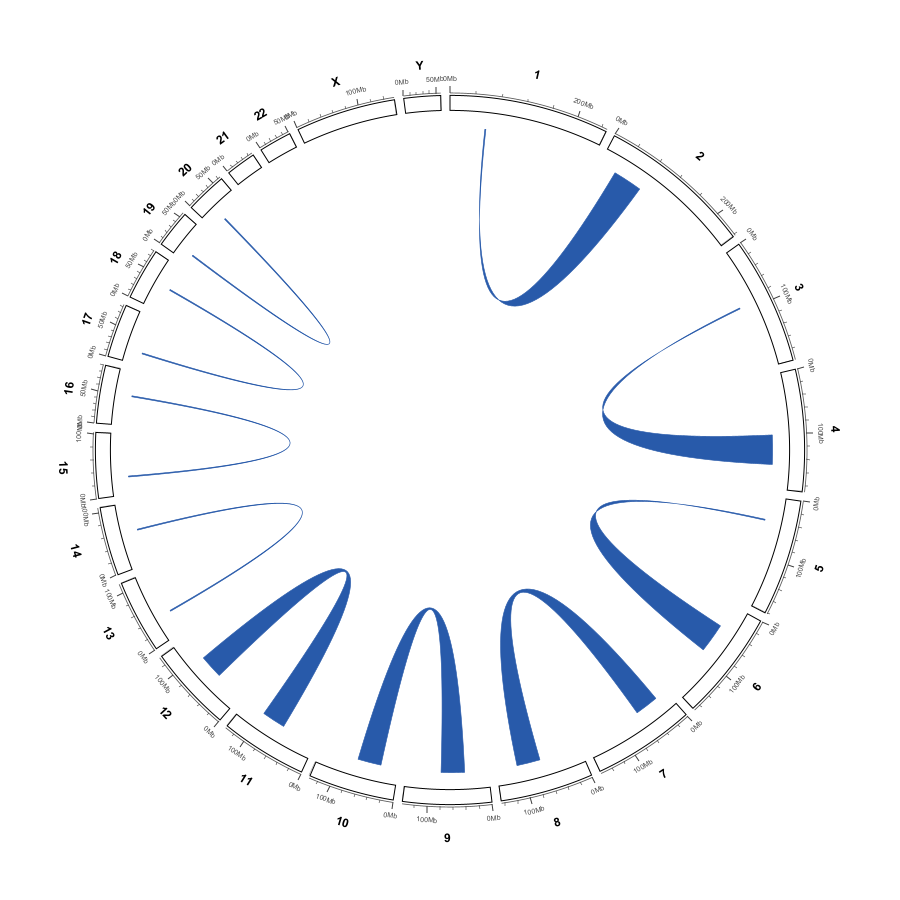
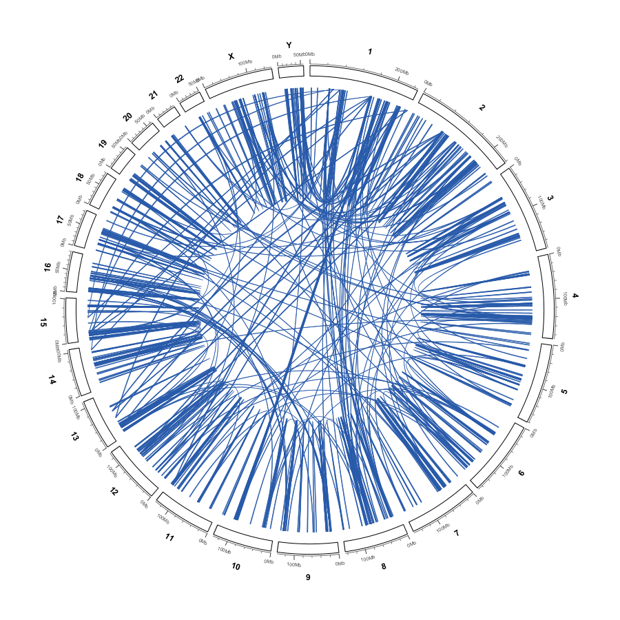
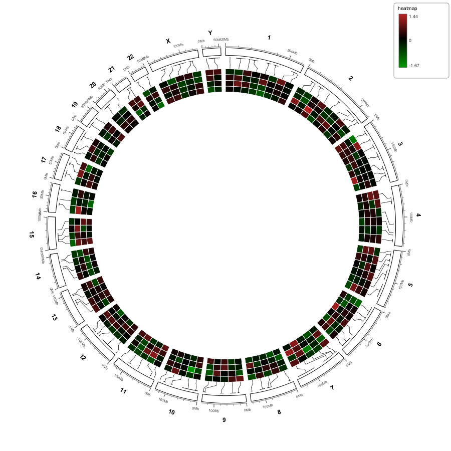
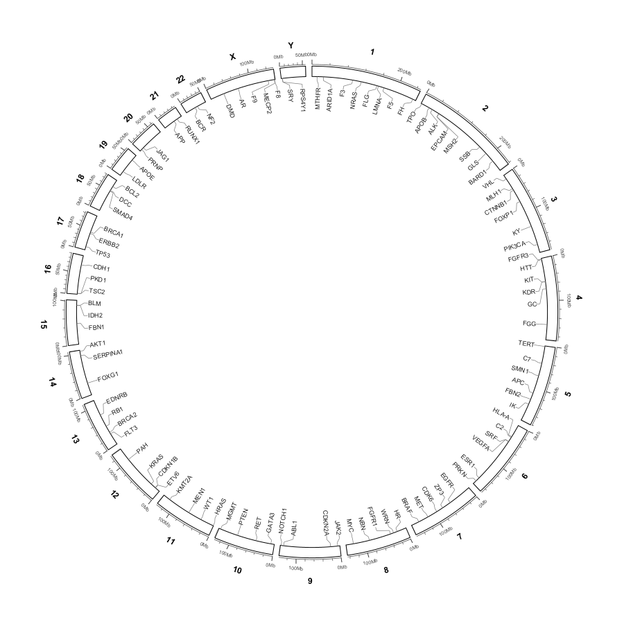
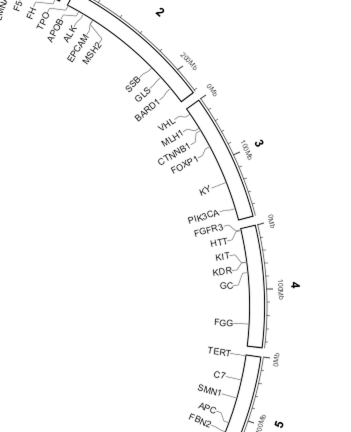
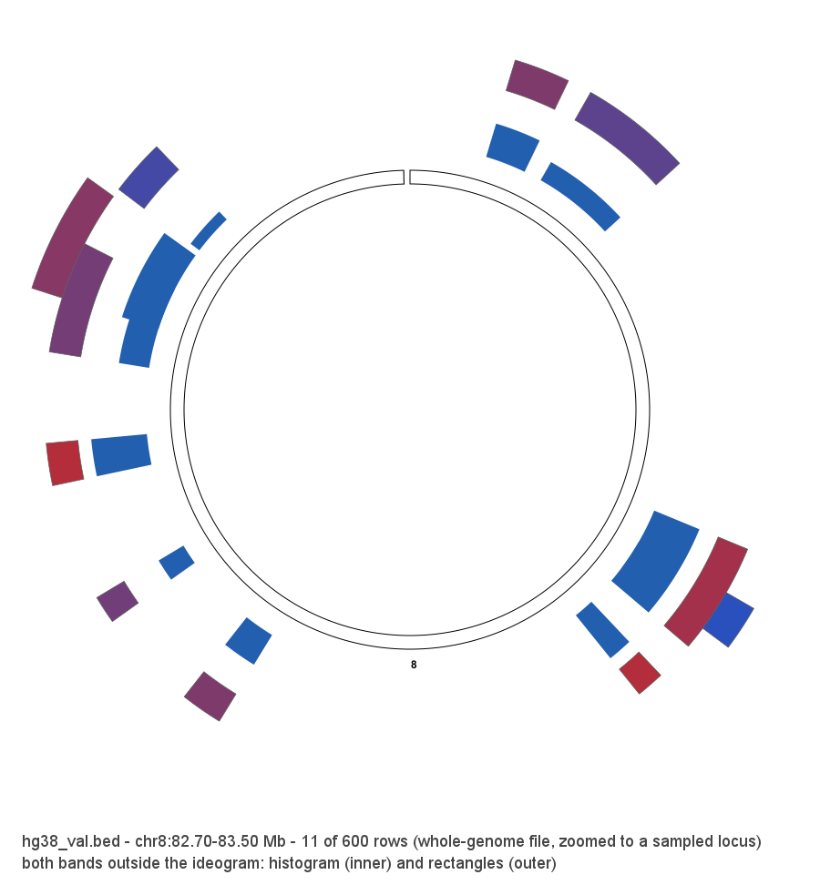
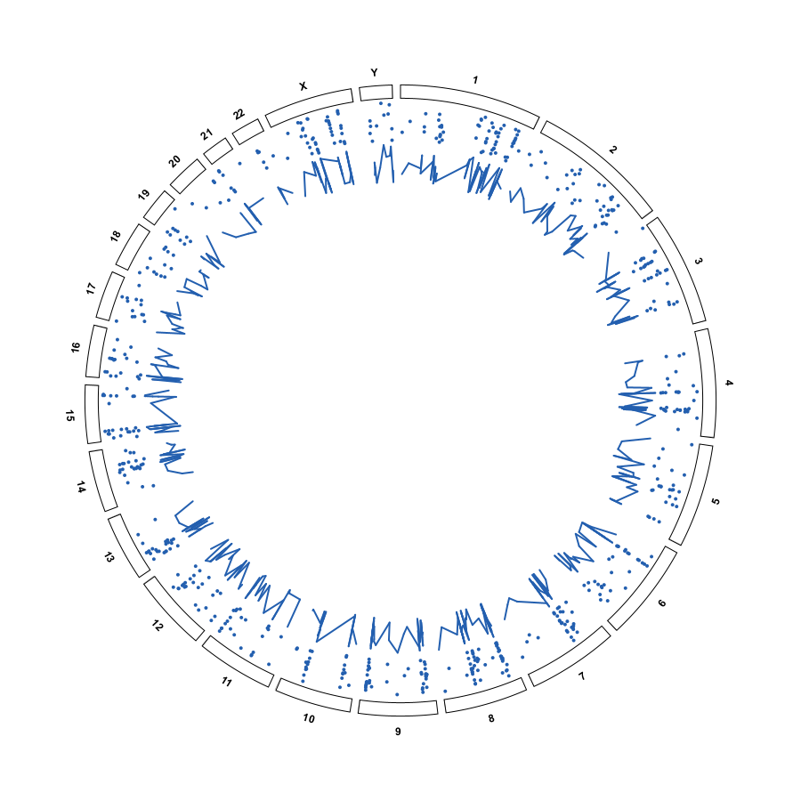
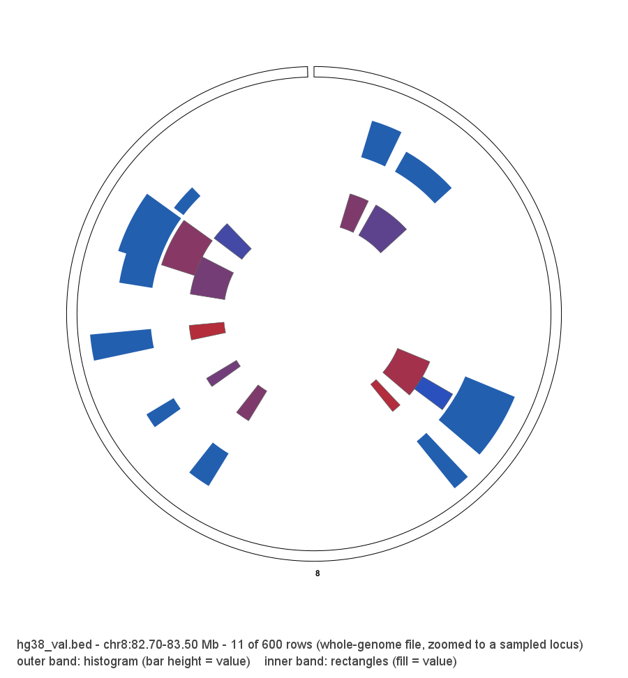
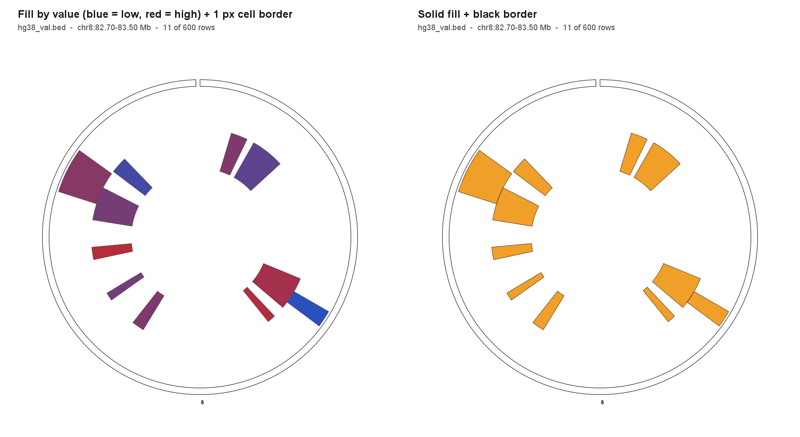
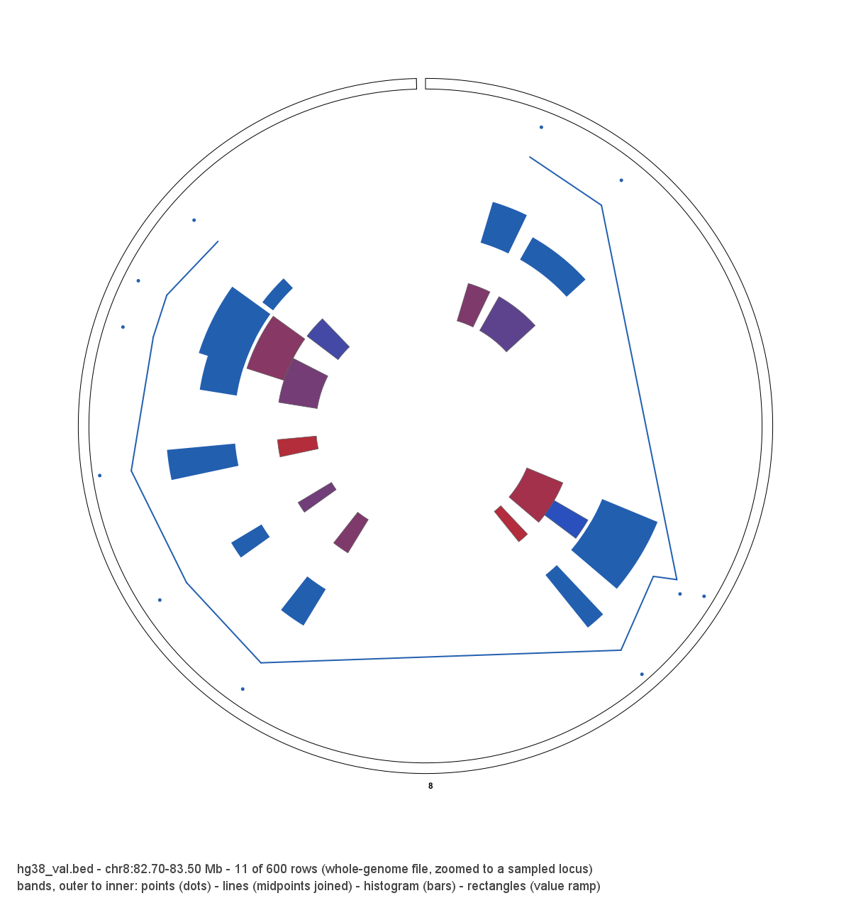

Import: circular-only data layers
=================================

``Import ▾`` is the first button in the Circular View toolbar.  It loads data
that exists **only in the Circular View**: links, a genomic heatmap, genomic
labels, and four interval+value tracks (points, lines, histogram, rectangles).

.. important::

   Files loaded here are **not IGV tracks**.  They never appear in the
   horizontal (linear) view, they are not added to the session's resource list,
   and they are not saved in a session.  They are drawn from in-memory layers
   held by ``CircularViewPanel`` and are lost when myIGV closes.  This is
   deliberate: it lets you build a publication figure without polluting the
   normal IGV workspace.

The Import menu
---------------

The dropdown contains these entries:

.. list-table::
   :header-rows: 1
   :widths: 42 58

   * - Menu item
     - File dialog title / action
   * - ``Links  (BEDPE / Circos links)…``
     - ``Load Circos / BEDPE links``
   * - ``Heatmap  (BED with value columns)…``
     - ``Load genomic heatmap (BED/TSV rows x samples)``
   * - ``Labels  (BED + name column)…``
     - ``Import labels (BED, 4th column = name)``
   * - ``Points  (BED + value column)…``
     - ``Import points (BED: chr start end value)``
   * - ``Lines  (BED + value column)…``
     - ``Import lines (BED: chr start end value)``
   * - ``Histogram  (BED + value column)…``
     - ``Import histogram (BED: chr start end value)``
   * - ``Rectangles  (BED + value column)…``
     - ``Import rectangles (BED: chr start end value)``
   * - ``Imported data is drawn in the circular view only``
     - Disabled hint (not clickable)

Every dialog opens a native ``java.awt.FileDialog`` for **local files only**
and is **multi-select**: Ctrl/Shift-click several files in one dialog and each
one becomes its own layer.  There is no remote/URL input in these dialogs:
the parsers read the path directly with ``FileInputStream``.

Each import creates a **new** layer; importing a second file of the same kind
stacks a second band rather than replacing the first, so you can overlay several
heatmaps, label sets, or value tracks and style each one independently.

Links: BEDPE / Circos links
---------------------------

Links are parsed by ``org.broad.igv.bedpe.BedPEParser`` — the same parser the
linear interaction-track loader uses.  It auto-detects **UTF-8, UTF-16LE and
UTF-16BE from the BOM**, so files produced by Windows PowerShell ``Out-File``
work, and it accepts a minimal 6-column BEDPE.  The reference links file is
``../hg38_links.bed`` — 600 rows, six tab-separated columns, ``chrN``
chromosome names.  Its first three rows are::

    chr1  3409043   3424043   chr1  3661928   3666928
    chr1  18802323  18842323  chrY  47460604  47485604
    chr1  47601256  47621256  chr4  143491541 143496541

The six columns are ``chrom1  start1  end1  chrom2  start2  end2``; the two
anchors may sit on different chromosomes (``chrY`` and ``chr4`` above).  See
:doc:`real_data_examples` for the full data inventory.

Optional columns (``name``, ``score``, ``strand1``, ``strand2``, ``color``,
…) are read when present.  Per-record ``score``, ``color``, ``thickness`` and
the remaining value string are carried into the ring layer.  Rows with a
missing chromosome name are skipped.  Both ``1`` and ``chr1`` chromosome
spellings are accepted.

.. note::

   A line beginning with ``#`` **never becomes a link**, but it is not simply
   discarded either.  ``BedPEParser`` reads three kinds of metadata from it:

   * ``#columns color=N thickness=M`` (semicolon-separated ``key=value`` after
     whitespace) sets the **1-based** index of the colour and thickness columns
     directly — ``colorColumn = N - 1``, ``thicknessColumn = M - 1``.
   * Any ``#`` line with **six or more tab-separated fields** replaces the
     entire column-name list with its tokens.  Columns named ``color`` or
     ``thickness`` at index ≥ 6 are then picked up automatically.
   * An ordinary ``#`` comment line produces no feature and changes nothing.

   The heatmap and labels parsers, by contrast, just skip ``#`` lines outright.

For example, ``../simulated_loops.full12.bedpe`` declares all 12 columns with a
single ``#`` header line::

    #chrom1  start1  end1  chrom2  start2  end2  name  score  strand1  strand2  color  thickness
    X        71124   76124 X       242555  247555 LONG_0001  94.0  +  -  31,119,180  1

A real 10-column example lives in the **upstream IGV source tree**, not in
this repository, at
``igv_mod/igv-main/test/data/bedpe/interleaved_chrs.bedpe`` (78 rows) — one
level above the ``myigv_v1.3`` checkout.  Its first row is::

    chr5  135399049  135399149  chr5  135398825  135398922  VH01587:178:...  255  -  +

.. warning::

   Some demo files (for example ``../links_demo_line_band.bed``) contain
   comments describing a ``View options → Links`` import path.  **That path no
   longer exists.**  Links files are imported through
   ``Import ▾ → Links  (BEDPE / Circos links)…`` and styled from the links
   layer's right-click menu.  See :doc:`circular_data_tracks`.

Each import creates a **new** links layer; importing several files stacks
several layers.  Links layers can be hidden, removed, or styled independently
from the Data Tracks column (see :doc:`circular_data_tracks`).

   A links layer imported from a small BEDPE demo.  Filled ribbon bands keep a
   visible width along their whole length.

   A dense whole-genome links layer with ``Ribbon (filled bands)`` enabled.

.. note::

   **Two loading paths coexist.**  ``File → Load from File...`` on a BEDPE
   creates a normal IGV interaction track (horizontal view, saved in session,
   with its own arc menus).  ``Import ▾ → Links`` creates a circular-only layer
   with ribbon/arrow menus.  Neither replaces the other.

Heatmap: BED with value columns
-------------------------------

The heatmap parser reads a BED-like text file, one genomic interval per row and
one or more numeric sample columns.  The reference file is
``../hg38_heatmap.bed`` (107 rows, one interval plus four numeric value
columns); its first three rows are::

    chr1  12349422  17367982  0.0521477005103746   0.142378383327149   0.27553691609403  -0.339657653591206
    chr1  34220407  65129873  -0.124433856269414  0.83281386326271    0.492758871260362 -0.536050429644896
    chr1  76239000  81288814  -0.245211130992809  0.451441410890585  -0.223131824672254  0.417541349308881

Exact parsing rules:

.. list-table::
   :header-rows: 1
   :widths: 32 68

   * - Rule
     - Behaviour
   * - Encoding
     - UTF-8, read from a local ``FileInputStream``.
   * - Delimiter
     - Tab.  If a tab split yields fewer than 4 fields, the line is re-split
       on arbitrary whitespace, so space-separated TSV works too.
   * - Comments / headers
     - Empty lines and lines starting with ``#`` are skipped.  A header line
       such as ``chr start end v1 …`` is skipped automatically because
       ``start`` / ``end`` do not parse as integers.
   * - Minimum columns
     - 4 (``chr``, ``start``, ``end``, at least one value).
   * - Values
     - Every field from column 4 onward must parse as a ``double``; if any
       fails, the **whole row** is skipped.
   * - Ragged rows
     - Short rows are padded with ``NaN`` to the widest row's sample count.
       ``NaN`` cells are not drawn.
   * - Range
     - Global ``min`` / ``max`` over all numeric cells drives the colour ramp.
   * - Chromosome names
     - ``1`` ↔ ``chr1`` aliases and case differences are resolved.

The three rows quoted at the start of this section are the first three lines
of ``../hg38_heatmap.bed`` (107 rows, 4 numeric columns).  It uses ``chrN``
chromosome names and its global min/max over all numeric cells drives the
colour ramp — see :doc:`real_data_examples` for the full data inventory.

.. note::

   The real data files used throughout this guide (``hg38_heatmap.bed``,
   ``hg38_genes.bed``, ``hg38_links.bed``, ``hg38_val.bed``, the ``.bw``,
   ``.hic`` / ``.mcool`` / ``.cool`` / ``.h5`` contact matrices and the
   ``HiC_TAD_results/`` products) live in the workspace directory **one level
   above** the ``myigv_v1.3`` repository (``../``) and are **not committed to
   it**; the headless probes read them by that ``../`` relative path.  The
   BEDPE example quoted above belongs to the upstream IGV test data at
   ``igv_mod/igv-main/test/data/bedpe/``.  See :doc:`real_data_examples` for
   the full inventory.

Importing another heatmap **adds a second heatmap layer** — several heatmaps
stack as independent bands, and each keeps its own colours, heights and
connection track (see :doc:`circular_heatmap`).

   The reference heatmap rendered with equal-width cells, comb connectors and
   the default green / black / red diverging ramp.  The colour-bar legend sits
   outside the ring at ``TOP_RIGHT``.

Labels: BED + name column
-------------------------

The labels parser reads a 4-column BED-like file.  The reference file is
``../hg38_genes.bed`` (100 rows, ``chr`` / ``start`` / ``end`` / ``name``);
its first three rows are::

    chr1  11785722  11805964  MTHFR
    chr1  26696014  26782104  ARID1A
    chr1  94529172  94541759  F3

Exact parsing rules:

.. list-table::
   :header-rows: 1
   :widths: 32 68

   * - Rule
     - Behaviour
   * - Encoding / location
     - UTF-8, local file only.
   * - Delimiter
     - Tab, with the same whitespace fallback as the heatmap parser.
   * - Comments
     - Empty lines and ``#`` lines are skipped.
   * - Minimum columns
     - 4; ``start`` and ``end`` must parse as ``int``.
   * - Empty name
     - Replaced by ``chr:start`` so the label is never blank.
   * - Extra columns
     - Ignored; only column 4 is used as the text.

The three rows quoted at the start of this section are the first three lines
of ``../hg38_genes.bed`` (100 rows, gene names such as ``MTHFR``, ``ARID1A``,
``F3``).  It uses ``chrN`` chromosome names; see
:doc:`real_data_examples` for the full data inventory.

Each import creates a **new** labels layer.  Labels are radial, sit inside the
ideogram by default, and are connected to their genomic position by a
four-segment comb.  There is no alternative leader-line style — see
:doc:`circular_labels`.

   The reference labels layer.  Dense names are fanned out by circlize's
   ``smartAlign`` so their connectors do not overlap.

   Zoomed detail: the comb stops at the near end of each gene name, so the
   connector never runs through the text.

Interval + value tracks: points, lines, histogram, rectangles
-------------------------------------------------------------

These four layer kinds share one parser and one file format — a 4-column
BED-like file whose fourth column is a single numeric value.  The reference
file is ``../hg38_val.bed`` (600 rows); its first three rows are::

    chr1  3409043   3424043   -1.1572
    chr1  18802323  18842323  0.0211
    chr1  47601256  47621256  -0.4700

Its first three columns are the **same intervals** used by the links file
``../hg38_links.bed``, so a value track and a links layer line up exactly when
both are loaded.  The value column spans roughly ``-1.99 … +2.00`` (the first
row reads ``-1.1572``); this global min/max drives the radial mapping.

Parsing rules (``parsePointLine``):

.. list-table::
   :header-rows: 1
   :widths: 32 68

   * - Rule
     - Behaviour
   * - Encoding / location
     - UTF-8, local file only.
   * - Delimiter
     - Tab, with the same whitespace fallback as the other parsers.
   * - Comments
     - Empty lines and ``#`` lines are skipped.
   * - Minimum columns
     - 4; ``start`` / ``end`` must be integers and the value must parse as a
       number, otherwise the row is skipped.
   * - Range
     - Global ``min`` / ``max`` over the value column drives the radial mapping.
   * - Multi-select
     - Several files can be picked in one dialog; each becomes its own band.

All four map **value → radius** inside their ring band (low values near the
inner edge, high values near the outer edge) and **genomic position → angle**
(interval start/end for the filled kinds, the interval midpoint for points and
lines).

.. list-table::
   :header-rows: 1
   :widths: 18 47 35

   * - Kind
     - Drawing
     - Right-click parameters
   * - Points
     - A small filled marker per row at the interval midpoint.
     - ``Colour…``, ``Point size…``, ``Band height…``, ``Points outside the
       ideogram``
   * - Lines
     - Consecutive rows on the same chromosome joined into a polyline.
     - ``Colour…``, ``Line width…``, ``Band height…``, ``Lines outside the
       ideogram``
   * - Histogram
     - One bar per row, from the band's inner edge up to the value's radius,
       spanning the interval's angular width.
     - ``Bar colour…``, ``Band height…``, ``Histogram outside the ideogram``
   * - Rectangles
     - Each interval fills the whole band, coloured by value.
     - ``Colours`` submenu (below), ``Expand overlapping rectangles``,
       ``Band height…``, ``Rectangles outside the ideogram``

The **Rectangles** ``Colours`` submenu controls fill and border:

* ``Fill by value (ramp)`` — on (default): the fill interpolates from the low
  colour to the high colour by value.  Off: a single solid fill is used.
* ``Fill colour…`` — one solid fill colour for every cell.
* ``Border colour…`` / ``No border`` — outline each cell, or clear the outline.
* ``Low value colour…`` / ``High value colour…`` — the two ends of the ramp.

**Expand overlapping rectangles.**  When intervals overlap, later cells would
otherwise cover earlier ones.  With ``Expand overlapping rectangles`` on, the
overlapping intervals are assigned radial **lanes** by greedy interval
scheduling, so each one occupies its own sub-slice of the band and stays
visible.  Off, every cell fills the whole band and overlaps cover each other.

All four kinds can also be drawn **outside the ideogram**; the checkbox in each
menu moves the layer to the ``Outside the ideogram`` column — see
:doc:`circular_data_tracks`.  The figure below shows the **Histogram** band
moved outside the ideogram with ``Histogram outside the ideogram`` enabled.

   A Histogram band placed **outside the ideogram** (``Histogram outside the
   ideogram``), with the bars radiating outward from the ring.  Rendered from
   the real ``hg38_val.bed``.

   A Points band (outer, markers at each interval midpoint) and a Lines band
   (inner, consecutive midpoints joined per chromosome), rendered from the
   real ``hg38_val.bed``.

   A histogram band (bars) and a rectangle band (cells coloured by value)
   stacked inside the ideogram, rendered from the real ``hg38_val.bed``.

   Left: rectangles filled by value (blue = low, red = high) with a 1 px cell
   border.  Right: one solid fill colour with a black border around every
   cell.  Both are rendered from the real ``hg38_val.bed``.

All four kinds can be driven by the **same** file.  The composite below stacks
Points, Lines, Histogram and Rectangles in one ring, each layer imported from
the identical ``../hg38_val.bed`` so the four radial mappings are directly
comparable.

   Four numeric bands — Points, Lines, Histogram and Rectangles — stacked
   from the same real ``hg38_val.bed``.  All four are drawn for one 0.8 Mb
   window (chr8:82.70–83.50 Mb, 11 of the file's 600 rows) so that the
   Histogram and Rectangle bands are wider than a single pixel; because every
   layer reads the same file, their value → radius mapping shares one global
   minimum and maximum.

Troubleshooting
---------------

.. list-table::
   :header-rows: 1
   :widths: 45 55

   * - Symptom
     - Cause / fix
   * - ``No numeric heatmap rows found in: …``
     - No row had ≥4 columns with all-numeric values from column 4 onward.
       Check the delimiter and remove non-numeric annotation columns.
   * - ``No chr / start / end / name rows found in: …``
     - The labels file had fewer than 4 columns or non-integer coordinates.
   * - ``Could not load links: …``
     - The BEDPE file could not be parsed.  Verify the first 6 columns and the
       file encoding; UTF-16 with BOM is supported.
   * - Heatmap appears empty
     - Chromosome names do not match the genome.  Use ``chr1`` or ``1`` as the
       genome uses; aliases are resolved but unrelated contig names are not.
   * - Data appears in the horizontal view
     - You used ``File → Load from File...``.  Use ``Import ▾`` instead.

.. tip::

   ``Import ▾`` layers are re-created each session.  If you need a reproducible
   figure, keep the three source files next to your session and re-import them
   after loading the session; the exported PNG/SVG/PDF is self-contained.
