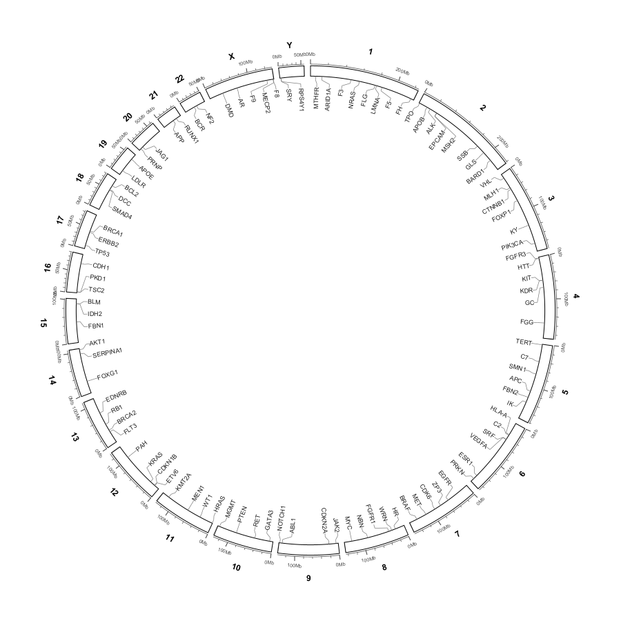
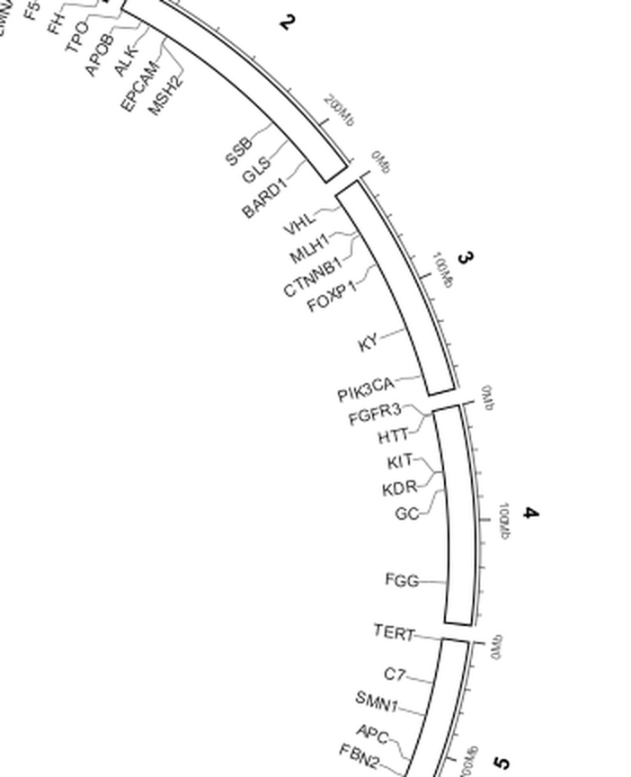
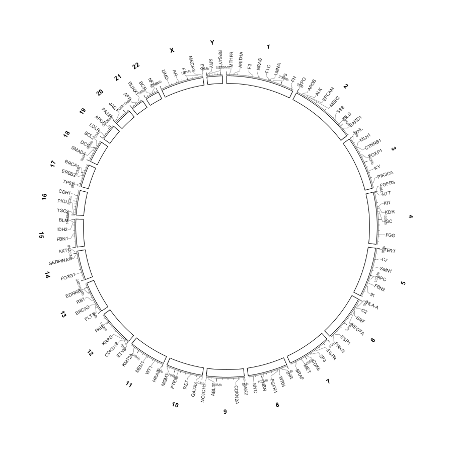
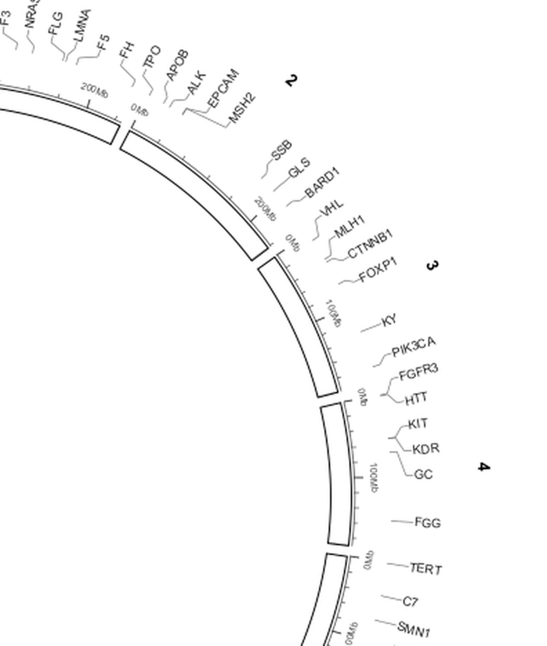
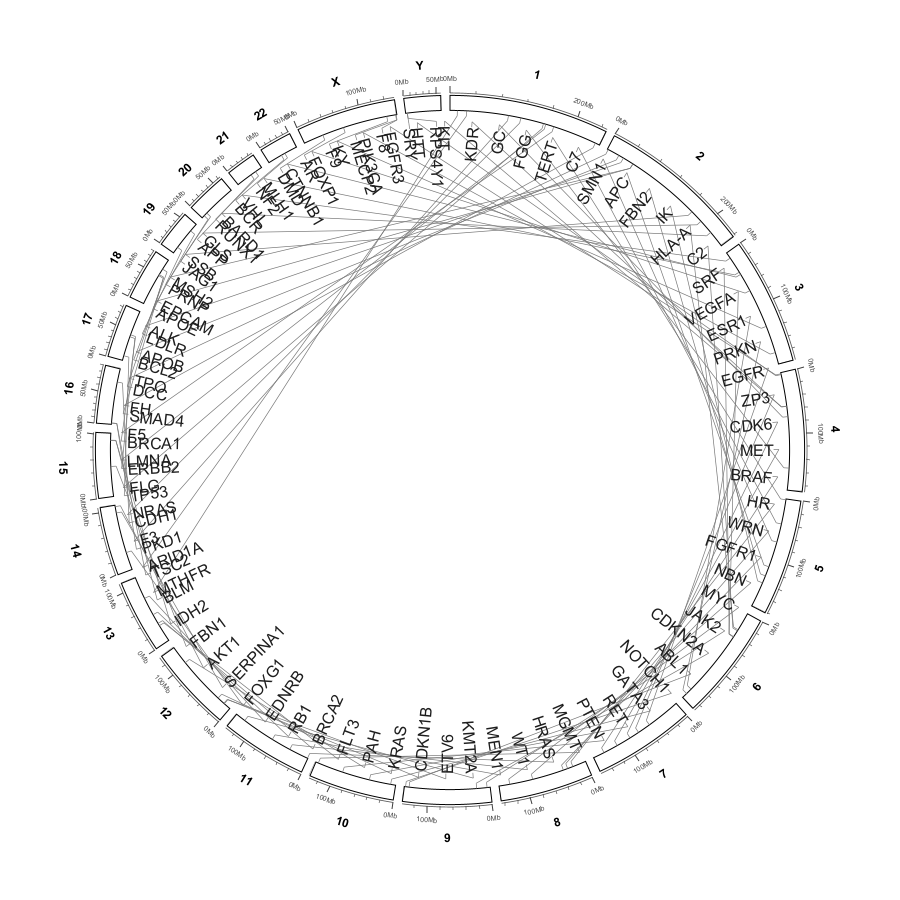

Labels layers: genomic label rings
==================================

A labels layer is created by ``Import ▾ → Labels  (BED + name column)…``
(see :doc:`circular_import`).  It reproduces the semantics of
``circos.genomicLabels`` from the circlize R package: radial gene names, a
position-transform comb to their genomic interval, and automatic fan-out where
names are dense.  Right-click the labels row in the Data Tracks column to open
its parameters.

.. important::

   There is **no leader-line style selector**.  When ``Show connector lines``
   is on, the connector is always the same four-segment comb used by the
   heatmap layer; there is no "elbow" mode and no "straight leader" mode.  The
   only control is on/off.  Earlier builds experimented with horizontal
   call-outs and straight leaders — that behaviour has been removed.

How a label is placed
---------------------

Three pieces of geometry work together.

**Radial text.**  Every name is drawn radially, pointing toward the centre of
the circle.  This is true for both the default *inside* placement and for
``Labels outside the ideogram`` — the outside mode does **not** switch back to
horizontal text.  ``Read labels toward the centre`` flips the text baseline so
that the name reads from the outside in (``1 → B``) instead of from the inside
out (``B → 1``).

**The comb stops at the name.**  The connector reuses the heatmap's four
segments — cap along the real interval, radial segment at the real midpoint,
diagonal to the equal-width slot, radial to the ring — but its final radius is
the **near end of the text**.  The layout stores each string's rendered length,
so the text centre is offset by half that length and the comb never runs
through the letters.

**``smartAlign`` for dense regions.**  When several names would overlap,
circlize groups consecutive overlapping extents into a cluster, then re-tiles
the cluster end to end around its midpoint so the names fan out in the
clockwise and counter-clockwise directions.  The clustering iterates until the
cluster count stabilises.  ``Label spacing…`` is the gap inserted between two
adjacent tiled names.

   The reference ``hg38_genes.bed`` labels layer.  Names are radial, sit inside
   the ideogram by default, and dense clusters are fanned out.

   Zoomed detail.  Each comb attaches to the end of its gene name that faces
   the ideogram; no line crosses the text.

Parameters
----------

.. list-table::
   :header-rows: 1
   :widths: 34 14 52

   * - Menu item
     - Default
     - What it controls
   * - ``Labels outside the ideogram``
     - off
     - ``off`` (default): the label ring is **inside** the ideogram.  ``on``:
       the labels and their combs grow outwards.  Text stays radial in both
       modes.
   * - ``Read labels toward the centre``
     - off
     - Flips the radial text baseline so the name reads from outside to inside.
       Default reads from the centre outwards.
   * - ``Show connector lines``
     - on
     - Draw the four-segment comb.  Off draws just the radial names.
   * - ``Bold labels``
     - off
     - Bold font weight.
   * - ``Font size… (<n> pt)``
     - ``9 pt``
     - Label font size in points; clamped to ``4 – 36``.
   * - ``Label colour…``
     - ``RGB(30, 30, 30)``
     - Text colour.
   * - ``Connector colour…``
     - ``RGB(120, 120, 120)``
     - Comb-line colour.  Heatmap combs, by contrast, are fixed dark black in
       the circlize style.
   * - ``Connector height… (<n> px)``
     - ``16 px``
     - Distance from the ideogram edge to the label ring; the comb lives in
       this gap.  Clamped to ``2 – 80``.
   * - ``Label height… (<n> px)``
     - ``40 px``
     - Radial room reserved for the label ring — circlize's
       ``labels_height``.  Clamped to ``10 – 160``.
   * - ``Label spacing… (<n> px)``
     - ``3 px``
     - Gap between two adjacent names when ``smartAlign`` tiles them end to
       end.  Clamped to ``0 – 30``.

.. tip::

   **Outside mode does not auto-avoid the axis tick text.**  This is
   intentional.  ``labelBaseRadius()`` returns the ideogram outer radius
   directly for outside labels, with no automatic clearance offset; the label
   ring starts immediately after the connector.  If outside names collide with
   the coordinate-axis numbers, raise ``Connector height…`` — it is the single
   manual knob for that clearance.  Alternatively switch tick labels to
   ``Inside (below the band)`` in :doc:`circular_view_options`.

Inside versus outside
---------------------

   ``Labels outside the ideogram`` on.  Labels remain radial and still point
   toward the centre; the ideogram radius shrinks to make room.

   Zoomed outside mode.  The comb now points outward, and the names are still
   radial rather than horizontal.

   ``Read labels toward the centre`` on: the radial text baseline is flipped
   relative to the default.

   Larger ``Font size…`` with ``Label height…`` increased to match.  Names that
   do not fit are tiled by ``smartAlign`` rather than dropped.

Full menu inventory
-------------------

In order, the labels layer context menu contains: ``Show labels``,
``Labels outside the ideogram``, ``Read labels toward the centre``,
``Show connector lines``, ``Bold labels``, ``Font size…``, ``Label colour…``,
``Connector colour…``, ``Connector height…``, ``Label height…``,
``Label spacing…``, and ``Remove labels from circular view…``.

How this differs from the heatmap menu
~~~~~~~~~~~~~~~~~~~~~~~~~~~~~~~~~~~~~~~

.. list-table::
   :header-rows: 1
   :widths: 32 34 34

   * - Concern
     - Heatmap layer
     - Labels layer
   * - Placement
     - ``Heatmap outside the ideogram``
     - ``Labels outside the ideogram``
   * - Connection track
     - ``Heatmap connection height…`` (px, min 0)
     - ``Connector height…`` (px, min 2)
   * - Ring thickness
     - ``Heatmap height…`` (px, min 8)
     - ``Label height…`` (px, min 10)
   * - Typography
     - none
     - ``Font size…``, ``Bold labels``, ``Read labels toward the centre``
   * - Colours
     - low / mid / high ramp + ``Show heatmap legend`` / ``Legend position``
     - ``Label colour…`` / ``Connector colour…`` (no legend)
   * - Spacing
     - none (cells are equal width)
     - ``Label spacing…`` (``smartAlign`` gap)
   * - Connectors
     - ``Show heatmap connectors``
     - ``Show connector lines``

Both layers share the same four-segment comb geometry; the labels version just
stops at the near end of the text.
