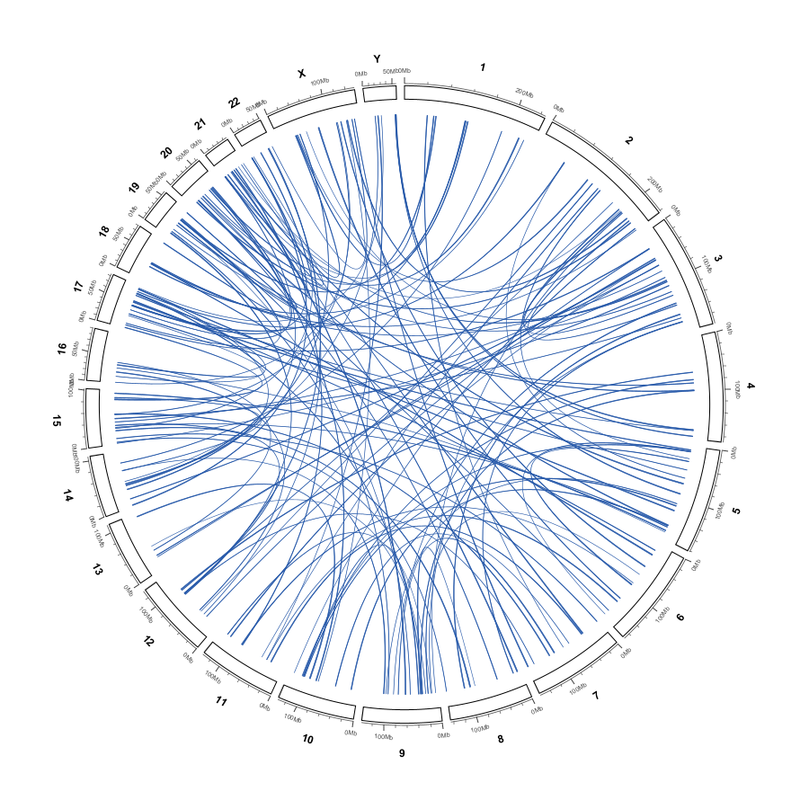
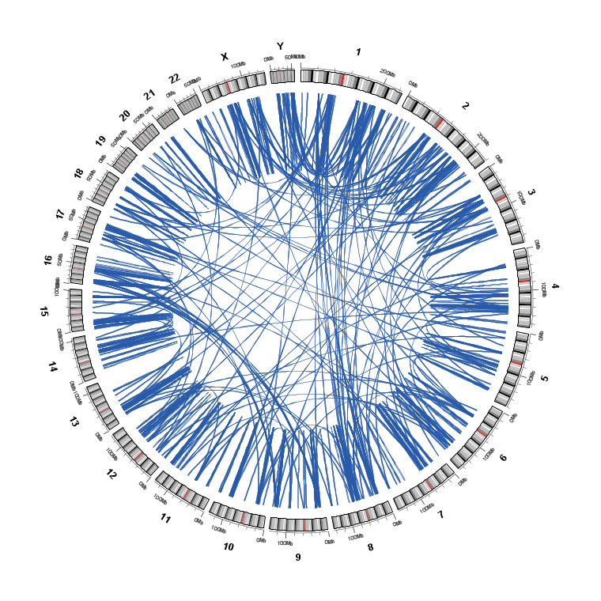
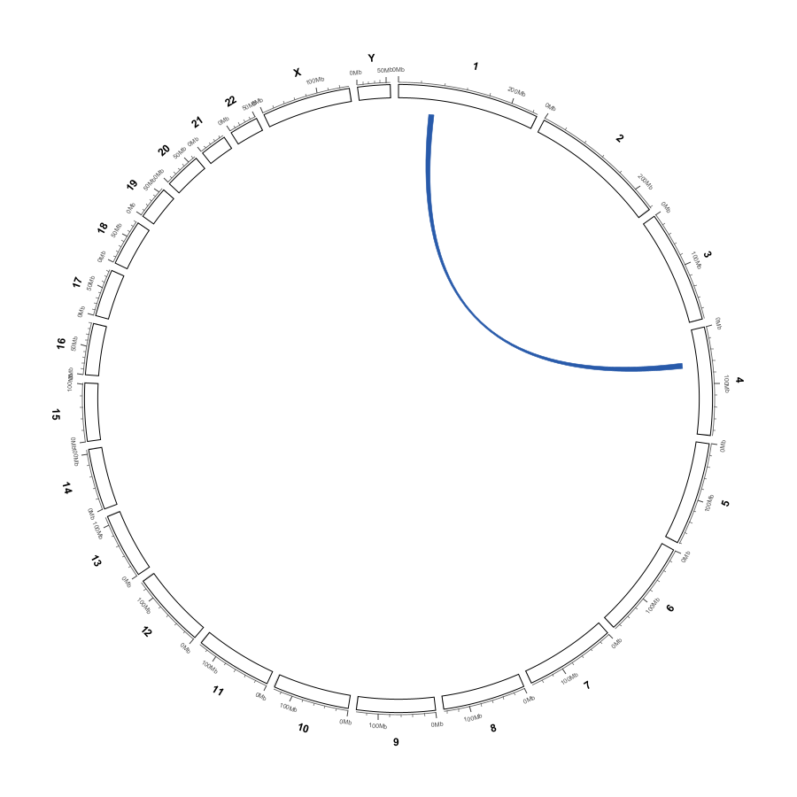
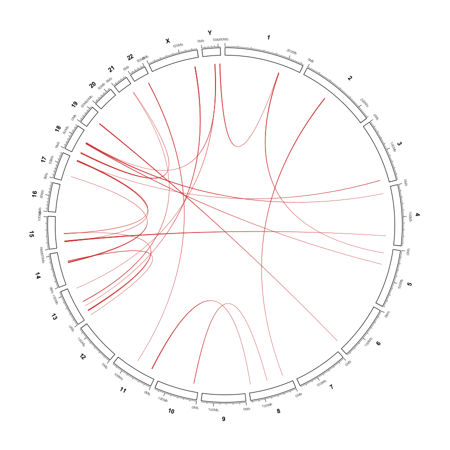
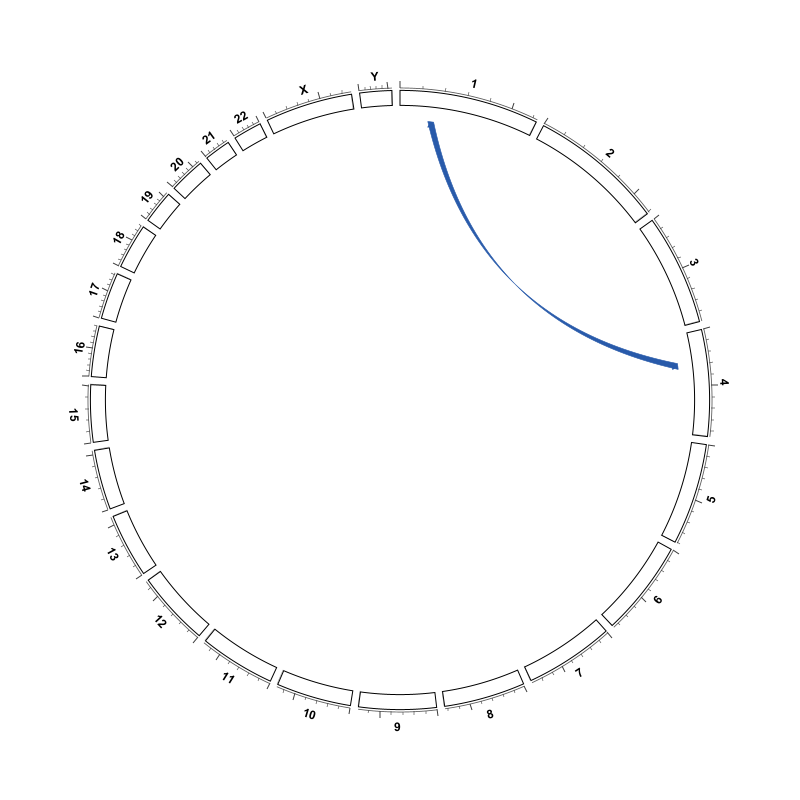
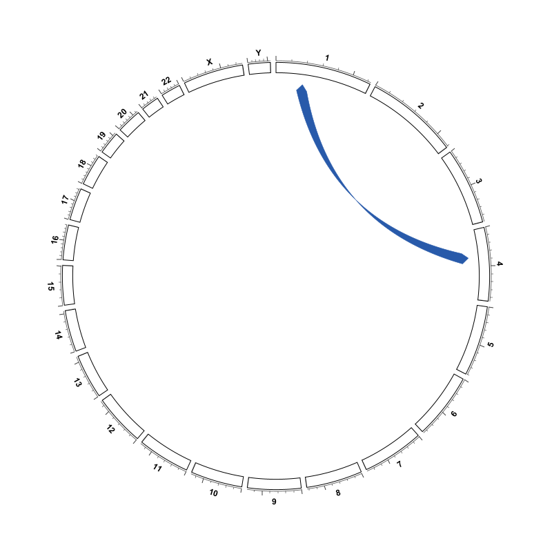
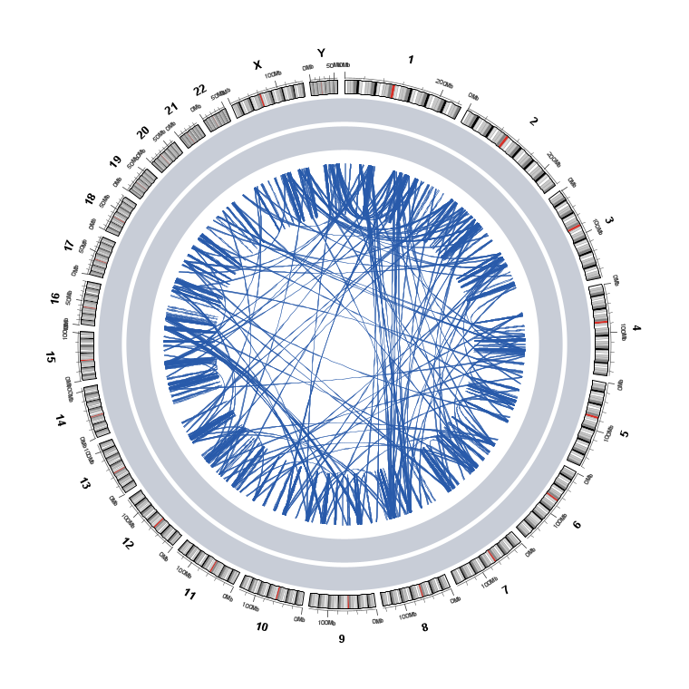

Links layers: ribbons and arrows
================================

A links layer is created by ``Import ▾ → Links  (BEDPE / Circos links)…``
(see :doc:`circular_import`).  Right-click its row in the Data Tracks column to
open its parameter menu.  The same styling menu is also reachable from the
``Links`` submenu of a normal interaction track loaded through
``File → Load from File...``.

.. note::

   These are *drawing* parameters for the ring.  They are not the arc-shape /
   arc-height settings of a linear BEDPE interaction track — those live in
   :doc:`desktop_extras`.

Visibility and geometry
-----------------------

.. list-table::
   :header-rows: 1
   :widths: 34 14 52

   * - Menu item
     - Default
     - What it controls
   * - ``Show links``
     - on
     - Master switch for all link layers in the figure.
   * - ``Draw inside data tracks``
     - on
     - Anchor links inside the stacked ring bands instead of on top of them.
       Turn it off when the bands are crowded and you want the links to pass in
       front of them.
   * - ``Ribbon (filled bands)``
     - on
     - Draw each link as a filled band (Circos ``ribbon=yes``) rather than a
       stroked curve.  Even when off, the other ribbon parameters below still
       govern the chord geometry.
   * - ``Twist ribbons``
     - off
     - Join the two ribbon edges the other way round — interval 1's start to
       interval 2's start instead of to its end (circlize ``inverse``).  The
       ribbon is still a smooth band; only which edges meet changes.  **Off by
       default**.
   * - ``Colour by chromosome``
     - off
     - Colour each link by its source chromosome instead of using one link
       colour.
   * - ``Colour…``
     - ``RGB(40, 90, 170)``
     - Single link colour when ``Colour by chromosome`` is off.
   * - ``Thickness… (<n> px)``
     - ``1.2 px``
     - Stroke width of non-ribbon links.  Values below ``0.1`` are clamped.

   ``Ribbon (filled bands)`` on: every link is a curved band that bows toward
   the centre and tapers at its ends, exactly like Circos ``ribbon=yes``.

   With ``Bezier radius (0-1)…`` set to ``0`` the same links become straight
   chords — the Circos ``bezier_radius=0`` behaviour.

Ribbon body
-----------

The ribbon is built the way circlize's ``circos.link`` builds it (see the
circlize R source, ``R/link.R``): the body is a polygon bounded by **two
independent quadratic Bézier edges** that bow toward the centre, closed by the
two **end arcs**.  Each end's width is the interval's own arc on the ring, so a
whole-genome BEDPE anchor (often only a few kilobases, hence sub-pixel on the
ring) tapers to a fine tip instead of a blunt stub, while a wide interval gives
a wide band.  The bow height follows circlize's automatic ``h``
(``h.ratio = 0.5``, ``w = 1``); two anchors on opposite sides of the ring draw a
near-straight chord through the centre.

.. list-table::
   :header-rows: 1
   :widths: 38 14 48

   * - Menu item
     - Default
     - What it controls
   * - ``End radius (0-1)…``
     - ``0.95``
     - Radial position of the link ends as a fraction of the ideogram inner
       radius.  Range ``0.05 – 1.0``.  Lower it to keep links clear of data
       rings.
   * - ``Bezier radius (0-1)…``
     - ``0.8``
     - Radial position of the Bezier control point of a **stroked** link
       (Circos ``bezier_radius``).  ``0`` draws a straight chord; ``1`` pushes
       the control point to the centre.  Range ``0 – 1``.  Filled ribbons use
       circlize's automatic bow height instead.
   * - ``Crest (0-1)…``
     - ``0.5``
     - Adds control points that make links meet the ideogram perpendicularly
       (Circos ``crest``).  ``0`` disables.  Range ``0 – 1``.
   * - ``Min ribbon width (deg)…``
     - ``1.2°``
     - Smallest angular width used when sizing a ribbon's **arrow head**.  The
       ribbon body now tapers to the true interval width, so this only keeps a
       tiny anchor's arrow from vanishing.  Minimum ``0``.
   * - ``Ribbon transparency (0 = solid)…``
     - ``0``
     - ``0`` is fully opaque; ``255`` is invisible.  Internally stored as an
       alpha of ``255 - value``.  Raise it to let overlapping ribbons show
       through.
   * - ``Outline ribbons``
     - on
     - Strokes the ribbon outline (Circos ``stroke_*``), which keeps a thin
       middle section readable.  Stroke thickness ``0.6 px``.
   * - ``Max links…``
     - ``5000``
     - Cap on links drawn per frame (Circos ``record_limit``).  Minimum ``1``.

An internal ``linkBezierPurity`` of ``1.0`` holds a **stroked** chord's control
point at the purely radial (angle-bisector) position; lower values tilt it
toward the Cartesian midpoint.  It has no menu item and does not affect filled
ribbons (those follow circlize's ``getQuadraticPoints`` geometry).

   A single interval-to-interval ribbon: two Bézier edges bowing toward the
   centre, closed by the two end arcs and tapering where the anchors are narrow.

   Mixed links where some ends are single points and others are intervals.
   ``Min ribbon width (deg)…`` keeps the point ends visible.

Arrows
------

The ``Arrows`` submenu adds directional heads.  This is a myIGV addition and is
**off by default**.

.. list-table::
   :header-rows: 1
   :widths: 34 16 50

   * - ``Arrows`` option
     - Value
     - Effect
   * - ``None``
     - ``0`` (default)
     - No arrow heads.
   * - ``Start (first interval)``
     - ``1``
     - An arrow head at the first BEDPE interval.
   * - ``End (second interval)``
     - ``2``
     - An arrow head at the second BEDPE interval.
   * - ``Both ends``
     - ``3``
     - Arrow heads at both intervals.

.. important::

   **The arrow shape depends on the interval width.**  An end is treated as a
   *point* when ``end - start <= 1`` bp; otherwise it is an *interval*.

   * A **point** end gets a thin arrow head — the circlize-style narrow
     triangle.
   * An **interval** end gets a **band arrow**: the ribbon polygon's edges stop
     at ``rou - arr.length`` and then close onto the arc midpoint, so the band
     body itself tapers into the head (the ``arr.type = "big.arrow"`` /
     ``arc.midpoint`` construction from ``R/link.R``).  It is *not* a small
     triangle glued to the outside of a ribbon.

.. list-table::
   :header-rows: 1
   :widths: 36 14 50

   * - Menu item
     - Default
     - What it controls
   * - ``Arrow length… (<n> px)``
     - ``9 px``
     - Length of the head in pixels; clamped to ``3 – 80``.
   * - ``Arrow width… (<n>x band)``
     - ``1.7x``
     - Base width of the head as a multiple of the band width; clamped to
       ``1.0 – 4.0``.

   ``Arrows → Both ends`` with **point** anchors (``end - start <= 1``): thin
   arrow heads at both ends.

   ``Arrows → Both ends`` with **interval** anchors: the ribbon body itself
   closes into the band arrow heads.

Other appearance
----------------

.. list-table::
   :header-rows: 1
   :widths: 38 14 48

   * - Menu item
     - Default
     - What it controls
   * - ``Transparency (0 = solid)…``
     - ``0``
     - Transparency of stroked (non-ribbon) links.  ``0`` solid, ``255``
       invisible.  Stored as ``255 - value``.
   * - ``Show this links layer``
     - on
     - Visibility checkbox at the top of this layer's context menu, from
       :doc:`circular_data_tracks`.
   * - ``Remove links from circular view…``
     - —
     - Deletes this layer entirely.

   ``Draw inside data tracks`` on: link ends sit inside the band stack rather
   than on top of it.

.. tip::

   For a dense whole-genome figure, start with ``Ribbon transparency`` around
   ``60 – 100`` and ``Max links…`` around ``2000``.  Both changes are instant;
   neither requires re-importing the file.
