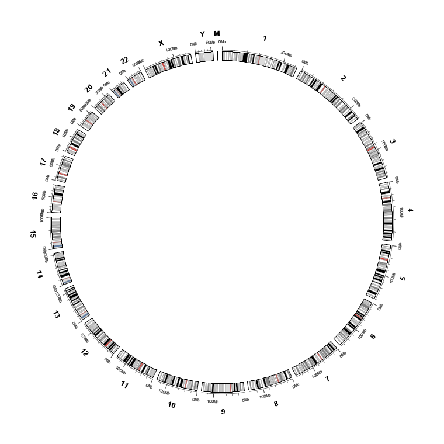
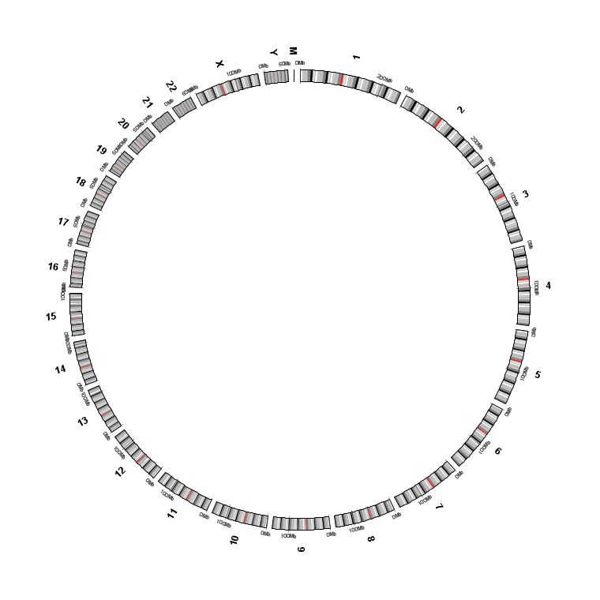
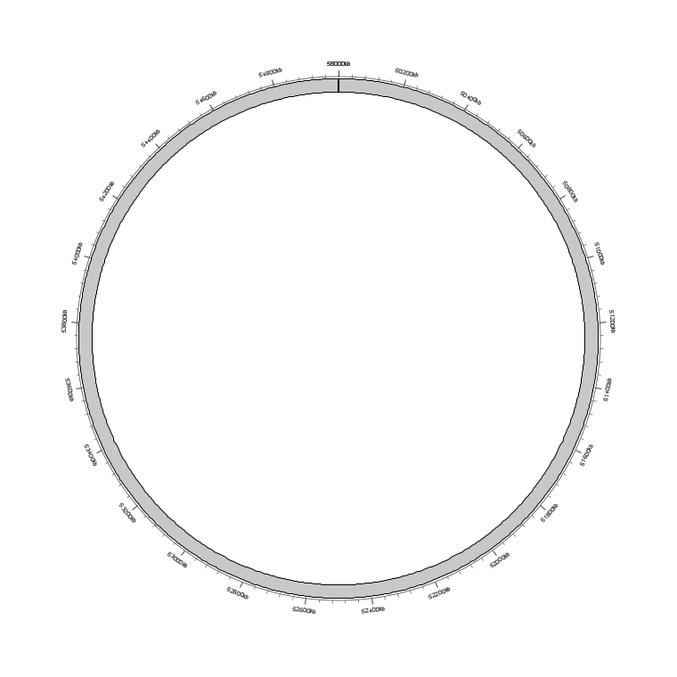
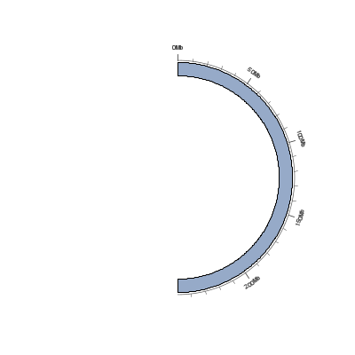
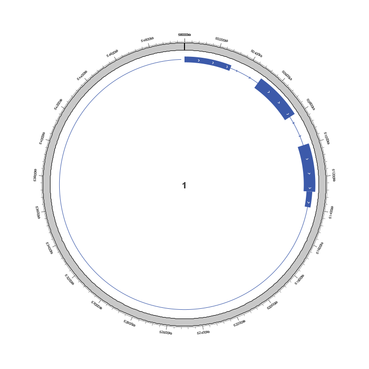
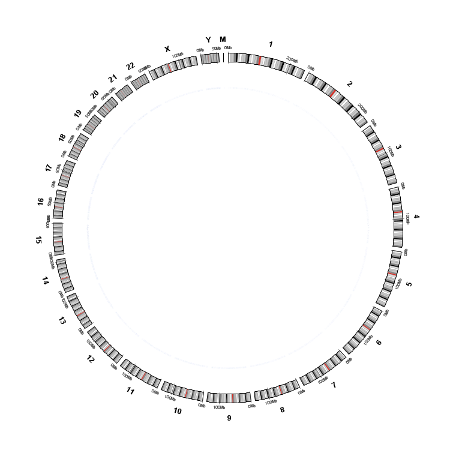

Circular View: overview
=======================

Upstream IGV 2.19.8 has no circlize-style whole-genome composition tooling.
myIGV adds a **Circular View** that draws the genome as a ring and stacks data
as concentric bands, plus links, a genomic heatmap, labelled gene rings, Hi-C
contact matrices and publication-quality export.

This chapter gives the layout and the vocabulary used by the following
chapters.  For every individual parameter, see :doc:`parameter_reference`.

The toolbar
-----------

The top of the Circular View has exactly three dropdown buttons, in this
left-to-right order:

.. list-table::
   :header-rows: 1
   :widths: 22 78

   * - Button
     - Purpose
   * - ``Import ▾``
     - **First button.** Loads Links, Heatmap, Labels, Points, Lines,
       Histogram and Rectangles files as circular-only layers (multi-select).
       See :doc:`circular_import`.
   * - ``View options ▾``
     - Axis, ticks, chromosome ring, arc span, and ``All settings…``. See
       :doc:`circular_view_options`.
   * - ``Export ▾``
     - ``Export PNG…`` / ``Export SVG…`` / ``Export PDF…``. See
       :doc:`circular_export`.

.. note::

   ``Import ▾`` deliberately comes first.  Importing and styling the three
   circular-only layer types used to be buried inside a ``Links`` submenu under
   ``View options``; they are now separate.  ``View options`` contains **no**
   Links submenu any more.

The Import dropdown ends with a disabled (greyed-out) hint that states the key
contract: ``Imported data is drawn in the circular view only``.

Showing the ring: the View menu
--------------------------------

The main window's ``View`` menu offers three **mutually exclusive** modes:

.. list-table::
   :header-rows: 1
   :widths: 40 60

   * - Menu item
     - Effect
   * - ``Horizontal View``
     - Horizontal (linear) view only; the circular view is hidden.
   * - ``Circular View``
     - Circular view only; the horizontal view is hidden.
   * - ``Both (Horizontal + Circular)``
     - Side-by-side split: the horizontal view on the left, the circular view
       on the right.

Selecting ``Horizontal View`` or ``Circular View`` turns the other view off, so
both are only visible together when ``Both`` is selected.

Anatomy of the figure
---------------------

Reading from the outside in:

#. **Heatmap and label rings (optional, outermost when outside mode is on).**
   ``Heatmap outside the ideogram`` grows outward and shrinks the ideogram
   radius to guarantee a radial slot for the band and its comb.
   ``Labels outside the ideogram`` also grows outward, but leaves the ideogram
   radius, chromosome names and coordinate axis untouched — position it with
   ``Connector height…``.
#. **Coordinate axis and tick labels.**  Major/minor ticks, Mb labels, and
   chromosome names.  Tick labels can sit outside (``Outside (above the band)``,
   default) or inside (``Inside (below the band)``).
#. **Ideogram / chromosome ring.**  Karyotype cytoband stripes (or a solid
   colour), separated by ``Gap between chromosomes (°)``.
#. **Data bands.**  Loaded feature, data, gene and Hi-C tracks, and the heatmap
   when it is inside.  The radial order is the Data Tracks column order.
#. **Links.**  Bezier ribbons or chords drawn in the empty centre.

   A full ``All``-chromosome ring: cytoband ideogram, outside coordinate axis
   with tick labels, chromosome names and one or more stacked data bands.

   The same ring with ``Number orientation → Radial`` instead of the default
   ``Tangential``.

Display modes
-------------

**All chromosomes** shows the whole genome.  ``Chromosomes to show (All mode)…``
opens a checkbox dialog to restrict the sectors.

**Single chromosome / gene-list mode** shows one chromosome or one gene-list
facet.  ``Single-chromosome arc`` controls how much of the circle the sector
occupies and ``Single-chromosome arc start`` controls where position 0 sits:

.. list-table::
   :header-rows: 1
   :widths: 36 64

   * - Control
     - Values
   * - ``Single-chromosome arc``
     - ``360°  (1.00)`` (default), ``270°  (0.75)``, ``180°  (0.50)``,
       ``120°  (0.33)``, ``90°  (0.25)``, or ``Custom (0–1)…``.
   * - ``Single-chromosome arc start``
     - ``Top  (0°)`` (default), ``Right  (90°)``, ``Bottom  (180°)``,
       ``Left  (270°)``, or ``Custom (degrees)…``.

   A partial single-chromosome arc.  ``Custom (0–1)…`` accepts any fraction
   in ``(0, 1]``.

   ``Single-chromosome arc → 180°  (0.50)`` with the default ``Top`` start.

Gene models on the ring
-----------------------

Gene/feature tracks are not drawn as flat bars.  The ring renderer draws the
intron spine, thick CDS blocks, thin UTR blocks and IGV-style strand chevrons
along the coding direction, scaled to the band thickness.

   A zoomed gene band: thin UTR blocks, thick CDS blocks and direction
   chevrons on the intron lines.

   Gene models distributed around the full ring.

.. tip::

   ``Show coordinate axis``, ``Show tick marks``, ``Show tick labels`` and
   ``Show chromosome labels`` are independent switches.  Turning all four off
   gives a clean ideogram-only figure for presentations — see
   ``circular_axis_off.png`` in :doc:`screenshots`.

Where to go next
----------------

* :doc:`circular_import` — file formats and the circular-only layer contract.
* :doc:`circular_data_tracks` — row order, drag-to-reorder, delete and
  per-layer context menus.
* :doc:`circular_view_options` — every axis and ring setting.
