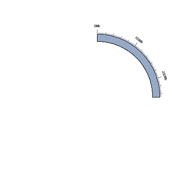
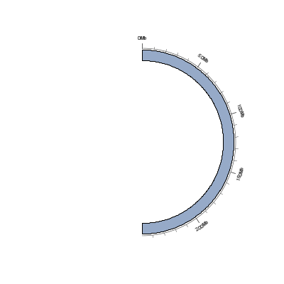
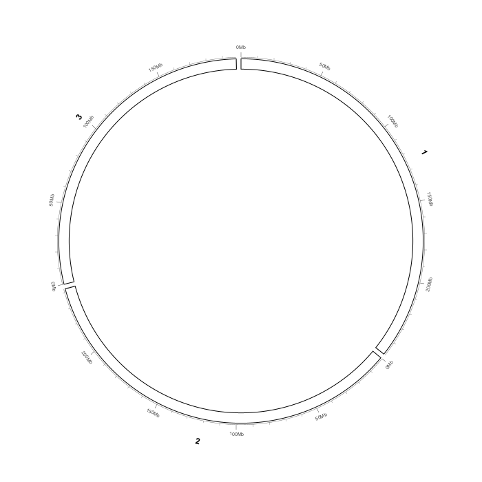
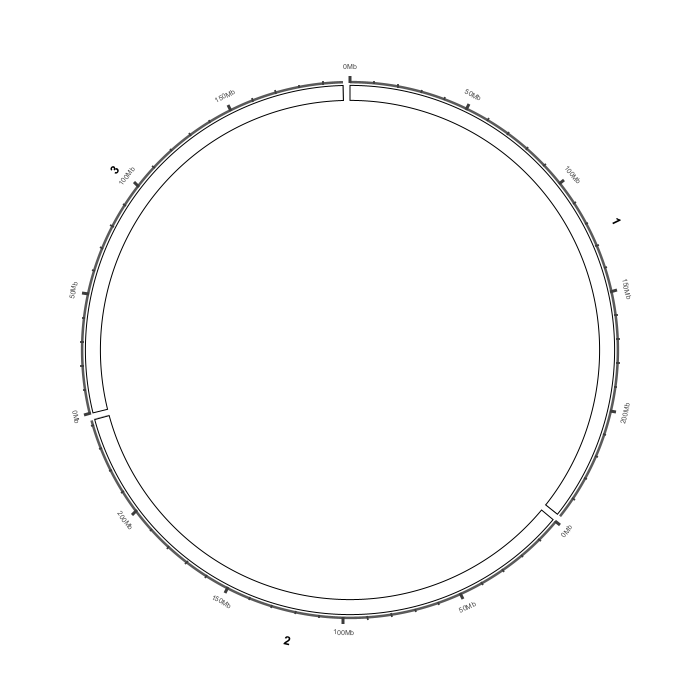
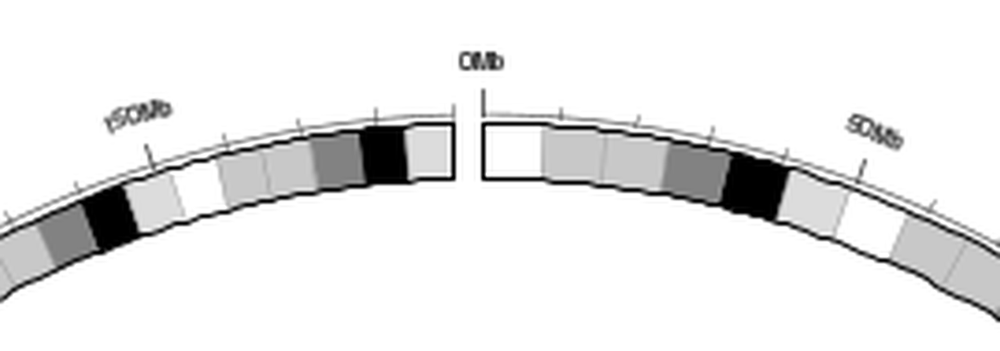
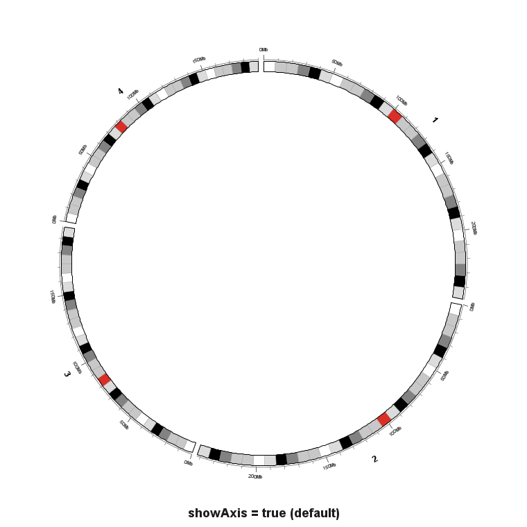
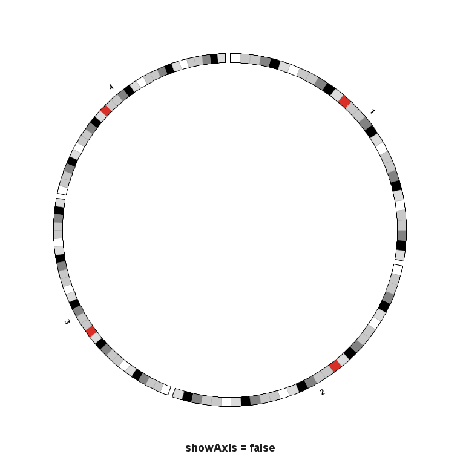
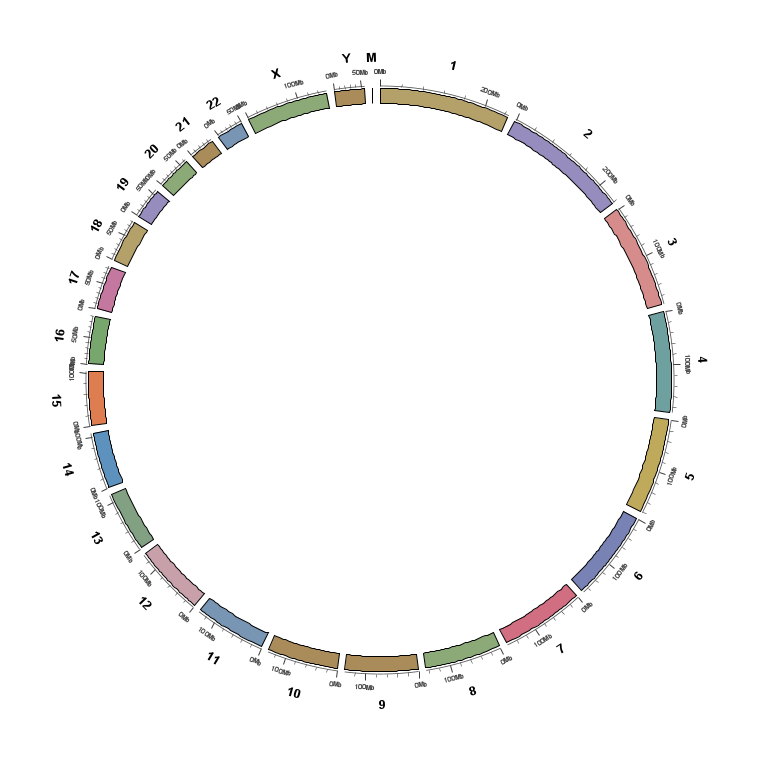
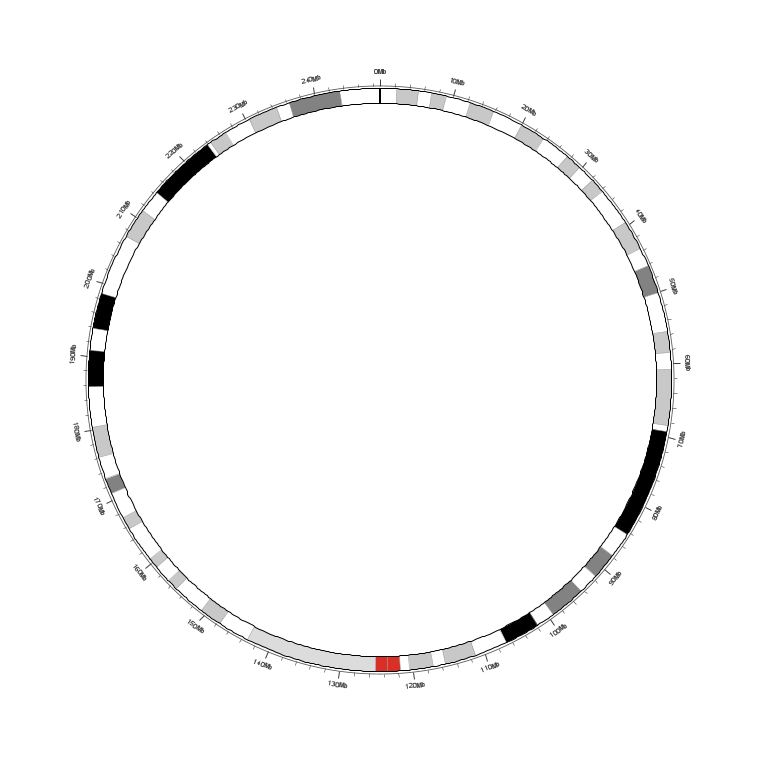

View options: axis, ring and layout
===================================

``View options ▾`` is the second button in the Circular View toolbar.  It holds
all axis, tick, chromosome-ring and arc-span settings.  The old ``Links``
submenu was removed from here; link and heatmap parameters now live on their
layer rows (see :doc:`circular_data_tracks`).

.. note::

   ``Import ▾`` is the **first** toolbar button, ``View options ▾`` the second,
   ``Export ▾`` the third.

Menu inventory
--------------

In source order, the dropdown contains:

.. list-table::
   :header-rows: 1
   :widths: 38 14 48

   * - Item
     - Default
     - What it controls
   * - ``Show coordinate axis``
     - on
     - Master switch for the baseline arc, major/minor ticks and their labels.
   * - ``Show tick marks``
     - on
     - Major and minor tick marks.
   * - ``Show tick labels``
     - on
     - Mb numbers at major ticks.
   * - ``Show chromosome labels``
     - on
     - Chromosome names around the ring.
   * - ``Chromosomes to show (All mode)…``
     - —
     - Checkbox dialog (``All`` / ``None`` / ``OK`` / ``Cancel``) that restricts
       which sectors appear in ``All`` mode.  An empty selection means all.
   * - ``Single-chromosome arc``
     - ``360°``
     - How much of the circle a single-chromosome sector occupies.
   * - ``Single-chromosome arc start``
     - ``Top``
     - Where position 0 sits, in degrees clockwise from the top.
   * - ``Tick labels position``
     - ``Outside``
     - ``Outside (above the band)`` / ``Inside (below the band)``.
   * - ``Number orientation``
     - ``Tangential``
     - ``Tangential`` / ``Radial`` for the Mb numbers.
   * - ``Multi-sample Y axis``
     - ``Per sample``
     - ``Per sample (default)`` / ``Shared (group)``.  Shared forces all data
       bands to use one Y range.
   * - ``Tick spacing (Mb)…``
     - ``0`` (auto)
     - Spacing in Mb; ``0`` gives roughly three ticks per chromosome.
   * - ``Tick label size…``
     - ``7``
     - Font size of the Mb numbers.
   * - ``Axis line thickness… (<n> px)``
     - ``1.00 px``
     - Stroke width of the axis.  See the dedicated section below.
   * - ``Chromosome label size…``
     - ``12``
     - Font size of chromosome names.
   * - ``Chromosome height (px)…``
     - ``15 px``
     - Radial thickness of the ideogram ring; minimum ``8``.
   * - ``Solid chromosome colour (override karyotype)``
     - off
     - Fill every chromosome with one colour instead of cytoband stripes.
   * - ``Chromosome colour…``
     - ``RGB(93, 145, 190)``
     - Picks the solid colour and automatically turns the override on.
   * - ``Reset zoom``
     - —
     - Returns the ring to its default zoom.
   * - ``All settings…``
     - —
     - Opens the ``Circular View Settings`` dialog described below.

.. warning::

   The ``Solid chromosome colour (override karyotype)`` item and the
   ``Chromosome colour…`` dialog both write the same flag: choosing a colour
   also sets the override to on.  To see cytobands again, uncheck the override.

Single-chromosome arc
---------------------

.. list-table::
   :header-rows: 1
   :widths: 36 64

   * - Submenu
     - Options
   * - ``Single-chromosome arc``
     - ``360°  (1.00)`` (default), ``270°  (0.75)``, ``180°  (0.50)``,
       ``120°  (0.33)``, ``90°  (0.25)``, ``Custom (0–1)…``.  Custom accepts
       any value in ``(0, 1]``.
   * - ``Single-chromosome arc start``
     - ``Top  (0°)`` (default), ``Right  (90°)``, ``Bottom  (180°)``,
       ``Left  (270°)``, ``Custom (degrees)…``.  Custom degrees are normalised
       into ``[0, 360)``.

   ``Single-chromosome arc → 90°  (0.25)``.

   ``Single-chromosome arc → 180°  (0.50)``.

Axis line thickness
-------------------

``Axis line thickness…`` is a myIGV addition.  It accepts ``0.25 – 6.0`` px
(clamped silently in the menu, bounded by the spinner in ``All settings…``).

* The **baseline arc** and **major ticks** use the value directly.
* **Minor ticks** use ``0.6 ×`` the value.
* The baseline's secondary thickness uses ``0.85 ×`` the value.

When tick labels are placed **inside**, ``insideLabelClearance()`` and
``bandStartRadius()`` reserve radial room for the text so the innermost data
band cannot overlap the numbers.  A thicker axis adds an extra ``axisPad`` to
that clearance.

   ``Axis line thickness… = 0.50 px`` — hairline axis.

   ``Axis line thickness… = 3.00 px``.  The baseline, major ticks and minor
   ticks all thicken, and inside labels are pushed further out.

   Zoomed detail of major ticks, the five minor ticks between them
   (``Minor ticks per major (0 = off)`` = ``5``), and Mb labels.

Axis on / off
-------------

   ``Show coordinate axis`` on (default).

   All four visibility switches off — a clean ideogram-only figure.

``All settings…`` — effects on the rendering
--------------------------------------------------

``All settings…`` opens a modal dialog titled ``Circular View Settings`` with
``OK`` / ``Cancel``.  It exposes the same values with bounded spinners, which is
safer than the free-text menu dialogs.  The captures in this section show the
**rendered effect** of those settings on the ring; this guide does not include
a screenshot of the dialog itself.

.. list-table::
   :header-rows: 1
   :widths: 40 18 18 24

   * - Row label (verbatim)
     - Default
     - Min
     - Max / step
   * - ``Show coordinate axis`` (checkbox)
     - on
     - —
     - —
   * - ``Show tick marks`` (checkbox)
     - on
     - —
     - —
   * - ``Show tick labels`` (checkbox)
     - on
     - —
     - —
   * - ``Show chromosome labels`` (checkbox)
     - on
     - —
     - —
   * - ``Tick label position:``
     - Outside
     - —
     - ``Outside (above the band)`` / ``Inside (below the band)``
   * - ``Tick spacing (Mb, 0 = auto):``
     - ``0.0``
     - ``0.0``
     - ``5000.0`` / step ``10.0``
   * - ``Minor ticks per major (0 = off):``
     - ``5``
     - ``0``
     - ``20`` / step ``1``
   * - ``Axis line thickness (px):``
     - ``1.00``
     - ``0.25``
     - ``6.0`` / step ``0.25``
   * - ``Tick label size:``
     - ``7``
     - ``4``
     - ``24`` / step ``1``
   * - ``Chromosome label size:``
     - ``12``
     - ``6``
     - ``30`` / step ``1``
   * - ``Chromosome height (px):``
     - ``15``
     - ``8``
     - ``220`` / step ``2``
   * - ``Chromosome number orientation:``
     - Tangential
     - —
     - ``Tangential`` / ``Radial``
   * - ``Band inner radius (0–1):``
     - ``0.78``
     - ``0.40``
     - ``0.85`` / step ``0.01``
   * - ``Band outer radius (0–1):``
     - ``0.90``
     - ``0.60``
     - ``0.99`` / step ``0.01``
   * - ``Gap between chromosomes (°):``
     - ``1.5``
     - ``0.0``
     - ``8.0`` / step ``0.1``

If ``Band inner radius`` ends up greater than or equal to ``Band outer
radius``, the dialog silently raises the outer value to
``min(0.99, inner + 0.05)``.

   ``Solid chromosome colour (override karyotype)`` on: no cytoband stripes.

   Cytoband stripes on a single-chromosome arc, with the override off.

.. tip::

   ``Band inner radius`` / ``Band outer radius`` / ``Gap between chromosomes``
   are only available in ``All settings…``; they have no separate toolbar menu
   items.
