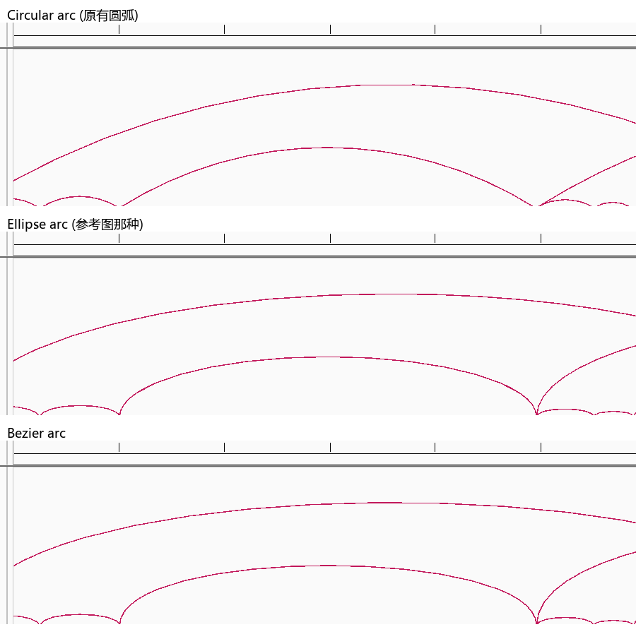
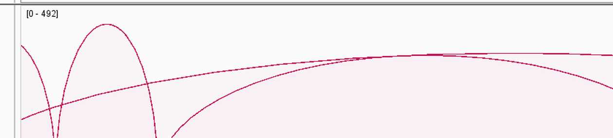

Additional desktop features
===========================

This chapter collects three myIGV additions that do not belong to the Hi-C or
Circular View chapters: switchable transcript labels, BEDPE interaction arcs,
and remote SSH/SFTP file browsing.  All of them are absent from upstream IGV
2.19.8 in the form described here.

Switchable transcript labels
----------------------------

In upstream IGV, an **Expanded** gene track labels every transcript row with
the *gene* name, so the individual isoforms cannot be told apart.  myIGV adds a
``Transcript label`` submenu to the track's right-click menu.

.. list-table::
   :header-rows: 1
   :widths: 32 15 53

   * - Option
     - Default
     - What it shows on each transcript row
   * - ``Gene name``
     - yes
     - The gene name (``HESX1``). This is the upstream IGV behaviour.
   * - ``Transcript ID (accession)``
     - no
     - RefSeq ``NM_`` / ``NR_`` accessions; for GTF, ``transcript_id`` such as
       ``ENST00000382410.4``.
   * - ``Transcript name (readable)``
     - no
     - ``transcript_name`` (for example ``HESX1-201``), falling back to the
       accession when that attribute is missing.
   * - ``Gene + ID``
     - no
     - Both, formatted as ``HESX1 (NM_003865.3)``.
   * - ``Custom field...``
     - no
     - Any attribute name present in the file, e.g. ``gene_id``.

The selection applies to the **current track only** and is saved with the
session.  ``Use for new annotation tracks`` promotes the current choice to the
global default for annotation tracks opened afterwards; right-clicking a track
and choosing ``Gene name`` overrides that default locally.

.. note::

   Long accessions (``ENST00000382410.4``) may not fit on a narrow transcript.
   The renderer skips labels that do not fit — this is expected, not a bug.
   Zoom in to see them.

BEDPE interaction (loops / arcs) tracks
---------------------------------------

A ``.bedpe`` file loads as an interaction track for pairwise chromatin
contacts such as loops.  myIGV extends the upstream implementation:

.. list-table::
   :header-rows: 1
   :widths: 30 20 50

   * - Control
     - Default
     - Meaning
   * - ``Nested Arcs``
     - on
     - Arc height follows the genomic span, so short arcs nest inside long
       ones.  This is now the unconditional default: myIGV no longer reads a
       global preference or guesses from the ``10x`` file type, so a previous
       session cannot pollute a newly loaded track.
   * - ``Proportional Arcs``
     - off
     - Arc height is driven by a numeric column instead of the span.
   * - ``Value Column (Proportional Arcs)``
     - ``score``
     - Menu lists every column that parses as a number.  ``Autoscale`` and
       ``Set Max Score`` renormalise against the chosen column.  The choice is
       saved in the session.
   * - ``Arc shape → Circular arc``
     - on
     - Circular arc, the classic IGV shape.  Ends meet the baseline at an
       angle.  In proportional mode the height is clamped to a semicircle so
       tall arcs cannot wrap into a self-crossing near-circle.
   * - ``Arc shape → Ellipse arc``
     - off
     - Half ellipse: ends drop vertically onto the baseline, the top is round.
       This is the shape used in most HiCExplorer / pyGenomeTracks figures.
   * - ``Arc shape → Bezier arc``
     - off
     - Cubic Bezier with control points at 4/3 of the height; flatter top,
       easier to read when many arcs overlap.
   * - ``Arc direction``
     - up
     - Draw arcs above or below the baseline.
   * - ``Set Arc Color...``
     - —
     - One colour for all arcs, taking priority over a per-record ``color``
       column.
   * - ``Reset Arc Colors To File``
     - —
     - Restores the per-record colours from the ``color`` column.
   * - ``Set Track Color...``
     - removed
     - Was misleading because a ``color`` column always won.  Removed from arc
       tracks; use ``Set Arc Color...`` instead.

All three shapes share the same apex height in nested mode — only the curvature
changes.  In proportional mode, ``Ellipse arc`` most closely resembles a
published loop track.  Each BEDPE file becomes its own track and keeps its own
arc mode, shape and colour settings independently (session attribute
``arcStyle``, default ``Circular arc``).

   Three stacked loop tracks comparing the circular, ellipse and Bézier arc
   shapes.  The two parenthetical notes inside the panels are in Chinese (left
   over from the verification script); the three shapes correspond to the
   ``Circular arc`` / ``Ellipse arc`` / ``Bezier arc`` menu entries.

   ``Proportional Arcs`` with ``Ellipse arc``: arc height now comes from the
   selected value column rather than from genomic span.

File-format tolerance
~~~~~~~~~~~~~~~~~~~~~

Two parser additions matter in practice:

* **UTF-16LE / UTF-16BE with BOM** is accepted.  Windows PowerShell's
  ``Out-File`` writes UTF-16LE by default, and upstream IGV would fail on such
  a file.  ``BedPEParser`` detects UTF-8 / UTF-16LE / UTF-16BE from the BOM.
* **Minimal 6-column BEDPE** — ``chrom1  start1  end1  chrom2  start2  end2``
  — is accepted; all optional columns (``name``, ``score``, ``strand1``,
  ``strand2``, ``color``, ...) may be omitted.

.. tip::

   The same BOM-tolerant parser is reused by ``Import ▾ → Links`` in the
   Circular View, so a UTF-16 BEDPE file works in both places.  See
   :doc:`circular_import`.

SSH / SFTP remote data
----------------------

myIGV can connect to an SSH server, browse its directories and read tracks
directly over SFTP — no manual download first.

.. list-table::
   :header-rows: 1
   :widths: 32 68

   * - Step
     - What to do
   * - Open the dialog
     - ``File → Load from SSH Server...`` (keyboard shortcut ``H``).
   * - Connect
     - Pick a server from ``Saved``, or fill ``Host`` / ``Port`` / ``User`` /
       ``Password`` and click ``Test connection``.  A successful test opens the
       remote file browser.
   * - Browse
     - ``Up`` goes to the parent directory; double-click a directory to enter
       it.
   * - Load
     - Select one or more files and click ``Open``.  They load as normal tracks.

Reading uses SFTP random access, so formats that need seeking work — BAM,
CRAM, bigWig, and Hi-C ``.cool`` / ``.mcool`` / ``.hic`` among them.

**Credentials.**  Connection details are stored in ``ssh-servers.json`` inside
the myIGV data directory.  Passwords are encrypted with OS-level facilities
(Windows DPAPI, macOS Keychain) and are never written in plain text.

**Proxy behaviour.**  SSH connections are made explicitly direct, so an enabled
system proxy or VPN cannot hijack the handshake (this fixes
``connection is closed by foreign host`` under
``-Djava.net.useSystemProxies=true``).  If you genuinely need a proxy, add
``-Dmyigv.ssh.useSystemProxy=true`` at startup.

Related pages
-------------

* :doc:`hic` — TAD overlays that also consume BED files.
* :doc:`circular_import` — links files that use the BEDPE parser.
* :doc:`view_interactions` — zoom and axis behaviour in the linear view.
