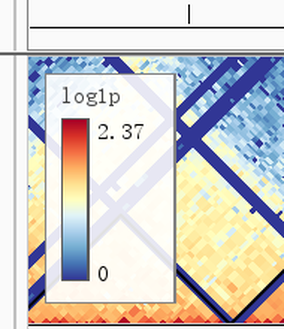
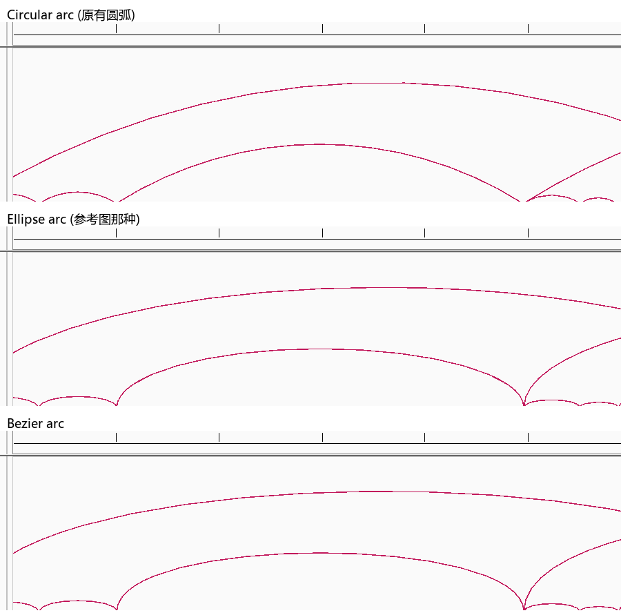
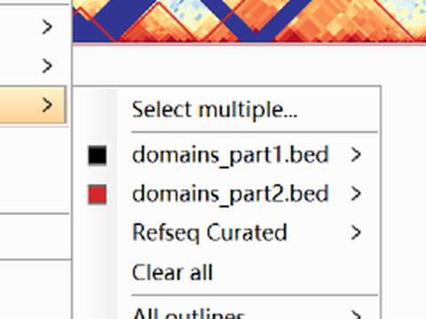
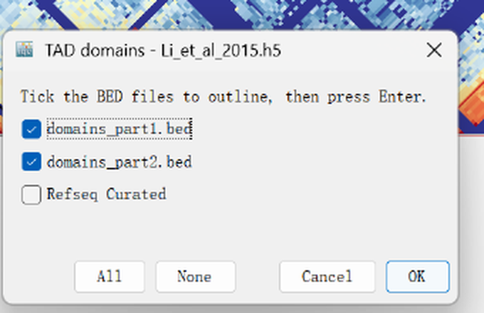
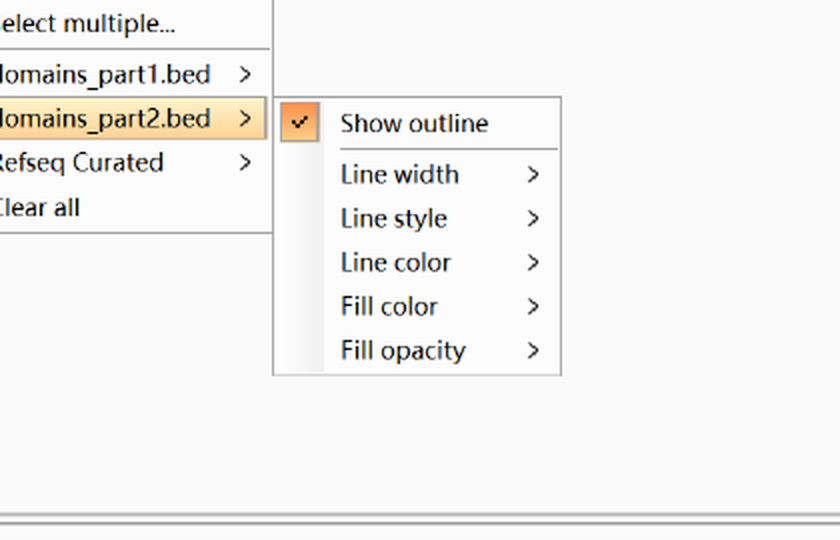

============================
Hi-C contact matrix tracks
============================

``myIGV`` can load and display Hi-C contact matrices directly, following the
``hic_matrix`` / ``hic_matrix_square`` implementations of
`pyGenomeTracks <https://github.com/deeptools/pyGenomeTracks>`_. This is a
substantial addition: upstream IGV 2.19.8 has no native Hi-C heatmap track.
Everything runs inside Java — there is **no Python dependency and no native
library** to install.

.. note::

   For Hi-C rendered **inside the circular view**, see :doc:`circular_hic`.
   This page covers Hi-C as a regular linear track.

Supported formats
-----------------

.. list-table:: Supported Hi-C file formats
   :header-rows: 1
   :widths: 22 18 60

   * - Option
     - Values
     - What it does
   * - HiCExplorer
     - ``.h5``
     - HDF5 layout produced by HiCExplorer / hicexplorer, with chunks
       compressed by PyTables + blosc.
   * - cooler (single)
     - ``.cool``
     - A single-resolution cooler file.
   * - cooler (multi)
     - ``.mcool``
     - Every resolution stored in the file is usable. ``Hi-C display →
       Resolution`` lists all of them, starts from the resolution closest to
       10 kb, and switches automatically with the viewport; visited
       resolutions are cached in memory.
   * - Juicer
     - ``.hic``
     - The Aiden Lab format. Blocks are read **on demand** (the whole, often
       hundreds-of-MB file is never loaded into memory). Multiple resolutions
       in one file are switched automatically according to the viewport.
   * - gzip-wrapped
     - ``.cool.gz`` / ``.h5.gz``
     - On first load the file is decompressed into the same directory; the
       decompressed copy is reused on later loads.

Pure-Java HDF5 and blosc
------------------------

HDF5 is read through the pure-Java ``io.jhdf`` library. HiCExplorer stores its
chunks with blosc compression (PyTables ``complib='blosc'``), which ``jhdf``
does not support natively. ``myIGV`` therefore includes a decoder ported from
**c-blosc 1.21.6** — ``BloscFilter``, registered as HDF5 **filter id 32001** —
that supports **blosclz + byte-shuffle**. No Python, no HDF5 native library, and
no blosc shared object are needed at run time.

Display geometry: triangle vs square
------------------------------------

``Hi-C display`` switches between two representations:

* **Triangle** — the matrix is rotated 45°. The x-axis is the **midpoint of the
  two anchors**, and the y-axis is the **distance between them**. The mapping
  keeps a strict 45° geometry: the vertical bp-per-pixel is **2× the
  horizontal** (because after rotation the separation spans twice the
  horizontal distance), so every contact cell is an equal-width/equal-height
  diamond — a square rotated by 45°. Leaving ``depth`` blank fills the track
  height automatically, and the shape never distorts at any zoom level.
* **Square** — both axes are genome coordinates with the diagonal running from
  upper-left to lower-right. The matrix always fills the window width and stays
  aligned with the chromosome ruler above.

.. list-table:: Triangle and square geometry options
   :header-rows: 1
   :widths: 26 16 16 42

   * - Option
     - Values
     - Default
     - What it does
   * - ``Hi-C display`` (triangle / square)
     - ``Triangle`` / ``Square``
     - ``Triangle``
     - Chooses the 45°-rotated triangle or the two-genome-axis square view.
   * - ``Make track square (height = width)``
     - action
     - n/a
     - In square mode both axes show the same genomic interval, so cells are
       only square when the canvas is square. This sets track height to panel
       width, giving a full square matrix. Re-run it after a window-width
       change.
   * - Automatic square track height
     - on
     - on
     - Switching to square mode auto-sets track height to the panel width
       (equivalent to pyGenomeTracks deriving height from the matrix aspect).

Colour scale
------------

The default palette is ``RdYlBu_r`` (deep blue → yellow → deep red). The upper
colour bound is the **80th percentile of the near-diagonal values**, and the
lower bound is the **median of far-away contacts**, matching pyGenomeTracks'
value-selection strategy.

Colour limits, however, are deliberately overridden by the colour-legend lower
bound (fixed at 0) — see the legend section below.

The ``Hi-C display`` menu
-------------------------

.. list-table:: Hi-C display menu parameters
   :header-rows: 1
   :widths: 30 22 16 32

   * - Option
     - Values
     - Default
     - What it does
   * - ``Hi-C display → Flip vertically (inverted triangle)``
     - on / off
     - off
     - Mirrors the whole track top-to-bottom so the diagonal moves to the top
       and the triangle apex points down (equivalent to pyGenomeTracks
       ``orientation: inverted``). The flip is applied to the **composited
       image**, so the matrix **and all TAD overlays flip together** — a BED
       added later is aligned automatically and overlays need no orientation
       flag. It also works in square mode. Saved as the session attribute
       ``flipped``; toggling only recomposites, it does not recompute the
       matrix.
   * - ``Set maximum depth...``
     - bp (blank = auto)
     - auto
     - Maximum contact distance shown in triangle mode. Blank lets ``myIGV``
       choose automatically to fill the track height.
   * - ``Set triangle height (0-1)...``
     - fraction of viewport span (blank = auto)
     - auto (45°)
     - Distance from the diagonal to the apex, as a fraction of the viewport
       span. ``1`` = the triangle reaches the apex exactly at the track top;
       ``0.5`` = only the near-diagonal half is drawn (a truncated trapezoid);
       blank = automatic 45° geometry with square cells. Setting this clips
       contact pairs to the current window so a true apex can appear.
   * - ``Make track square (height = width)``
     - action
     - n/a
     - Square-mode helper that sets track height equal to panel width.
   * - ``Hi-C display → Color legend``
     - ``Top left`` / ``Top right`` / ``None``
     - ``Top left``
     - Draws a vertical colour bar inside the heatmap (see the dedicated
       section below).
   * - ``Hi-C display → Resolution``
     - ``Automatic`` or a fixed bin size
     - ``Automatic``
     - Picks or pins the matrix resolution (see the dedicated section below).
   * - ``Hi-C display`` triangle / square switch
     - ``Triangle`` / ``Square``
     - ``Triangle``
     - Toggles the two display geometries.

Colour legend
~~~~~~~~~~~~~

``Hi-C display → Color legend`` places a vertical colour bar inside the track.
It is saved with the session.

.. list-table:: Colour legend parameters
   :header-rows: 1
   :widths: 30 22 16 32

   * - Option
     - Values
     - Default
     - What it does
   * - Position
     - ``Top left`` / ``Top right`` / ``None``
     - ``Top left``
     - Where the legend bar is drawn. ``None`` hides it.
   * - Lower bound
     - fixed ``0``
     - ``0``
     - The colour scale lower bound is **fixed at 0**: it is 0 for ``log1p`` /
       ``Linear``, and ``log10(floor)`` for ``log`` / ``-log`` (matching
       HiCExplorer defaults). The old behaviour used the far-contact median as
       the lower bound, which crushed the whole low-value region into one dark
       colour and started the legend at a confusing number.
   * - Labels
     - transformed ``vmin`` / ``vmax``
     - n/a
     - The bar matches the **current palette and the current transform**
       (``log1p`` / ``log`` / ``-log``). Numbers are printed to the **right** of
       the bar: top aligned with ``vmax``, bottom aligned with ``vmin``
       (lower bound 0).
   * - Visible-height guard
     - hidden below 78 px
     - n/a
     - When the visible track height is less than 78 px, the legend is not
       drawn at all rather than showing a half-cut box.

The bar is rendered as **one ``BufferedImage`` with bilinear scaling**, not by
per-row ``drawLine`` calls: at 150% display scaling a logical 1 px line falls
between device pixel rows and blends with the white background, producing
horizontal **white seams** in the bar. The legend is drawn **outside the cached
image**, so flipping the heatmap does not move the legend or its text, and
changing the legend position does not recompute the matrix. The legend box is
positioned against "track rect ∩ actual drawing clip" — when the track is
scrolled out of view or the window is short, the clip is smaller than the rect,
and positioning against the rect would clip off the bottom of the box together
with the ``vmin`` label (the "legend has no 0" bug).

   The in-track colour legend with its lower bound fixed at 0 and values
   labelled to the right of the bar.

Resolution
~~~~~~~~~~

``Hi-C display → Resolution`` controls the bin size for multi-resolution files
(``.hic`` and ``.mcool``). ``Automatic`` switches resolution with the viewport;
you can also pin a fixed size.

.. list-table:: Resolution parameters
   :header-rows: 1
   :widths: 30 26 16 28

   * - Option
     - Values
     - Default
     - What it does
   * - Mode
     - ``Automatic`` / fixed size
     - ``Automatic``
     - Automatic adapts the bin size to the current viewport; a fixed size pins
       one resolution.
   * - Fixed resolutions
     - ``1 kb`` / ``5 kb`` / … / ``2.5 Mb``
     - n/a
     - Manually selectable bin sizes.
   * - Constraint: pixels per bin
     - ≥ 2 px per bin
     - n/a
     - Automatic mode never picks a bin smaller than 2 px, which would skip
       bins and create moiré patterns.
   * - Constraint: bins per window
     - ≤ 250 bins in window
     - n/a
     - Automatic mode never shows more than 250 bins at once.
   * - Automatic floor
     - 5 kb
     - 5 kb
     - Automatic mode stops at 5 kb. A 1 kb block holds so much data that a
       200 kb window took 4.1 s; finer resolutions stay a manual choice.

The ``Hi-C color`` menu
-----------------------

.. list-table:: Colour and transform parameters
   :header-rows: 1
   :widths: 30 26 16 28

   * - Option
     - Values
     - Default
     - What it does
   * - ``Hi-C color → Transform``
     - ``Linear`` / ``log1p`` / ``log`` / ``-log``
     - ``log1p``
     - Numerical transform applied **before** colour mapping, with four levels
       matching pyGenomeTracks. ``log``-family transforms floor zero values
       with the smallest positive count in the sample; ``-log`` is ``log``
       plus a reversed colour band.
   * - ``Hi-C color`` palette
     - ``RdYlBu_r`` / ``Viridis`` / ``Reds`` / ``Blues`` / ``Greys`` /
       ``Custom...``
     - ``RdYlBu_r``
     - Switches the colour map. You can also set manual colour-scale limits or
       restore automatic limits.
   * - ``Custom...``
     - low / mid / high colours (mid optional)
     - n/a
     - Builds a smooth gradient from a low, optional mid, and high colour.
       Saved with the session.
   * - ``Change Track Color...``
     - removed
     - n/a
     - This menu item had no effect on heatmaps and is **removed** from Hi-C
       tracks to avoid misleading you.

BEDPE interaction tracks (loops / arcs)
---------------------------------------

When a BEDPE interaction track is loaded together with a Hi-C matrix, the arcs
are drawn on top of the heatmap. The defaults and options below are additions
over upstream IGV 2.19.8.

.. list-table:: BEDPE interaction parameters
   :header-rows: 1
   :widths: 30 26 16 28

   * - Option
     - Values
     - Default
     - What it does
   * - Display mode
     - ``Nested Arcs`` / others
     - ``Nested Arcs``
     - Always opens in ``Nested Arcs``. ``myIGV`` no longer reads a global
       preference or guesses from "10x" file types, so a previous choice cannot
       pollute a freshly loaded track.
   * - ``Set Arc Color...``
     - a colour
     - n/a
     - Sets one colour for **all** arcs, with higher priority than any
       per-record colour in the file.
   * - ``Reset Arc Colors To File``
     - action
     - n/a
     - Restores the per-record colours defined in the file.
   * - ``Set Track Color...``
     - removed
     - n/a
     - Removed: a file with a ``color`` column always wins per record, so this
       item was ineffective.
   * - ``Value Column (Proportional Arcs)``
     - numeric columns in the file
     - ``score``
     - Chooses which column drives arc height. The menu lists only columns that
       parse as numbers. Saved with the session.
   * - ``Autoscale`` / ``Set Max Score``
     - on / a max value
     - ``Autoscale``
     - Re-normalises arc heights against the selected value column.
   * - ``Arc shape``
     - ``Circular arc`` / ``Ellipse arc`` / ``Bezier arc``
     - ``Circular arc``
     - Curve shape, stored per track as the session attribute ``arcStyle``.

Arc shapes
~~~~~~~~~~

.. list-table:: Arc shape options
   :header-rows: 1
   :widths: 22 20 16 42

   * - Option
     - Values
     - Default
     - What it does
   * - ``Circular arc``
     - shape
     - ``Circular arc``
     - A circular arc (the classic IGV look) whose ends leave the baseline at an
       angle. When arc height is set by intensity and would exceed a
       semicircle, it is **clamped to a semicircle** — otherwise the arc wraps
       into nearly a full circle and appears to self-intersect.
   * - ``Ellipse arc``
     - shape
     - n/a
     - A half-ellipse whose ends meet the baseline vertically with a rounded
       top — the style commonly seen in HiCExplorer / pyGenomeTracks figures.
   * - ``Bezier arc``
     - shape
     - n/a
     - A cubic Bézier arch (control points at 4/3 height) with a flatter top,
       easier to read when many arcs overlap.

In ``Nested Arcs`` mode all three shapes share the **same arc height** (one
sagitta) and differ only in curvature. In ``Proportional Arcs`` mode the height
comes from the chosen value column; combined with ``Ellipse arc`` this most
closely reproduces a published loop track.

   Three stacked horizontal loop tracks with red arcs comparing the circular,
   ellipse and Bézier arc shapes.  The two parenthetical notes inside the
   panels are in Chinese (left over from the verification script); the three
   shapes correspond to the ``Circular arc`` / ``Ellipse arc`` / ``Bezier arc``
   menu entries.

TAD domains overlay
-------------------

``TAD domains`` superimposes any already-loaded BED / feature tracks onto the
heatmap. You can select several at once, each automatically assigned its own
line colour. A domain is drawn as a closed **triangle** whose base sits on the
diagonal and whose apex is above the interval midpoint (triangle mode), or as a
box along the diagonal (square mode).

   The TAD domains menu opened over a triangle Hi-C matrix.

Selecting and styling overlays
~~~~~~~~~~~~~~~~~~~~~~~~~~~~~~

.. list-table:: TAD overlay menu and style parameters
   :header-rows: 1
   :widths: 32 24 14 30

   * - Option
     - Values
     - Default
     - What it does
   * - ``Select multiple...``
     - checkbox dialog
     - n/a
     - Opens a check-box dialog listing the available BED files; tick any number
       and confirm to apply them all at once.
   * - Per-BED submenu
     - one per file
     - n/a
     - Each BED gets its own submenu; the colour swatch in the menu title shows
       that overlay's current line colour.
   * - ``Show outline``
     - on / off
     - off until enabled
     - Enables the overlay for that file. Files that are **not** enabled show
       only this item, so you never see style controls that would have no
       effect.
   * - Line width
     - ``1`` / ``1.5`` / ``2`` / ``2.5`` / ``3`` px
     - ``2`` px
     - Outline stroke width for that file.
   * - Line style
     - solid / dashed / dotted
     - solid
     - Outline stroke style for that file.
   * - Line colour
     - 6 presets + ``More colors...``
     - auto-assigned
     - Outline colour for that file.
   * - Fill colour
     - 6 presets + ``More colors...``
     - n/a
     - Interior fill colour for the domain shape.
   * - Fill opacity
     - 0–100 %
     - ``0 %``
     - Interior fill opacity; ``0 %`` is fully transparent.
   * - ``All outlines ▸``
     - batch submenu
     - n/a
     - Appears when two or more overlays are active; applies a style change to
       **all** overlays at once.
   * - ``Clear all``
     - action
     - n/a
     - Removes every overlay binding. The menu title shows the current overlay
       count.

   The ``Select multiple...`` check-box dialog for choosing several BED
   overlays at once.

   A per-file style submenu (one submenu per BED) with ``Show outline`` and
   that file's own line width, line style, line colour, fill colour and fill
   opacity controls.

Rendering and binding details
~~~~~~~~~~~~~~~~~~~~~~~~~~~~~

* **Crisp 45° lines.** Outlines are stroked onto a **2× supersampled
  transparent layer** and then bilinearly downscaled, with ``VALUE_STROKE_PURE``
  enabled. A 1–2 px 45° line drawn directly onto the colourful heatmap has only
  1–3 dark pixels per row; its antialiased edges blend with the bright matrix
  and look like "a string of dots". Supersampling produces a continuous solid
  line.
* **HiDPI cache.** The cached image is rendered at **device resolution**
  according to the ``Graphics2D`` transform (Windows 150% = 1.5) and pasted back
  1:1. Otherwise the whole logical-pixel image would be resampled up 1.5× by
  the system, stretching a 45° line into a string of alternating half-pixel
  blocks.
* **Many-to-many binding.** One Hi-C track can host any number of BED files,
  and one BED file can be referenced by any number of Hi-C tracks. On a single
  Hi-C track, the same BED is de-duplicated by file path; style parameters are
  stored **per overlay** (``lineColor`` / ``lineWidth`` / ``lineStyle`` /
  ``fillColor`` / ``fillAlpha``).
* **Auto-hide bound BED tracks.** Once bound, a BED track is hidden from the
  panel automatically so the same intervals are not shown twice. Unbinding or
  unticking restores it; when several Hi-C tracks share one BED, a **reference
  count** is used.
* **Session persistence.** Bindings are saved with the session.
* **Chromosome alias fallback.** If a domain interval cannot be found under the
  current chromosome name, ``myIGV`` automatically tries the ``X`` ↔ ``chrX``
  spelling, avoiding empty overlays when BED and genome use different naming.
* **Style-only changes are cheap.** Changing only line styles does **not** redraw
  the matrix — it reuses the already-computed matrix image and only repaints the
  outlines, dropping response time from hundreds of milliseconds to a few
  milliseconds.

Performance
-----------

Reference benchmarks from the project:

* ``Li_et_al_2015.h5`` (14 MB, 11,104 bins, ~1.66 million non-zero cells) is
  read in about **0.26 seconds**, and a single draw takes about **30
  milliseconds**. Values were verified against the original file cell by cell
  (for example bin 8 = ``1054.47482997``).
* Juicer ``.hic`` blocks are inflated on demand and cached with an LRU of 8
  blocks; a single draw measures 26–146 ms.
* The automatic-resolution floor of 5 kb exists because a 1 kb block over a
  200 kb window took 4.1 s to inflate, versus 0.26 s at 5 kb.

Implementation notes
--------------------

For developers, the Hi-C subsystem is split into:

* a ``HiCSource`` interface abstracting "a matrix" into a by-bin data source, so
  renderers are format-independent;
* ``HicFileSource.java`` (new) — Juicer ``.hic`` parsing (header, master index,
  per-chromosome-pair block tables, zlib blocks) with LRU block caching;
* ``org.broad.igv.hic.BloscDecompressor.java``, ``BlosclzDecompressor.java``,
  ``BloscFilter.java`` — pure-Java blosc decoding registered into ``jhdf``;
* ``HiCFileReader.java`` — recognises and reads both HiCExplorer and cooler
  layouts (CSR, and COO→CSR);
* ``HiCData.java`` — in-memory matrix model (per-chromosome bins, sparse values,
  region submatrices);
* ``HiCRenderer.java`` / ``HiCColorScale.java`` — triangle and square drawing,
  ``RdYlBu_r`` colouring;
* ``HiCTrack.java`` — the IGV track wrapper (right-click menus, session
  persistence);
* ``TrackLoader`` — routes ``.h5`` / ``.cool`` / ``.mcool`` into the Hi-C
  branch.
