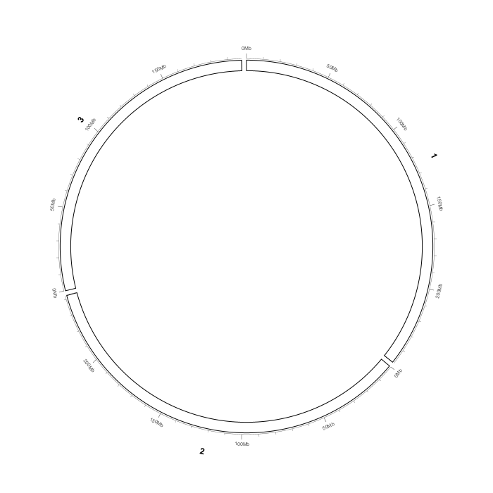
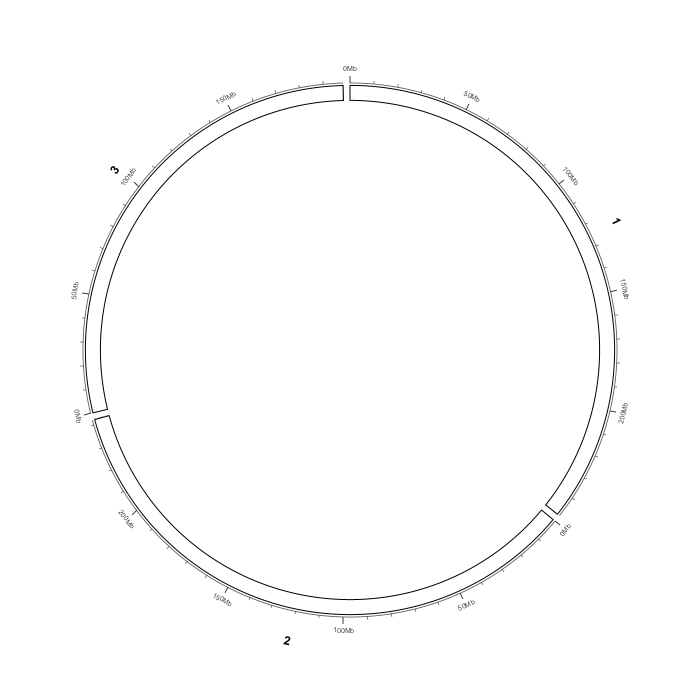
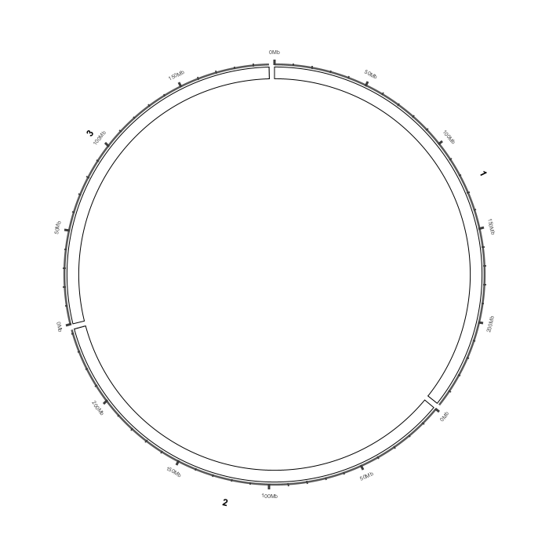

Parameter reference
===================

This chapter is the lookup table for **every user-adjustable parameter added to
the Circular View by myIGV**.  Menu labels are quoted verbatim from the source,
including the dynamic ``(current value)`` suffix that many items display.
Defaults are the values in ``CircularViewPanel.CircularSettings`` when the
application starts.

.. important::

   Circular View settings are **per-session in-memory state**.  They are not
   written into an IGV session file and are not persisted by the global
   Preferences dialog.  Re-launching ``myigv`` restores the defaults below.
   The exception is the linear :doc:`hic` track, whose display, colour and TAD
   settings *are* session-persisted.

Where a parameter lives
-----------------------

.. list-table::
   :header-rows: 1
   :widths: 30 70

   * - Location
     - Parameters found there
   * - ``View options ▾``
     - Coordinate axis, ticks, tick labels, chromosome labels, chromosome
       selection, single-chromosome arc, number orientation, multi-sample Y
       axis, allele-free ring colours, ``Reset zoom``, ``All settings…``.
   * - ``View options ▾ → All settings…``
     - A single ``Circular View Settings`` dialog bundling all axis/geometry
       values with spinners and explicit min/max limits.
   * - Right-click a **Links** row in Data Tracks
     - Ribbon geometry, colours, twist, arrows, transparency, bezier control
       points, record limit.  Identical items also appear in the
       ``Links`` submenu of an interaction track's row.
   * - Right-click a **Heatmap** row in Data Tracks
     - Heatmap placement, band height, connection-track height, legend, colour
       ramp.
   * - Right-click a **Labels** row in Data Tracks
     - Label placement, reading direction, connector lines, font, colours,
       connector height, label height, label spacing.
   * - Right-click a **Points / Lines / Histogram / Rectangles** row in Data
       Tracks
     - Inside/outside placement, colour, point size / line width (Rectangles:
       the ``Colours`` fill + border submenu and ``Expand overlapping
       rectangles``), band height.
   * - Right-click an ordinary **track** row in Data Tracks
     - Per-band height, feature stacking, graph type, Y-axis range and
       multi-sample group scaling (``TrackRingConfig``).
   * - ``Export ▾`` → ``Export circular view`` dialog
     - Format, width, height, resolution, output path.  See
       :doc:`circular_export`.

.. note::

   Every circular-layer parameter is stored **on that layer**.  Two imports of
   the same kind have independent colours, sizes, band heights and
   inside/outside placement, so editing one never changes the other.  The
   ``… outside the ideogram`` item moves the row between the ``Data Tracks`` and
   ``Outside the ideogram`` sections; see :doc:`circular_data_tracks`.

.. note::

   Numeric dialogs clamp out-of-range values, but **the clamping rules differ
   between the free-text menu items and the ``All settings…`` spinners**.  Where
   both exist, the table below gives the free-text rule and notes the spinner
   range separately.

Coordinate axis, ticks and labels — ``View options ▾``
------------------------------------------------------

.. list-table::
   :header-rows: 1
   :widths: 34 14 20 32

   * - Menu item (verbatim)
     - Default
     - Range / values
     - What it does
   * - ``Show coordinate axis``
     - on
     - on / off
     - Master switch for the baseline arc, major and minor ticks, and tick
       numbers (``showAxis``).
   * - ``Show tick marks``
     - on
     - on / off
     - Draws the major and minor tick strokes (``showTicks``).
   * - ``Show tick labels``
     - on
     - on / off
     - Draws the numeric Mb labels (``showTickLabels``).
   * - ``Show chromosome labels``
     - on
     - on / off
     - Draws the chromosome names around the ideogram.
   * - ``Chromosomes to show (All mode)…``
     - all
     - checkbox list
     - Restricts which sectors are drawn in whole-genome mode.  An empty set
       means all chromosomes; at least one must be selected.
   * - ``Tick labels position → Outside (above band)``
     - selected
     - ``Outside (above band)`` / ``Inside (below band)``
     - Places the coordinate numbers outside or inside the ideogram.  When
       placed inside, ``insideLabelClearance()`` reserves radial room so the
       innermost data band does not collide with the text.
   * - ``Number orientation → Tangential``
     - selected
     - ``Tangential`` / ``Radial``
     - Orientation of the numeric tick labels (``labelTangential``).
   * - ``Multi-sample Y axis → Per sample (default)``
     - selected
     - ``Per sample (default)`` / ``Shared (group)``
     - Whether all data tracks share one Y range or scale independently
       (``ySharedAcrossTracks``).
   * - ``Tick spacing (Mb)…``
     - ``0`` (auto)
     - ``0`` = auto (~3 ticks per chromosome); otherwise a positive Mb value
     - Fixed spacing between major ticks (``tickSpacingMb``).  ``All
       settings…`` spinner allows ``0``–``5000`` in steps of ``10``.
   * - ``Tick label size…``
     - ``7``
     - free integer; spinner ``4``–``24``
     - Font size in points for tick numbers (``tickLabelSize``).
   * - ``Axis line thickness… (1.00 px)``
     - ``1.00``
     - ``0.25``–``6.0``
     - Stroke width of the baseline arc and major ticks (``axisLineWidth``).
       Minor ticks are drawn at ``0.6×`` and the baseline at ``0.85×`` this
       value.  Thicker axes add an ``axisPad`` so the tick text is pushed clear.
   * - ``Chromosome label size…``
     - ``12``
     - free integer; spinner ``6``–``30``
     - Font size in points for chromosome names.
   * - ``Chromosome height (px)…``
     - ``15``
     - minimum ``8``; spinner ``8``–``220``
     - Radial thickness of the ideogram ring (``chromosomeHeightPx``).
   * - ``Solid chromosome colour (override karyotype)``
     - off
     - on / off
     - Fills each chromosome with a single colour instead of cytoband stripes.
   * - ``Chromosome colour…``
     - ``RGB(93, 145, 190)``
     - any colour
     - Picks the solid fill.  Selecting a colour implicitly turns
       ``Solid chromosome colour`` on.  Also the fallback palette base for
       genomes without karyotype data.
   * - ``Reset zoom``
     - —
     - action
     - Clears per-chromosome zoom and visible-range zoom.
   * - ``All settings…``
     - —
     - opens dialog
     - Opens ``Circular View Settings`` (details below); invalidating the ring
       cache and repainting.

   ``Axis line thickness…`` at ``0.5 px`` — a hairline baseline and fine ticks.

   ``Axis line thickness…`` at its default ``1.0 px``.

   The same view at ``3.0 px``.  The baseline and major ticks thicken; tick
   labels are pushed outward by ``axisPad`` so they stay legible.

``Circular View Settings`` dialog (``All settings…``)
-----------------------------------------------------

All 16 controls of this dialog, with the exact spinner bounds enforced by the
``JSpinner`` models:

.. list-table::
   :header-rows: 1
   :widths: 38 14 20 28

   * - Control (verbatim)
     - Default
     - Bounds
     - Setting
   * - ``Show coordinate axis`` / ``Show tick marks`` / ``Show tick labels`` /
       ``Show chromosome labels``
     - all on
     - checkboxes
     - the four master switches above
   * - ``Tick label position:``
     - ``Outside (above the band)``
     - ``Outside (above the band)`` / ``Inside (below the band)``
     - ``tickLabelsOutside``
   * - ``Tick spacing (Mb, 0 = auto):``
     - ``0.0``
     - ``0.0``–``5000.0``, step ``10.0``
     - ``tickSpacingMb``
   * - ``Minor ticks per major (0 = off):``
     - ``5``
     - ``0``–``20``, step ``1``
     - ``minorTicksPerMajor``; ``0`` disables minor ticks
   * - ``Axis line thickness (px):``
     - ``1.0``
     - ``0.25``–``6.0``, step ``0.25``
     - ``axisLineWidth``
   * - ``Tick label size:``
     - ``7``
     - ``4``–``24``, step ``1``
     - ``tickLabelSize``
   * - ``Chromosome label size:``
     - ``12``
     - ``6``–``30``, step ``1``
     - ``chromosomeLabelSize``
   * - ``Chromosome height (px):``
     - ``15``
     - ``8``–``220``, step ``2``
     - ``chromosomeHeightPx``
   * - ``Chromosome number orientation:``
     - ``Tangential``
     - ``Tangential`` / ``Radial``
     - ``labelTangential``
   * - ``Band inner radius (0–1):``
     - ``0.78``
     - ``0.40``–``0.85``, step ``0.01``
     - ``bandInner`` — inner limit of the data-band stack as a fraction of the
       ideogram radius
   * - ``Band outer radius (0–1):``
     - ``0.90``
     - ``0.60``–``0.99``, step ``0.01``
     - ``bandOuter`` — outer limit of the stack
   * - ``Gap between chromosomes (°):``
     - ``1.5``
     - ``0.0``–``8.0``, step ``0.1``
     - ``gapDeg`` — angular gap between adjacent sectors

.. note::

   If ``bandInner >= bandOuter`` after editing, the dialog automatically sets
   ``bandOuter = min(0.99, bandInner + 0.05)`` so the band stack keeps a
   positive thickness.

Single-chromosome arc — ``View options ▾``
-------------------------------------------

Only active when a single chromosome (or gene) is displayed.

.. list-table::
   :header-rows: 1
   :widths: 34 16 50

   * - Menu item (verbatim)
     - Default
     - What it does
   * - ``Single-chromosome arc → 360°  (1.00)``
     - selected
     - Full ring.  Other presets: ``270°  (0.75)``, ``180°  (0.50)``,
       ``120°  (0.33)``, ``90°  (0.25)``.
   * - ``Single-chromosome arc → Custom (0–1)…``
     - —
     - Any fraction ``0 < f <= 1``; ``1`` = 360°.  Prompt:
       ``Ring arc fraction for single-chromosome mode (0–1, 1 = 360°):``
   * - ``Single-chromosome arc start → Top  (0°)``
     - selected
     - Where the arc's zero position sits, clockwise from the top.  Also
       ``Right  (90°)``, ``Bottom  (180°)``, ``Left  (270°)``.
   * - ``Single-chromosome arc start → Custom (degrees)…``
     - —
     - Any degree value, normalised modulo 360.  Prompt:
       ``Arc start position, degrees clockwise from top (0=top, 90=right,
       180=bottom, 270=left):``

Links layer — right-click a Links row
-------------------------------------

.. list-table::
   :header-rows: 1
   :widths: 36 13 20 31

   * - Menu item (verbatim)
     - Default
     - Range / values
     - What it does
   * - ``Show links``
     - on
     - on / off
     - Global visibility of every links layer (``showLinks``).
   * - ``Draw inside data tracks``
     - on
     - on / off
     - Anchors link ends inside the stacked data bands instead of on top of
       them (``linkEndsInsideTracks``).
   * - ``Ribbon (filled bands)``
     - on
     - on / off
     - Draw a filled ribbon (Circos ``ribbon=yes``) instead of a stroked curve.
   * - ``Twist ribbons``
     - off
     - on / off
     - Join the two ribbon edges the other way round (circlize ``inverse``):
       interval 1's start meets interval 2's start instead of its end.  The band
       stays smooth; only which edges connect changes.  Default is **off**.
   * - ``Colour by chromosome``
     - off
     - on / off
     - Colour each link by its source chromosome.
   * - ``Colour…``
     - ``RGB(40, 90, 170)``
     - any colour
     - Uniform link colour; dialog titled ``Link colour``.
   * - ``Thickness… (1.2 px)``
     - ``1.2``
     - minimum ``0.1``
     - Stroke width for non-ribbon links (``linkThickness``).
   * - ``Arrows → None``
     - selected
     - ``None`` / ``Start (first interval)`` / ``End (second interval)`` /
       ``Both ends``
     - Arrow mode (``linkArrow`` = 0/1/2/3).  A 1 bp endpoint gets a thin
       triangular arrow; an interval endpoint gets an arrow formed by the
       ribbon body itself.
   * - ``Arrows → Arrow length… (9 px)``
     - ``9``
     - ``3``–``80`` px
     - Length of the arrow head (``linkArrowLength``).
   * - ``Arrows → Arrow width… (1.7x band)``
     - ``1.7``
     - ``1.0``–``4.0`` × band width
     - Base width multiplier (``linkArrowWidth``).
   * - ``Transparency (0 = solid)… (0)``
     - ``0``
     - ``0``–``255``
     - Link stroke transparency; internally stored as alpha ``255 - t``.
   * - ``End radius (0-1)… (0.95)``
     - ``0.95``
     - ``0.05``–``1.0``
     - Radial position of link ends as a fraction of the ideogram inner radius.
       Lower it to keep links clear of the data rings.
   * - ``Bezier radius (0-1)… (0.8)``
     - ``0.8``
     - ``0.0``–``1.0``
     - Radial position of the bezier control point of a **stroked** link; ``0``
       gives a straight chord (Circos ``bezier_radius``).  Filled ribbons use
       circlize's automatic bow height.
   * - ``Crest (0-1)… (0.5)``
     - ``0.5``
     - ``0.0``–``1.0``
     - Extra control points that make links meet the ideogram perpendicularly;
       ``0`` disables (Circos ``crest``).
   * - ``Min ribbon width (deg)… (1.2)``
     - ``1.2``
     - minimum ``0``
     - Smallest angular width used to size a ribbon's arrow head.  The ribbon
       body tapers to the true interval width, so real BEDPE anchors (often a
       few kb, sub-pixel on a whole-genome ring) taper to a tip, not a stub.
   * - ``Ribbon transparency (0 = solid)… (0)``
     - ``0``
     - ``0``–``255``
     - Fill transparency of ribbons; internally alpha ``255 - t``.
   * - ``Outline ribbons``
     - on
     - on / off
     - Draws a ``0.6 px`` outline so the thin middle of a tapered band stays
       visible (Circos ``stroke_*``).
   * - ``Max links… (5000)``
     - ``5000``
     - minimum ``1``
     - Cap on the number of links drawn per frame (``linkRecordLimit``).
   * - ``Remove links from circular view…``
     - —
     - action
     - Removes the layer.  It does not touch the horizontal IGV view.

.. tip::

   ``linkBezierPurity`` (default ``1.0``; stroked chords only), ``geneFlankBp``
   (``2000``) and ``linkRibbonStrokeThickness`` (``0.6``) are internal
   constants with no dedicated menu item; they are listed here for completeness
   only.

Heatmap layer — right-click a Heatmap row
-----------------------------------------

.. list-table::
   :header-rows: 1
   :widths: 38 13 18 31

   * - Menu item (verbatim)
     - Default
     - Range / values
     - What it does
   * - ``Show heatmap``
     - on
     - on / off
     - Visibility of the heatmap layer.
   * - ``Show heatmap connectors``
     - on
     - on / off
     - Draws the four-segment circlize ``circos.genomicPosTransformLines``
       comb that ties each equal-width cell back to its real genomic position.
   * - ``Heatmap outside the ideogram``
     - off
     - on / off
     - ``off`` (default) places the heatmap inside the ideogram; ``on`` grows
       the band and its comb outwards and shrinks the main ring so nothing
       leaves the canvas.
   * - ``Heatmap height… (50 px)``
     - ``50``
     - minimum ``8``
     - Radial thickness of the coloured cell band (``heatmapHeightPx``).
   * - ``Heatmap connection height… (22 px)``
     - ``22``
     - minimum ``0``
     - Height of the connection track that contains the comb.  ``0`` packs the
       heatmap against the ideogram with no visible comb.  This is an
       **absolute pixel value, not a 0–1 radius fraction**.
   * - ``Show heatmap legend``
     - on
     - on / off
     - Draws a vertical colour bar outside the ring with the global ``min`` /
       ``max`` labels.  Also drawn on the export path and on screen with no
       Hi-C track loaded.
   * - ``Legend position``
     - ``TOP_RIGHT``
     - ``TOP_LEFT`` / ``TOP_RIGHT`` / ``BOTTOM_LEFT`` / ``BOTTOM_RIGHT`` /
       ``NONE``
     - Legend corner.  The submenu shows **upper-case enum constant names**,
       unlike the Hi-C ``Color legend`` submenu which shows ``Top left`` style
       labels.  Same four corners plus ``None`` in both cases.
   * - ``Heatmap colours (low / 0 / high)`` → ``Low (min)…``
     - ``RGB(0, 150, 0)`` green
     - any colour
     - Colour at the global minimum.
   * - ``… → Mid (0)…``
     - ``RGB(0, 0, 0)`` black
     - any colour
     - Colour pinned at value ``0``; only used when the range straddles zero.
       When all values have the same sign the submenu is titled
       ``Heatmap colours (low / high)`` and this item is disabled with the
       tooltip ``Only used when the data range contains 0 (negative and
       positive values).``
   * - ``… → High (max)…``
     - ``RGB(215, 40, 40)`` red
     - any colour
     - Colour at the global maximum.
   * - ``… → Reset (green / black / red)``
     - —
     - action
     - Restores the three defaults.
   * - ``Remove heatmap from circular view…``
     - —
     - action
     - Removes the layer.

Labels layer — right-click a Labels row
---------------------------------------

.. list-table::
   :header-rows: 1
   :widths: 38 13 18 31

   * - Menu item (verbatim)
     - Default
     - Range / values
     - What it does
   * - ``Labels outside the ideogram``
     - off
     - on / off
     - ``off`` (default) puts the label ring **inside** the ideogram with
       radial text; ``on`` puts it outside, still radial.  Outside mode does
       **not** shrink the ring or move the chromosome names / coordinate axis:
       the label ring grows from the ideogram's normal outer edge.
   * - ``Read labels toward the centre``
     - off
     - on / off
     - Flips radial text so it reads inward (``1 → B``) instead of outward
       (``B → 1``).  ``labelInward``.
   * - ``Show connector lines``
     - on
     - on / off
     - Draws the heatmap-style comb from the genomic position to the label
       slot.  The line stops at the end of the text nearest the ring, so it
       never crosses the gene name.
   * - ``Bold labels``
     - off
     - on / off
     - Bold font weight.
   * - ``Font size… (9 pt)``
     - ``9``
     - ``4``–``36`` pt
     - Label font size (``labelFontSize``).
   * - ``Label colour…``
     - ``RGB(30, 30, 30)``
     - any colour
     - Text colour; dialog titled ``Label colour``.
   * - ``Connector colour…``
     - ``RGB(120, 120, 120)``
     - any colour
     - Comb-line colour; dialog titled ``Connector colour``.
   * - ``Connector height… (16 px)``
     - ``16``
     - ``2``–``80`` px
     - Distance from the ideogram edge to the label ring; the comb lives in
       this gap.  **This is the only knob for clearing axis tick text** —
       myIGV deliberately does not auto-avoid the coordinate labels.
   * - ``Label height… (40 px)``
     - ``40``
     - ``10``–``160`` px
     - Radial room reserved for the label ring (circlize ``labels_height``).
   * - ``Label spacing… (3 px)``
     - ``3``
     - ``0``–``30`` px
     - Gap inserted between two adjacent labels when circlize ``smartAlign``
       tiles a dense cluster end to end.
   * - ``Remove labels from circular view…``
     - —
     - action
     - Removes the layer.

Interval + value layers — right-click a Points / Lines / Histogram / Rectangles row
-----------------------------------------------------------------------------------

These four kinds share one parser (``chr start end value``) and one set of
row-position rules; only the drawing and a few items differ.

.. list-table::
   :header-rows: 1
   :widths: 38 13 18 31

   * - Menu item (verbatim)
     - Default
     - Range / values
     - What it does
   * - ``Show points`` / ``Show lines`` / ``Show histogram`` /
       ``Show rectangles``
     - on
     - on / off
     - Visibility of that layer.
   * - ``Points outside the ideogram`` / ``Lines outside the ideogram`` /
       ``Histogram outside the ideogram`` / ``Rectangles outside the ideogram``
     - off
     - on / off
     - ``on`` moves the row to the ``Outside the ideogram`` column and draws the
       band beyond the chromosome names; outside bands stack in their row order.
   * - ``Colour…`` (Points / Lines) or ``Bar colour…`` (Histogram)
     - blue
     - any colour
     - Marker / polyline / bar colour for that layer (``plColor``).
   * - ``Point size… (4 px)``
     - ``4``
     - ``1``–``30`` px
     - Diameter of the point markers (Points only, ``plPointSize``).
   * - ``Line width… (2 px)``
     - ``2``
     - ``1``–``20`` px
     - Stroke width of the polyline (Lines only, ``plLineWidth``).
   * - ``Colours`` ▸ ``Fill by value (ramp)``
     - on
     - on / off
     - Rectangles only.  On: fill interpolates from the low to the high colour
       by value.  Off: a single solid ``Fill colour…`` is used.
   * - ``Colours`` ▸ ``Fill colour…``
     - —
     - any colour
     - Rectangles only.  One solid fill colour for every cell
       (``rectFill``); ignored while ``Fill by value (ramp)`` is on.
   * - ``Colours`` ▸ ``Border colour…``
     - none
     - any colour
     - Rectangles only.  Outline every cell in this colour (``rectBorder``).
   * - ``Colours`` ▸ ``No border``
     - —
     - action
     - Rectangles only.  Clears the border colour.
   * - ``Colours`` ▸ ``Low value colour…`` / ``High value colour…``
     - blue / red
     - any colour
     - Rectangles only.  The two ends of the value ramp (``rectLow`` /
       ``rectHigh``).
   * - ``Expand overlapping rectangles``
     - off
     - on / off
     - Rectangles only.  On: overlapping intervals are assigned radial lanes by
       greedy interval scheduling, so each one stays visible instead of covering
       the others.  Off: every cell fills the whole band.
   * - ``Band height… (42 px)``
     - ``42``
     - ``10``–``200`` px
     - Radial room this band occupies on the ring (``plHeightPx``).
   * - ``Remove points|lines|histogram|rectangles from circular view…``
     - —
     - action
     - Removes the layer.

Ordinary track rows — right-click a data track
----------------------------------------------

.. list-table::
   :header-rows: 1
   :widths: 38 15 47

   * - Menu item (verbatim)
     - Default
     - What it does
   * - ``Track height… (26 px)``
     - ``26`` px (``60`` px for Hi-C)
     - Radial height of one data band; minimum ``8``.  A separate
       ``Hi-C ring height… (60 px)`` item appears for Hi-C rows.
   * - ``Expanded (stack features)``
     - off
     - Stacks overlapping features into rows instead of collapsing them.
   * - ``Stack from outer edge``
     - off
     - Pins transcript rows to the outer edge and grows inward.
   * - ``Graph type``
     - ``Bar``
     - ``Bar`` / ``Point`` / ``Line`` / ``Heatmap`` for numeric tracks.
   * - ``Y-axis range``
     - ``Per chromosome (default)``
     - ``Per chromosome (default)`` / ``All chromosomes (unified)``.
   * - ``Y-axis scale (multi-sample)``
     - ``Self scale (default)``
     - ``Self scale (default)`` / ``Group scale (selected)`` /
       ``Group scale each gene panel``.  The last option computes the shared
       range per sector, so a weak gene is not flattened by a strong one.
   * - ``Colour…``
     - ``RGB(60, 90, 170)``
     - Band colour; dialog titled ``Track colour``.
   * - Hi-C submenus
     - —
     - The linear Hi-C track's own parameter submenus are attached verbatim
       here, so every Hi-C setting is reachable from the ring as well; see
       :doc:`hic`.

Export dialog
-------------

.. list-table::
   :header-rows: 1
   :widths: 32 18 50

   * - Field
     - Default
     - Range / meaning
   * - ``Format:``
     - format chosen in the menu
     - ``PNG image`` / ``SVG vector`` / ``PDF vector``.
   * - ``Width (px):``
     - current panel width
     - ``100``–``20000`` px, whole number.
   * - ``Height (px):``
     - current panel height
     - ``100``–``20000`` px, whole number.
   * - ``Resolution (dpi):``
     - ``300``
     - ``1``–``2400``; disabled for SVG.  Written into the PNG ``pHYs`` chunk
       and used for the PDF page size.
   * - ``File:``
     - ``<home>/circular_view.<ext>``
     - Any writable path; extension auto-syncs to the format.

Full details, validation messages and format-specific behaviour are in
:doc:`circular_export`.

Four gotchas worth remembering
------------------------------

#. **Heatmap legend labels are upper-case enum names.**  ``Legend position``
   shows ``TOP_LEFT`` … ``NONE``, whereas the Hi-C ``Color legend`` shows
   ``Top left`` … ``None``.  Both offer the same four corners plus ``None``.
#. **Heights are pixels, not radius fractions.**  ``Heatmap connection
   height…``, ``Connector height…`` and ``Label height…`` are absolute pixel
   values.  Setting the connection height to ``1`` does not mean "1 % of the
   radius" — it means one pixel.  This was a deliberate change so visual
   height no longer changes with window size.
#. **Outside labels do not auto-avoid tick text.**  Increase ``Connector
   height…`` manually until the label ring clears the coordinate axis labels.
#. **Outside labels never re-layout the rest of the figure.**  Turning on
   ``Labels outside the ideogram`` does not shrink the ideogram ring and does
   not move the chromosome names or the axis — unlike ``Heatmap outside the
   ideogram``, which does shrink the ring.  ``Connector height…`` is the only
   control for where the outside label ring sits.

.. seealso::

   :doc:`circular_view_options` for the narrative explanation of the axis,
   :doc:`circular_links` for ribbon and arrow geometry,
   :doc:`circular_heatmap` for the circlize comb and colour ramp,
   :doc:`circular_labels` for ``smartAlign`` and radial text, and
   :doc:`screenshots` for a gallery of every figure used in this guide.
