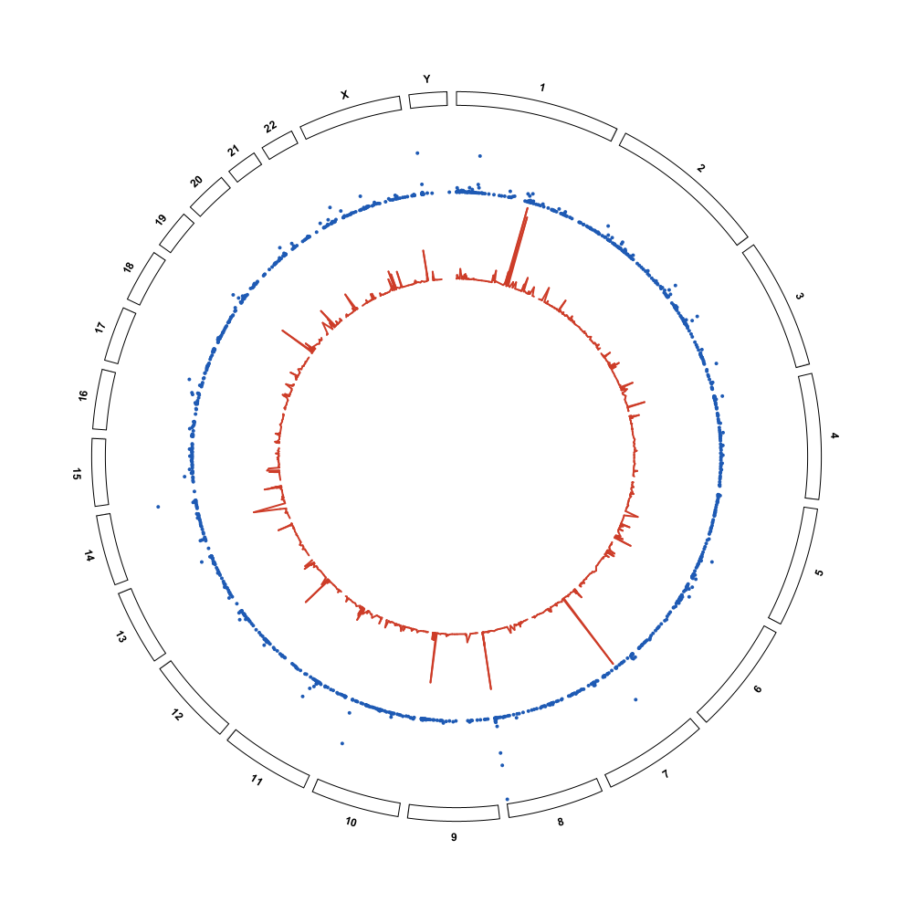

Example data used in this guide
===============================

The screenshots in this guide are rendered by the headless probes in
``build/check/probe/`` from **real data files**, not from invented coordinates.
The tables below are the complete inventory of those files: their format, size,
row count, chromosome naming, and the figure(s) they appear in.

.. important::

   All files listed here live in the workspace directory **one level above** the
   ``myigv_v1.3`` repository — that is, in ``igv_mod/`` — and are written in
   this guide as ``../<file>``.  They are **not committed to the repository**.
   The probes read them by that ``../`` relative path, for example
   ``new File("../hg38_heatmap.bed")``, and the repository contains only the
   rendered PNGs whose names mention them.

.. warning::

   **Two incompatible chromosome naming schemes are present; do not mix them in
   one genome.**  The ``hg38_*`` files, the ``.bw`` / Hi-C matrices and the
   ``HiC_TAD_results/`` products use ``chrN`` names (``chr1`` … ``chrX``,
   ``chrY``).  The ``domains*.bed`` and ``simulated_loops*`` demo files use a
   **bare ``X``** and cover **only the X chromosome**.  Loading a bare-``X``
   file together with an hg38 genome produces no matching sectors — the two
   groups must be rendered against different genomes.

BigWig signal tracks
--------------------

.. list-table::
   :header-rows: 1
   :widths: 30 14 12 10 12 22

   * - File
     - Type
     - Size
     - Rows
     - Chr naming
     - Used in figure(s)
   * - ``../Scr_R1_IP.bw``
     - BigWig (hg38)
     - ≈ 43.9 MB
     - binary
     - ``chrN``
     - ``bw_signal_ring.png`` — the blue outer **Points** ring (IP signal,
       sampled scores ≈ ``0 … 90``)
   * - ``../Scr_R1_input.bw``
     - BigWig (hg38)
     - ≈ 43.2 MB
     - binary
     - ``chrN``
     - ``bw_signal_ring.png`` — the red inner **Lines** ring (input signal,
       sampled scores ≈ ``0 … 12``); see :doc:`view_interactions` for how
       bigwig tracks are autoscaled

Both ``.bw`` files are read at render time by IGV's own
``org.broad.igv.ucsc.bb.BBFile`` reader — the same path used by
``TrackLoader.loadBWFile()`` — in ``BwSignalRingProbe.java``.  ``htsjdk``'s
``tribble.bigwig`` package is not on this classpath, so the older
``BwProbe.java`` approach cannot compile; the ``BBFile`` path is the working
one and needs no ``htsjdk`` bigwig classes.

Circular-only BED layers (hg38)
-------------------------------

.. list-table::
   :header-rows: 1
   :widths: 30 14 12 10 12 22

   * - File
     - Type
     - Size
     - Rows
     - Chr naming
     - Used in figure(s)
   * - ``../hg38_heatmap.bed``
     - BED, 7 cols (chr/start/end/v1..v4)
     - ≈ 10 KB
     - 107
     - ``chrN``
     - ``circlize_heatmap_links.png``,
       ``heatmap_hg38_heatmap_bed.png``, ``heatmap_inside.png``,
       ``heatmap_outside.png``
   * - ``../hg38_heatmap2.bed``
     - BED, 7 cols (copy of the above)
     - ≈ 10 KB
     - 107
     - ``chrN``
     - ``two_heat_legends.png`` (one legend per layer)
   * - ``../hg38_genes.bed``
     - BED, 4 cols (chr/start/end/name)
     - ≈ 2.9 KB
     - 100
     - ``chrN``
     - ``labels_ring.png``, ``labels_zoom.png``,
       ``labels_ring_outside.png``
   * - ``../hg38_genes2.bed``
     - BED, 4 cols (copy of the above)
     - ≈ 2.9 KB
     - 100
     - ``chrN``
     - ``labels_ring_big.png``, dense-label captures
   * - ``../hg38_links.bed``
     - BED / BEDPE-style links, 6 cols
     - ≈ 28 KB
     - 600
     - ``chrN``
     - ``circular_links_ribbon.png``, ``links_thin.png``,
       ``circular_links_straight.png``
   * - ``../hg38_val.bed``
     - BED, 4 cols (chr/start/end/value); values ≈ ``-1.99 … +2.00``
     - ≈ 18 KB
     - 600
     - ``chrN``
     - ``points_lines.png``, ``hist_rect.png``,
       ``hist_rect_outside.png``, ``rect_colours.png``,
       ``real_value_tracks.png``

``hg38_val.bed`` shares its first three columns with ``hg38_links.bed``, so a
value track and a links layer line up exactly when both are loaded.  Its value
column spans roughly ``-1.99 … +2.00`` (min ``-1.9856``, max ``1.9951``); the
four interval+value tracks (Points / Lines / Histogram / Rectangles) are all
rendered from this one file.

``hg38_genes.bed`` is another already-real example: ``labels_ring.png`` and
``labels_zoom.png`` are rendered straight from it by ``LabelsProbe.java``.
The names on the ring follow column 4 in file order (``MTHFR``, ``ARID1A``,
``F3``, ``NRAS``, ``FLG`` …), and later rows such as ``PIK3CA`` (row 22),
``TP53`` (row 84) and ``BRCA1`` (row 90) all come from this same 100-row file
— they are not invented gene names.  See :doc:`circular_labels`.

Links, loops and domain demo files
----------------------------------

.. list-table::
   :header-rows: 1
   :widths: 30 14 12 10 12 22

   * - File
     - Type
     - Size
     - Rows
     - Chr naming
     - Used in figure(s)
   * - ``../links_demo_line_band.bed``
     - BED, 6 cols + comments
     - ≈ 1 KB
     - 10 data (+8 comments, 3 blank)
     - ``chrN``
     - ``links_demo_ribbons.png`` (all 10), ``ribbon_single.png`` (first
       row), ``circular_links_ribbon_mixed.png`` (the 7 rows with a 1 bp end)
   * - ``../simulated_loops.bedpe``
     - BEDPE, 6 cols + header
     - ≈ 20 KB
     - 525 (+1 header)
     - bare ``X`` only
     - checked by ``BedpeDetectProbe.java`` / ``LinkProbe.java``; no rendered
       figure reads this file directly
   * - ``../simulated_loops.full12.bedpe``
     - BEDPE, 12 cols + header
     - ≈ 36 KB
     - 525 (+1 header)
     - bare ``X`` only
     - the 12-column ``#`` header example quoted in :doc:`circular_import`;
       checked by ``BedpeDetectProbe.java``; no rendered figure
   * - ``../simulated_loops.links``
     - Circos links, 7 cols
     - ≈ 23 KB
     - 525
     - bare ``X`` only
     - checked by ``BedpeDetectProbe.java`` (7-column links); no rendered
       figure reads this file directly
   * - ``../domains.bed``
     - BED, 9 cols
     - ≈ 33 KB
     - 498
     - bare ``X`` only
     - checked by ``BedpeDetectProbe.java`` (9-column BED, correctly rejected
       as BEDPE); no rendered figure reads this file directly
   * - ``../domains_part1.bed``
     - BED, 9 cols (first half)
     - ≈ 16 KB
     - 249
     - bare ``X`` only
     - ``tad_overlay_on.png`` / ``tad_overlay_off.png`` /
       ``tad_overlay_flipped.png`` (``TadOverlayProbe.java``) plus TAD-menu
       captures in :doc:`hic`
   * - ``../domains_part2.bed``
     - BED, 9 cols (second half)
     - ≈ 17 KB
     - 249
     - bare ``X`` only
     - TAD-menu / per-file-style captures in :doc:`hic`

Hi-C contact matrices
---------------------

Five format families / sources are exercised: Juicer ``.hic``, multi-resolution
cooler ``.mcool``, gzip-wrapped single-resolution cooler ``.cool.gz``,
HiCExplorer ``.h5``, and the derived 50 kb single-resolution ``.cool``
matrices in ``../HiC_TAD_results/matrices/``.  See :doc:`hic` for the loaders
and :doc:`circular_hic` for the ring renderer.

.. list-table::
   :header-rows: 1
   :widths: 30 14 12 10 12 22

   * - File
     - Type
     - Size
     - Rows
     - Chr naming
     - Used in figure(s)
   * - ``../GSE280419_HiC_AID_0h.hic``
     - Juicer ``.hic``
     - ≈ 907 MB
     - multi-res
     - ``chrN``
     - ``hic_real_juicer.png`` (real); also supplies the chromosome set for
       the arrow/ribbon geometry probes
   * - ``../GSE280419_HiC_AID_48h.hic``
     - Juicer ``.hic``
     - ≈ 905 MB
     - multi-res
     - ``chrN``
     - not used by any figure in the current guide (an earlier synthetic mode
       demo used its name; that demo now reads ``AID_48h_50kb.cool``)
   * - ``../GSM10137692_A375-Acute-Bottom10-DMSO.10kb.mcool``
     - cooler ``.mcool``
     - ≈ 494 MB
     - multi-res
     - ``chrN``
     - ``hic_real_mcool.png``
   * - ``../GSM8842576_S1_raw_5000_.cool.gz``
     - cooler ``.cool.gz``
     - ≈ 132 MB
     - single-res
     - ``chrN``
     - ``hic_real_cool.png``
   * - ``../Li_et_al_2015.h5``
     - HiCExplorer ``.h5``
     - ≈ 14.2 MB
     - 11,104 bins
     - ``chrN``
     - performance benchmark in :doc:`hic` (no dedicated PNG)
   * - ``../HiC_TAD_results/matrices/AID_0h_50kb.cool``
     - cooler ``.cool`` (derived, 50 kb)
     - ≈ 14 MB
     - 50 kb bins
     - ``chrN``
     - ``hic_ring_triangle.png`` / ``hic_ring_square.png`` (``log1p`` track),
       ``hic_genelist.png``, and ``export_hic.png`` / ``export_hic_pdf.png``
       (a chr1 0–50 Mb window)
   * - ``../HiC_TAD_results/matrices/AID_48h_50kb.cool``
     - cooler ``.cool`` (derived, 50 kb)
     - ≈ 13 MB
     - 50 kb bins
     - ``chrN``
     - ``hic_ring_triangle.png`` / ``hic_ring_square.png`` (the ``-log``
       second track)

.. note::

   **All nine Hi-C figures are now real-data driven.**  Earlier drafts of
   ``hic_ring_triangle.png``, ``hic_ring_square.png`` and ``hic_genelist.png``
   used a small synthetic matrix whose legends merely carried real ``.hic``
   file names; those were replaced.  The three ring-mode captures now read the
   real 50 kb cooler matrices
   ``../HiC_TAD_results/matrices/AID_0h_50kb.cool`` (``log1p``) and
   ``AID_48h_50kb.cool`` (``-log``), whose names appear in their legends, and
   ``export_hic.png`` / ``export_hic_pdf.png`` use a chr1 0–50 Mb window of
   ``AID_0h_50kb.cool``.  Together with the four ``hic_real_*.png`` captures
   (Juicer ``.hic``, ``.mcool``, ``.cool.gz`` and the real loop BEDPE), every
   Hi-C figure in this guide shows a genuine contact matrix — no remaining
   "real file name + synthetic data" combinations.  See :doc:`circular_hic`
   and :doc:`hic`.

HiC_TAD_results/ products
-------------------------

Real ``hicFindTADs`` / ``hicDetectLoops`` output produced from the AID 0 h
matrix, living in ``../HiC_TAD_results/``.

.. list-table::
   :header-rows: 1
   :widths: 30 14 12 10 12 22

   * - File
     - Type
     - Size
     - Rows
     - Chr naming
     - Used in figure(s)
   * - ``../HiC_TAD_results/loops/AID_0h_10kb_loops.bedpe``
     - BEDPE loops (10 cols)
     - ≈ 91 KB
     - 1384
     - ``chrN``
     - ``hic_real_loops.png`` (real loops drawn as ribbon links)
   * - ``../HiC_TAD_results/AID_0h_50kb_TADs_domains.bed``
     - BED domains (9 cols)
     - ≈ 393 KB
     - 4749
     - ``chrN``
     - checked by ``BedpeDetectProbe.java``; the TAD-overlay probes use a
       synthetic BED of the same name, so no figure reads this file directly
   * - ``../HiC_TAD_results/AID_0h_50kb_TADs_score.bedgraph``
     - bedGraph TAD score
     - ≈ 2.3 MB
     - 57,611
     - ``chrN``
     - **not used by any PNG** in the current guide: an earlier draft of the
       signal ring used it, but that path was replaced by the real ``.bw``
       render described below

A real signal ring
------------------

The headless probes also render a signal ring from a real quantitative track —
a real BigWig / TAD-score signal track — rather than from a synthetic array.
In this build the ring is rendered from the **two real BigWig files**
``../Scr_R1_IP.bw`` and ``../Scr_R1_input.bw``.  ``htsjdk``'s
``tribble.bigwig`` package is absent from this classpath, so the older
``BwProbe.java`` approach cannot compile; IGV's own
``org.broad.igv.ucsc.bb.BBFile`` reader (the one used by
``TrackLoader.loadBWFile()``) is available, and ``BwSignalRingProbe.java``
uses it to read genuine ``score`` records from both files.  Each file is
uniformly sampled to about 1200 rows across the 24 hg38 chromosomes, and
every plotted value is a real wig record.  The
``AID_0h_50kb_TADs_score.bedgraph`` TAD-score file is **not** used by any
figure in this guide.

   A real BigWig / TAD-score signal track rendered as a circular ring: the
   blue outer **Points** band is ``Scr_R1_IP.bw`` and the red inner **Lines**
   band is ``Scr_R1_input.bw``, both read with IGV's ``BBFile`` reader — not
   mock data and not the TAD-score bedGraph.  See :doc:`view_interactions`
   for the group-autoscale setting that governs the Y range of such tracks.

Real-data screenshots added for this release
--------------------------------------------

The six figures below were introduced with the real-data pass; each is listed
with its source in :doc:`screenshots`.

.. list-table::
   :header-rows: 1
   :widths: 32 68

   * - File
     - Source data
   * - ``bw_signal_ring.png``
     - real ``../Scr_R1_IP.bw`` + ``../Scr_R1_input.bw`` (this page)
   * - ``real_value_tracks.png``
     - ``../hg38_val.bed`` — Points / Lines / Histogram / Rectangles
       (:doc:`circular_import`)
   * - ``hic_real_juicer.png``
     - ``../GSE280419_HiC_AID_0h.hic`` (:doc:`hic`, :doc:`circular_hic`)
   * - ``hic_real_mcool.png``
     - ``../GSM10137692_A375-Acute-Bottom10-DMSO.10kb.mcool``
       (:doc:`hic`, :doc:`circular_hic`)
   * - ``hic_real_cool.png``
     - ``../GSM8842576_S1_raw_5000_.cool.gz`` (:doc:`hic`,
       :doc:`circular_hic`)
   * - ``hic_real_loops.png``
     - ``../HiC_TAD_results/loops/AID_0h_10kb_loops.bedpe`` (:doc:`hic`,
       :doc:`circular_hic`)
