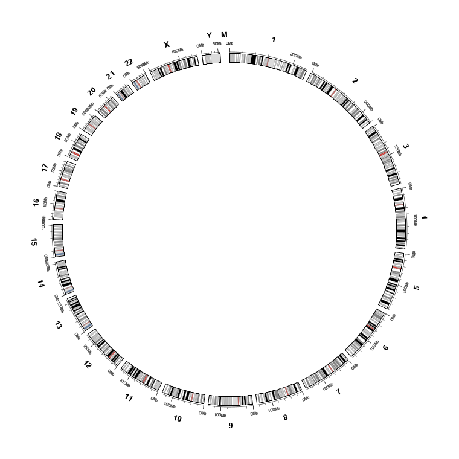
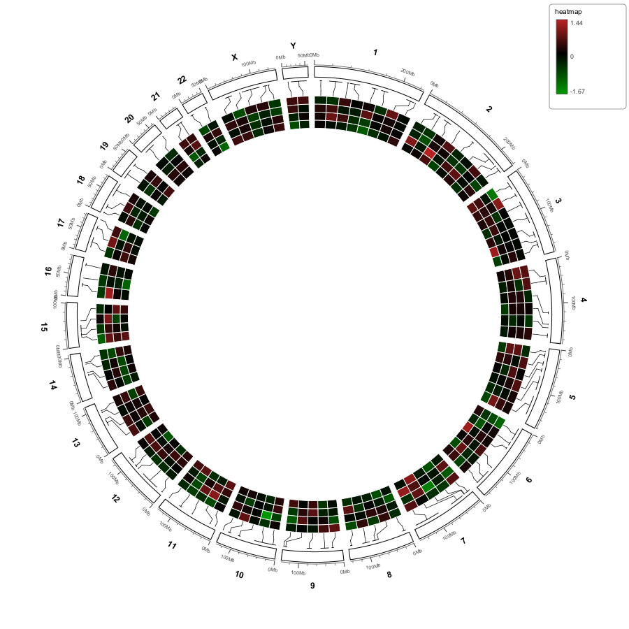
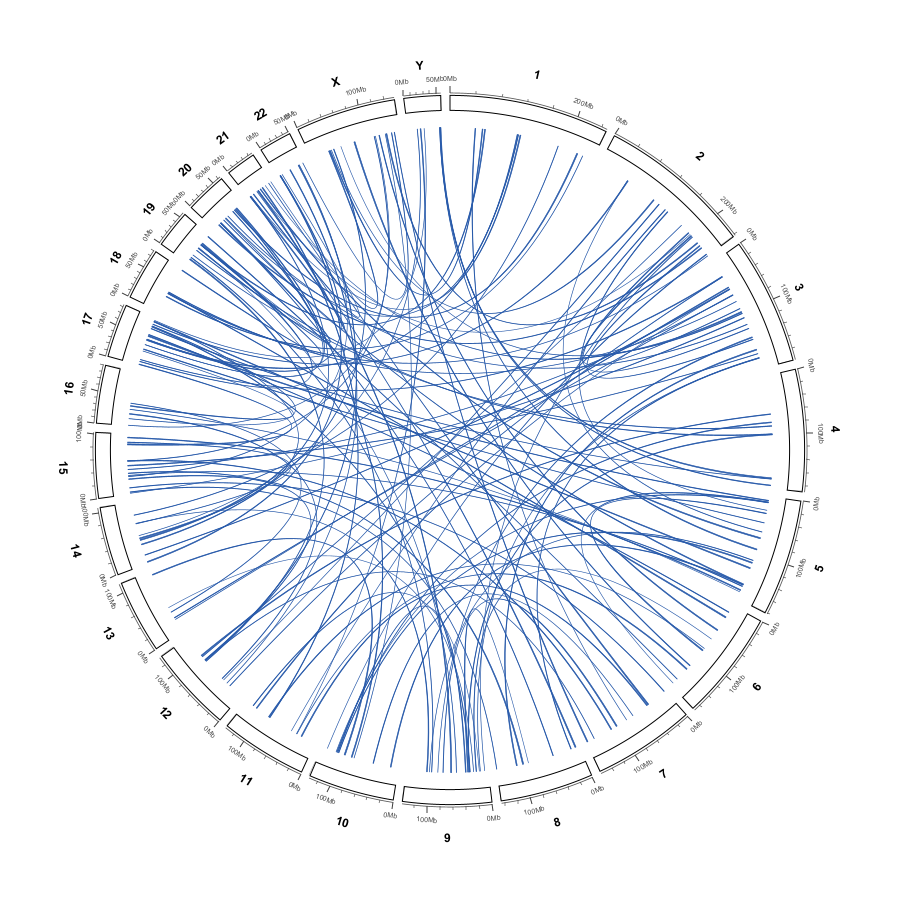
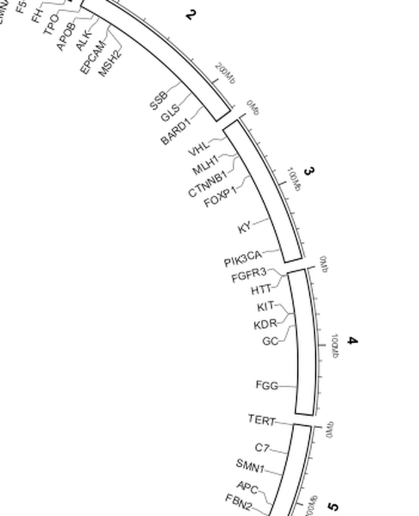
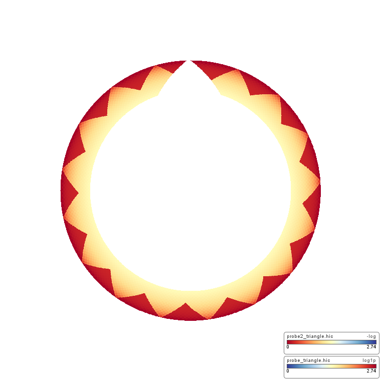
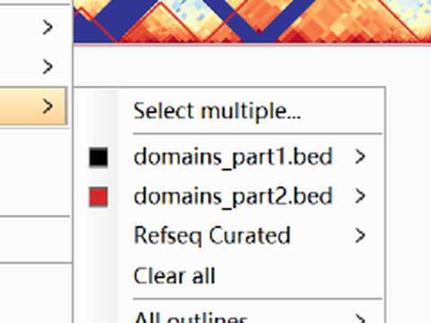

Screenshot gallery
==================

Every illustration in this guide is a real render produced by myIGV's headless
verification harness (``build/check/probe/``), captured into
``build/check/exports/`` and copied into ``docs/images/``.  They are not
mock-ups and not screenshots of a different application.

.. note::

   A few captures in ``build/check/exports/`` are deliberately **excluded**:
   shots of older UI builds (the former ``View options → Links`` submenu, an
   About box reading ``1.0.1``) and the ``facet_*.png`` browser screenshots of
   a reference publication figure, which are not myIGV output.  All figures
   below come from the current source tree.  Menu labels in the text were
   verified against the Java sources, not read off historical captures.

Showcase
--------

   The complete whole-genome Circular View: chromosome ideogram, outside
   coordinate axis, tick labels and stacked gene/data bands.  See
   :doc:`circular_overview`.

   A circlize-style heatmap: equal-width cells, four-segment comb connectors
   and the corner colour-bar legend.  See :doc:`circular_heatmap`.

   Filled ribbon links across the whole genome.  See :doc:`circular_links`.

   Radial gene labels with heatmap-style comb connectors, tiled by
   ``smartAlign`` so dense clusters do not overlap.  See
   :doc:`circular_labels`.

   A Hi-C contact matrix warped onto the ring.  See :doc:`circular_hic`.

   The ``TAD domains`` menu over a triangle Hi-C matrix.  See :doc:`hic`.

Complete figure index
---------------------

The table below lists every figure embedded in this guide, what it demonstrates,
and the chapter where it appears with its full caption.

Getting started and desktop features
~~~~~~~~~~~~~~~~~~~~~~~~~~~~~~~~~~~~~~~~

.. list-table::
   :header-rows: 1
   :widths: 30 52 18

   * - File
     - Demonstrates
     - Chapter
   * - ``lin_gene.png``
     - Linear gene models after structure-less ``gene`` container rows are
       skipped; transcript models with exon blocks remain.
     - :doc:`search`
   * - ``zoom_tip.png``
     - Arc geometry before Ctrl+wheel zoom-to-cursor.
     - :doc:`view_interactions`
   * - ``zoom_tip_after.png``
     - The same arcs after zooming; the locus under the pointer stays put.
     - :doc:`view_interactions`
   * - ``group_scale_axis_zoom.png``
     - Y-axis ``[min - max]`` range label on a numeric track.
     - :doc:`view_interactions`
   * - ``circular_group_pergene.png``
     - Group autoscale computed separately per gene panel.
     - :doc:`view_interactions`
   * - ``circular_group_global.png``
     - The same data with one global range shared by all facets.
     - :doc:`view_interactions`
   * - ``group_scale_axis_zoom2.png``
     - Per-panel ``[min - max]`` range label on a numeric track.
     - :doc:`view_interactions`
   * - ``arc_style_compare.png``
     - The three BEDPE ``Arc shape`` options: circular, ellipse and bezier.
     - :doc:`hic`, :doc:`desktop_extras`
   * - ``loop_prop_ellipse.png``
     - Proportional arcs driven by a value column, drawn as ellipses.
     - :doc:`desktop_extras`
   * - ``legend_zero_fixed.png``
     - Hi-C colour legend with its lower bound fixed at ``0``.
     - :doc:`hic`
   * - ``two_tad_menu_v2.png``
     - ``TAD domains`` menu with multiple BED files and ``Select multiple…`` /
       ``Clear all``.
     - :doc:`hic`
   * - ``tad_multiselect.png``
     - The ``Select multiple…`` checkbox dialog for choosing BED overlays.
     - :doc:`hic`
   * - ``tad_per_file_style.png``
     - Per-file TAD style submenu: ``Show outline``, ``Line width``,
       ``Line style``, ``Line color``, ``Fill color``, ``Fill opacity``.
     - :doc:`hic`

Circular View overview and axes
~~~~~~~~~~~~~~~~~~~~~~~~~~~~~~~~~~~~~~~~

.. list-table::
   :header-rows: 1
   :widths: 30 52 18

   * - File
     - Demonstrates
     - Chapter
   * - ``circular_all.png``
     - Full whole-genome view with axis, ideogram and data bands.
     - :doc:`circular_overview`
   * - ``circular_all_radial.png``
     - Radial number orientation instead of tangential.
     - :doc:`circular_overview`
   * - ``circular_range_zoom_single.png``
     - Single-chromosome / range zoom.
     - :doc:`circular_overview`
   * - ``arc_90.png``
     - Single-chromosome arc preset ``90°  (0.25)``.
     - :doc:`circular_view_options`
   * - ``arc_180.png``
     - Single-chromosome arc preset ``180°  (0.50)``.
     - :doc:`circular_overview`, :doc:`circular_view_options`
   * - ``circular_gene_utr_cds.png``
     - Gene structure (UTR / CDS) rendered as a ring band.
     - :doc:`circular_overview`
   * - ``circular_genes.png``
     - Gene feature band around the whole ring.
     - :doc:`circular_overview`
   * - ``axis_width_0.5.png``
     - ``Axis line thickness…`` at ``0.5 px``.
     - :doc:`circular_view_options`, :doc:`parameter_reference`
   * - ``axis_width_1.0.png``
     - ``Axis line thickness…`` at its default ``1.0 px``.
     - :doc:`parameter_reference`
   * - ``axis_width_3.0.png``
     - ``Axis line thickness…`` at ``3.0 px``; labels pushed clear.
     - :doc:`circular_view_options`, :doc:`parameter_reference`
   * - ``circular_axis_ticks_zoom.png``
     - Zoomed major/minor ticks and tick labels.
     - :doc:`circular_view_options`
   * - ``circular_axis_on.png``
     - Coordinate axis enabled.
     - :doc:`circular_view_options`
   * - ``circular_axis_off.png``
     - Coordinate axis disabled.
     - :doc:`circular_view_options`
   * - ``circular_all_nocyto.png``
     - Solid-colour ideogram when no cytoband data is available.
     - :doc:`circular_view_options`
   * - ``circular_chr1_cyto.png``
     - Cytoband (Giemsa) stripes on a single chromosome sector.
     - :doc:`circular_view_options`

Links, ribbons and arrows
~~~~~~~~~~~~~~~~~~~~~~~~~~~~~~~~~~~~~~~~

.. list-table::
   :header-rows: 1
   :widths: 30 52 18

   * - File
     - Demonstrates
     - Chapter
   * - ``links_demo_ribbons.png``
     - A small mixed links demo drawn as ribbons.
     - :doc:`circular_import`
   * - ``circular_links_ribbon.png``
     - Dense whole-genome bezier ribbons.
     - :doc:`circular_import`, :doc:`circular_links`
   * - ``circular_links_straight.png``
     - The same links as straight chords (``Bezier radius`` at ``0``).
     - :doc:`circular_links`
   * - ``ribbon_single.png``
     - A single ribbon showing its two boundary curves and constant waist
       width.
     - :doc:`circular_links`
   * - ``circular_links_ribbon_mixed.png``
     - Mixed point and interval endpoints in one links layer.
     - :doc:`circular_links`
   * - ``arrow_point_both.png``
     - ``Arrows → Both ends`` on 1 bp point endpoints (thin arrows).
     - :doc:`circular_links`
   * - ``arrow_band_both.png``
     - ``Arrows → Both ends`` on interval endpoints (band arrows).
     - :doc:`circular_links`
   * - ``circular_links_inside_tracks.png``
     - ``Draw inside data tracks`` — link ends anchored inside the band stack.
     - :doc:`circular_links`

Heatmap and legend
~~~~~~~~~~~~~~~~~~~~~~~~~~~~~~~~~~~~~~~~

.. list-table::
   :header-rows: 1
   :widths: 30 52 18

   * - File
     - Demonstrates
     - Chapter
   * - ``circlize_heatmap_links.png``
     - Reference ``hg38_heatmap.bed``: equal-width green/black/red cells,
       comb connectors, default ``TOP_RIGHT`` legend.
     - :doc:`circular_import`, :doc:`circular_heatmap`
   * - ``heatmap_hg38_heatmap_bed.png``
     - Close view of uniform-width cells and comb connectors.
     - :doc:`circular_heatmap`
   * - ``heatmap_inside.png``
     - Default inside placement with an inward comb.
     - :doc:`circular_heatmap`
   * - ``heatmap_outside.png``
     - ``Heatmap outside the ideogram``: outward comb and a shrunken main ring.
     - :doc:`circular_heatmap`
   * - ``polish_legend_TOP_RIGHT.png``
     - ``Legend position → TOP_RIGHT`` (default).
     - :doc:`circular_heatmap`
   * - ``polish_legend_BOTTOM_LEFT.png``
     - ``Legend position → BOTTOM_LEFT``.
     - :doc:`circular_heatmap`
   * - ``polish_legend_NONE.png``
     - ``Legend position → NONE`` / legend hidden.
     - :doc:`circular_heatmap`
   * - ``polish_legend_onscreen.png``
     - The legend renders on the normal on-screen path with no Hi-C loaded.
     - :doc:`circular_heatmap`
   * - ``polish_heat_first.png``
     - Heatmap band at one position in the Data Tracks row order.
     - :doc:`circular_data_tracks`
   * - ``polish_heat_second.png``
     - The same heatmap after dragging its row — the radial band order follows.
     - :doc:`circular_data_tracks`
   * - ``layers_ring.png``
     - Multiple circular-only layers stacked with ordinary tracks.
     - :doc:`circular_data_tracks`

Labels
~~~~~~~~~~~~~~~~~~~~~~~~~~~~~~~~~~~~~~~~

.. list-table::
   :header-rows: 1
   :widths: 30 52 18

   * - File
     - Demonstrates
     - Chapter
   * - ``labels_ring.png``
     - Default inner radial label ring.
     - :doc:`circular_import`, :doc:`circular_labels`
   * - ``labels_zoom.png``
     - Zoomed radial labels with comb connectors and ``smartAlign`` tiling.
     - :doc:`circular_import`, :doc:`circular_labels`
   * - ``labels_ring_outside.png``
     - ``Labels outside the ideogram`` — radial text outside the ring, with the
       ideogram radius and chromosome names unchanged.
     - :doc:`circular_labels`
   * - ``labels_outside_zoom.png``
     - Zoom of the outside label ring: outward combs, radial names and
       chromosome numbers left at their default radius.
     - :doc:`circular_labels`
   * - ``labels_ring_inward.png``
     - ``Read labels toward the centre`` flips the reading direction.
     - :doc:`circular_labels`
   * - ``labels_ring_big.png``
     - Larger ``Font size…`` / ``Label height…`` on a dense label set.
     - :doc:`circular_labels`

Hi-C on the ring and export
~~~~~~~~~~~~~~~~~~~~~~~~~~~~~~~~~~~~~~~~

.. list-table::
   :header-rows: 1
   :widths: 30 52 18

   * - File
     - Demonstrates
     - Chapter
   * - ``hic_ring_triangle.png``
     - Triangle Hi-C matrix warped into a ring band.
     - :doc:`circular_hic`
   * - ``hic_ring_square.png``
     - Square Hi-C matrix warped into a ring band.
     - :doc:`circular_hic`
   * - ``hic_genelist.png``
     - Hi-C ring in gene-list (faceted) mode.
     - :doc:`circular_hic`
   * - ``tad_overlay_on.png``
     - TAD/domain outlines composited onto the warped Hi-C ring.
     - :doc:`circular_hic`
   * - ``tad_overlay_off.png``
     - The same ring without the TAD overlay.
     - :doc:`circular_hic`
   * - ``tad_overlay_flipped.png``
     - ``Flip vertically`` mirrors the matrix **and** the TAD outlines
       together.
     - :doc:`circular_hic`
   * - ``export_hic.png``
     - Export of a ring containing a Hi-C band.
     - :doc:`circular_hic`
   * - ``export_hic_pdf.png``
     - PDF export with the Hi-C ring and its legend.
     - :doc:`circular_hic`, :doc:`circular_export`
   * - ``export_shot.png``
     - A circular figure produced through the export path.
     - :doc:`circular_export`
   * - ``shot_svg.png``
     - SVG vector output of the same layout.
     - :doc:`circular_export`
   * - ``shot_pdf.png``
     - PDF vector output of the same layout.
     - :doc:`circular_export`
   * - ``export_renderTo.png``
     - Re-rendering at a custom export width/height.
     - :doc:`circular_export`

.. tip::

   To regenerate any figure, run the corresponding probe under
   ``build/check/probe/`` with the project runtime classpath, then copy the
   PNG from ``build/check/exports/`` into ``docs/images/``.  The probes use
   real ``.hic``, ``hg38_heatmap.bed``, ``hg38_genes.bed`` and links BEDPE
   files, so the figures stay reproducible from the source tree.
