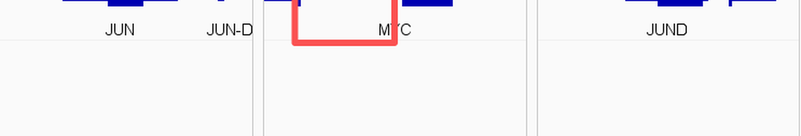

========================
Gene search enhancements
========================

``myIGV`` extends the IGV search box in several ways that are additions over
upstream IGV 2.19.8: it accepts multiple genes or loci in one query, lets you
choose a loaded GTF/GFF file as the gene-name source, keeps a canonical gene
name in the box instead of overwriting it with coordinates, and fixes the way
GTF gene container records are drawn. All of these changes are about the
search box and the gene models it produces.

Multi-gene / multi-locus input and faceted panels
-------------------------------------------------

The search box now accepts **comma- or semicolon-separated** lists of multiple
genes and/or loci. For example:

.. code-block:: text

   SOX1,SOX2,SOX3
   BRCA1;TP53;EGFR
   EGFR, chr1:1,000,000-2,000,000

When you press Enter, ``myIGV`` treats the input as an IGV **Gene List
(Regions)**. It lays out one region panel per gene side by side at the bottom of
the view — this is the "faceted" effect, and it uses exactly the same mechanism
as the IGV menu ``Regions → Gene Lists``. The Gene List stores either a gene
name (when the query hit a feature) or a locus (when it hit coordinates), and
you can review or export those entries from the Regions panel.

Each resulting facet holds a single gene or locus and can be inspected,
zoomed, and exported independently, while all facets remain visible side by
side. This is the same set of panels you would get by building a gene list
through ``Regions → Gene Lists`` by hand; ``myIGV`` simply creates it directly
from the search string.

.. note::

   Coordinates often contain commas as **thousand separators** — for instance
   ``chr1:1,000,000-2,000,000``. ``myIGV`` guards against breaking these: as
   long as the search string contains a colon, it does **not** split on commas,
   so a locus with thousand separators stays intact.

The split logic is added in ``SearchCommand.runSearch`` (comma / semicolon
separation), the multi-result branch of ``showSearchResult`` (store feature hits
as gene names in the Gene List), and ``SearchTextField`` (the live hint follows
the last fragment only).

Choosing a GTF / GFF file as the gene-search source
---------------------------------------------------

A **gene-source drop-down box** has been added next to the search box. It shows
``Default genome annotation`` by default. Its behaviour:

* after you import a GTF, GFF, GFF3 or GVF file (including ``.gz`` versions),
  that track appears automatically in the drop-down, labelled with the track
  name;
* when you select a GTF, **both the live candidate hints and the Enter search**
  match gene names using only that file;
* matching supports **gene name and gene ID**: ``gene_name`` / ``gene_id`` for
  GTF, and ``Name`` / ``ID`` for GFF3 (for example ``gene:ENSG00000141510``).
  Matching is **case-insensitive**;
* typing a partial name such as ``SOX`` and pressing Enter expands **all
  prefix-matching genes** from that GTF into faceted Gene List panels, capped at
  **50 panels** so that a single keystroke cannot open thousands of panels at
  once;
* a coordinate string such as ``chr1:1,000,000-2,000,000`` is unaffected and
  still jumps to the locus;
* switching back to ``Default genome annotation`` restores native IGV behaviour
  (the genome's bundled annotation plus the UCSC query).

The first time you select a given GTF, ``myIGV`` builds a **one-pass background
index** over the file (it scans the whole file once, reads only ``gene`` rows,
and falls back to merged transcript/exon intervals if the file has no ``gene``
rows). Hovering the mouse over the drop-down shows the index progress and the
gene count. The index is **cleared when you switch genomes**, because gene
coordinates are normalised against the previous genome's chromosome naming.

Implementation: ``org.broad.igv.feature.GeneSearchIndex.java`` (new, GTF/GFF
parsing plus exact/prefix name queries), ``org.broad.igv.feature.GeneSearchSources.java``
(new, source list, index cache, current selection, cleared on genome switch),
``IGVCommandBar`` (the new drop-down, refreshed on click), and
``SearchCommand`` / ``SearchTextField`` (resolve names from the selected index).

Search box shows the canonical gene name
----------------------------------------

In upstream IGV 2.19.8 the search box doubles as a "current position" display —
the moment you jump, it is replaced by coordinates like
``chr17:7,659,779-7,689,546``. That overwrites the gene name you just searched
for and prevents you from appending more genes. ``myIGV`` changes this:

* after a gene hit, the box is filled with the **canonical gene name** — typing
  ``sox1`` or ``egfr`` becomes ``SOX1`` / ``EGFR``;
* a gene-only hit no longer back-fills coordinates; jumping, zooming and panning
  do not erase the gene name;
* the cursor stays at the **end of the text**, so you can immediately type
  ``,SOX2`` to append another gene (this pairs with the multi-gene faceting
  above);
* a coordinate query (``chr1:100,000-200,000``) or a chromosome-name lookup
  keeps exactly what you typed;
* coordinate back-filling resumes after you **manually edit** the text, switch
  genomes, or switch to Gene List mode.

Implementation: ``SearchCommand`` adds ``resolvedGeneTextFor()`` (which turns a
hit into a gene-name list, or returns ``null`` for coordinate queries so nothing
is rewritten) plus a callback; ``SearchTextField`` tracks the state with a
``showingResolvedGenes`` flag; and ``IGVCommandBar.updateCurrentCoordinates()``
skips coordinate back-filling while that flag is set.

GTF tracks no longer draw a "long solid bar"
--------------------------------------------

Ensembl / GENCODE GTF files contain, in addition to transcript / exon / CDS
records, a single ``gene`` record per gene. That record has only a start and an
end and no exon structure. IGV renders it as a solid bar spanning the entire
gene, sitting directly on top of the real transcript models — visually a single
very long column.

``myIGV`` skips these **structure-less ``gene`` / ``pseudogene`` container
records** during rendering and keeps only the transcript models (exon blocks,
intron connecting lines, and strand-direction arrows). Three safeguards keep
this safe:

#. records that carry their own exons (``xxx_gene``-style records, or GFF3 genes
   that directly hold exons) are **kept**, not mistakenly deleted;
#. a file that contains **only** ``gene`` rows with no transcript/exon records
   (a pure gene-interval annotation) is still displayed in full;
#. gene-name search is unaffected — the search index comes from the original
   file and ``FeatureDB`` still collects these records.

The filter lives in ``GFFFeatureSource.getFeatures``, which drops gene
containers with ``hasExons() == false`` after merging.

   Linear gene models now show exon blocks and intron lines without the
   overlying solid ``gene`` bar.

.. tip::

   This rendering fix is related to, but independent of, the automatic
   ``*.sorted.gtf`` copy described in :doc:`auto_indexing`. Ensembl GTFs are
   sorted by gene start, so htsjdk cannot index them directly; the auto-sort
   step generates a sorted copy (original untouched) that is generated once and
   reused.
