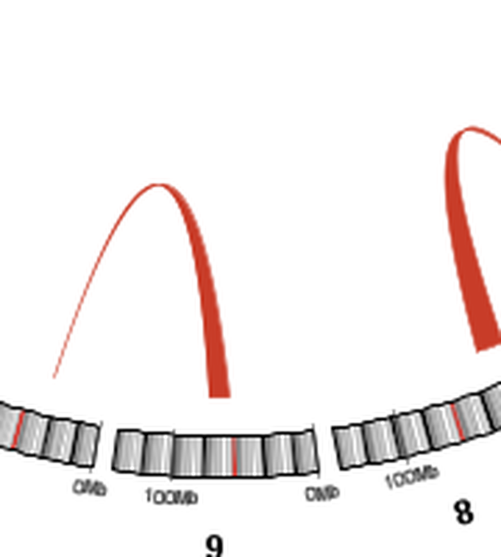
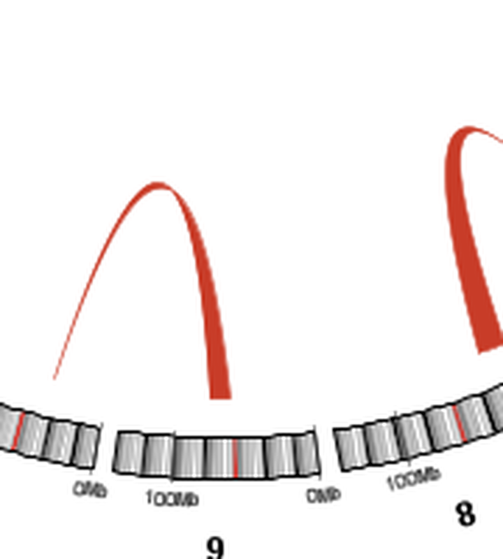
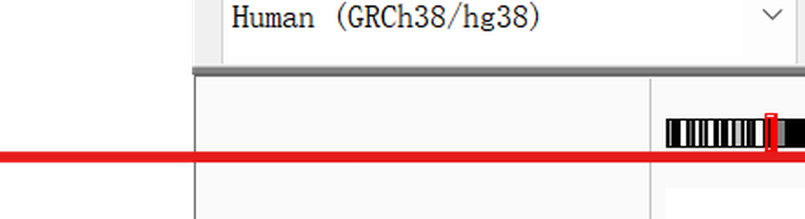
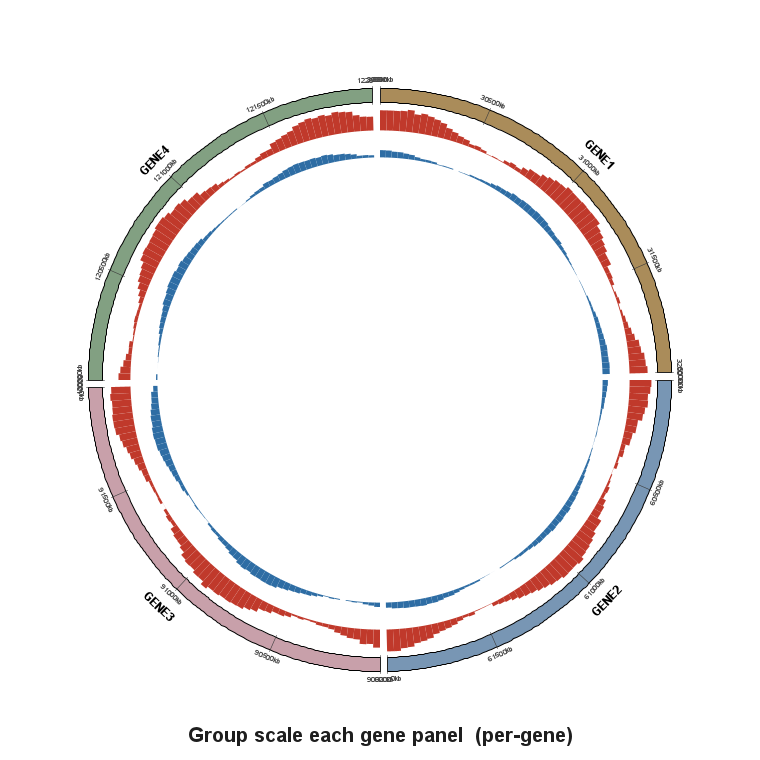
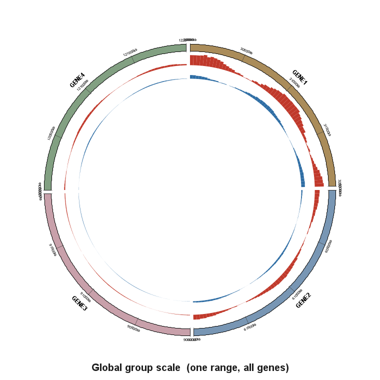
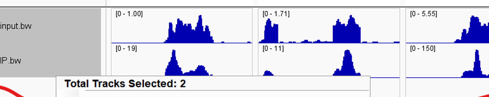

=================================
Zoom, axes and panel scaling
=================================

This page groups three interface refinements that ``myIGV`` adds over upstream
IGV 2.19.8: Ctrl + wheel zoom with zoom-to-cursor, a configurable Y-axis range
label, and per-panel Group Autoscale for gene facets.

Ctrl + wheel zoom (fix and zoom-to-cursor)
------------------------------------------

In addition to the coordinate-bar ``+/-`` buttons, the zoom slider and the
right-click menu, ``myIGV`` supports **Ctrl + mouse wheel** (⌘ / Meta on macOS)
to zoom the current view.

IGV 2.19.8 actually shipped a version of this logic, but two bugs made it feel
broken:

#. It computed ``zoomIncr = -wheelRotation / 2``. With Java integer division, a
   single wheel notch (``wheelRotation = ±1``) yields ``0`` — no zoom at all. You
   had to scroll two notches to get one step, so the feature felt unresponsive.
#. Zoom was centred on the **view centre** rather than the pointer, so the locus
   under the cursor drifted away as you zoomed.

``myIGV`` fixes both:

* one notch now equals one zoom step (scroll up = zoom in, scroll down = zoom
  out);
* **zoom-to-cursor**: the zoom is anchored at the genome coordinate under the
  pointer, so that locus stays put — the experience is close to a map or a web
  browser.

The changes are confined to ``DataPanel.mouseWheelMoved``:

* ``zoomIncr = -wheelRotation`` (the ``/2`` is removed);
* a new ``ReferenceFrame.doIncrementZoomAtCursor(zoomIncr, cursorGenomePos,
  cursorPixelX)`` first calls ``setZoom`` to change the level and recompute the
  scale, then resets the origin via ``origin' = cursorGenomePos − newScale ×
  cursorPixelX`` so the locus beneath the pointer remains at the same X pixel
  after zooming (rather than being moved to the screen centre);
* ``e.consume()`` prevents the event from also triggering vertical scrolling.

   Zoomed detail of a circular ring sector before the zoom gesture: two red
   interaction arcs above a curved ideogram segment with kb tick labels.

   After zooming toward the cursor, the locus that was under the pointer stays
   at the same screen X while the arcs and ideogram scale up around it.

.. note::

   These two captures come from the headless render harness and show a
   **circular ring sector**, not a tooltip or a horizontal track panel.  They
   illustrate the geometry of zoom-to-cursor; the same
   ``doIncrementZoomAtCursor`` call is used by the linear ``DataPanel`` and by
   the Sashimi plot.

.. note::

   Ctrl + wheel zooms **only the panel under the pointer** — a single view, or
   one row within a multi-gene facet. Without Ctrl/Meta, the wheel keeps the
   original behaviour of scrolling the track list vertically.

Y-Axis Range Label (right-click submenu)
-----------------------------------------

Data tracks such as bigwig and line plots show a ``[min - max]`` Y-axis range
label in their upper-left corner. You can now configure it from
**right-click → Y-Axis Range Label** on a track.

.. list-table:: Y-Axis Range Label parameters
   :header-rows: 1
   :widths: 26 30 16 28

   * - Option
     - Values
     - Default
     - What it does
   * - ``Font size``
     - 8 / 9 / 10 / 11 / 12 / 14 / 16 / 18 / 20
     - ``8``
     - Font size of the ``[min - max]`` label. Single-select.
   * - ``Position``
     - ``Top left`` / ``Top right``
     - ``Top left``
     - Corner in which the label is drawn. Single-select.

Choices take effect **immediately** (no restart) and are remembered in the
global preferences. The setting is **global** — it affects the range labels of
all data tracks.

   Y-axis ``[min - max]`` range labels on grouped data tracks, shown with the
   configurable font size and position.

.. note::

   If ``CHART_DRAW_Y_AXIS`` (the full left-hand axis with tick marks) is
   enabled, a different drawing path is used and this corner label is not
   shown; the settings above apply only to the default ``[min - max]`` corner
   label.

Implementation: ``Constants`` adds ``AXIS_RANGE_FONT_SIZE`` and
``AXIS_RANGE_POSITION`` (with two entries in ``preferences.tab``, defaults ``8``
/ ``left``); ``DataRenderer.drawScale`` uses ``FontManager.getFont(size)`` and
``FontMetrics`` to compute the baseline (so a larger font is not clipped at the
top), and right-aligns with ``arect.x + arect.width - textWidth - 5`` for
``right`` or left-aligns with ``arect.x + 5`` otherwise;
``TrackMenuUtils.getAxisRangeLabelItem()`` adds the ``Y-Axis Range Label``
submenu below ``Show Data Range`` and calls ``IGV.repaint()`` on change.

Group Autoscale per gene panel
------------------------------

When several bigwig tracks share **Group Autoscale** in a multi-gene facet
(gene list), upstream IGV 2.19.8 computes a single data range from **all
facets combined**. A high-signal gene then pulls the overall Y axis up and
flattens the signal in low-signal genes (for example an input group), hiding
real differences.

``myIGV`` changes the default so Group Autoscale computes **each facet
separately**: all group members inside one facet share a range, but different
facets do not influence each other. In the example above the JUN panel might
show ``[0 - 30]`` while the JUND panel shows ``[0 - 169]``, and the input
group's peaks become visible again.

.. list-table:: Group Autoscale parameters
   :header-rows: 1
   :widths: 34 16 16 34

   * - Option
     - Values
     - Default
     - What it does
   * - ``Group scale each gene panel``
     - on / off
     - on
     - Checkbox located directly below ``Group Autoscale`` in the track
       right-click menu (and in the Circular View's ``Y-axis scale
       (multi-sample)`` popup). When on, each gene facet computes its own
       shared range; unchecking restores the upstream global behaviour (one
       range for the whole view). The choice is remembered.

.. note::

   Some older notes and README text call this option ``Autoscale each gene
   panel separately``.  The current label in the source is ``Group scale each
   gene panel`` (``TrackMenuUtils.java`` and ``IGVContentPane.java``).  It is
   the same setting.

   Per-gene group autoscale in the circular view, where each facet uses its own
   data range. With the option unchecked, all facets fall back to one global
   range (upstream IGV 2.19.8 behaviour).

   The same data with the per-gene option off: one global range is shared by
   every facet, so low-signal panels are flattened by the high-signal ones.

   The ``[min - max]`` range label is computed per panel, which is what makes
   the difference visible when several facets are shown side by side.

Implementation: ``Track`` gains ``getDataRange(ReferenceFrame)`` (defaulting to
the global range); ``AbstractTrack`` stores a "panel name → DataRange" map and
``setDataRange(DataRange)`` clears the per-facet values; ``Autoscaler`` computes
per ``ReferenceFrame`` when in gene-list mode with the option on; and
``XYPlotRenderer`` / ``LineplotRenderer`` pick the range for the current facet
(including the left-side ``[min - max]`` axis label).
